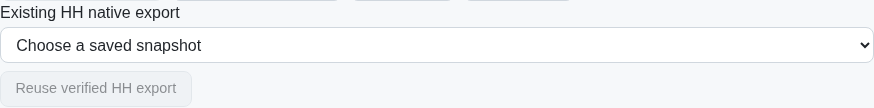
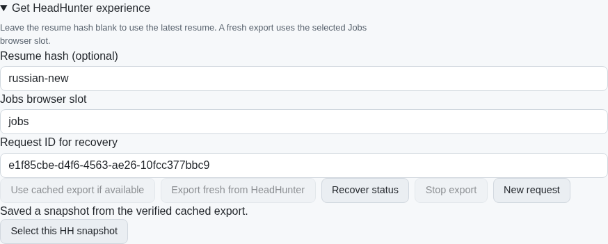
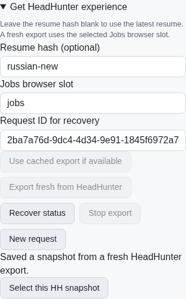

# HeadHunter experience acquisition

In the parent revision `2ef23f42`, CV → Experience documents could convert an
already recorded Jobs export. To obtain a missing or fresh export, a user had
to leave CV, open Jobs, export the résumé there and return to CV to find it
again. The application had no single recoverable request for this flow.

Open CV → Experience documents → Get HeadHunter experience. Enter a résumé
hash if you need a specific résumé. **Use cached export if available** checks
the selected Jobs browser slot and verifies the exact structured artifact.
Without a hash, the cached résumé listing identifies the most recent résumé.
Without a listing, one cached receipt or a uniquely newest provider timestamp
can identify it. An absent export or missing structured file starts one native
HTML export. Invalid receipts and digest mismatches surface an error.

**Export fresh from HeadHunter** explicitly starts an HTML export in the
selected Jobs browser slot. Native acquisition uses the existing Jobs reader
and its configured headed or headless mode. **Stop export** drains the export
owned by this request. After losing the reply or reloading, status reads use
the saved request ID. **Select this HH snapshot** opens the verified revision
for comparison or a directed plan, including after an intervening newer export.

The CLI uses the same operations. A foreground Start can be interrupted and
drained. Supply a request ID when you need to recover from another shell.

```sh
meta-sovereign cv-experience-hh-start --resume=my-hash --browser-slot=jobs --request-id=my-request
meta-sovereign cv-experience-hh-start --resume=my-hash --refresh-hh --request-id=new-request
meta-sovereign cv-experience-hh-status --request-id=new-request
meta-sovereign cv-experience-hh-stop --request-id=new-request
```

Both text and binary Lino expose Start, Stop and status at
`/api/cv/experience/hh-start`, `/api/cv/experience/hh-stop` and
`/api/cv/experience/hh-status`. Requests return private, non-cacheable
receipts with the exact snapshot revision and the browser slot. The HTML and
structured documents stay within the existing verified export storage.

## Verification

```sh
node --test --test-concurrency=1 js/tests/cv-hh-acquisition.test.js
RUN_BROWSER_E2E=1 E2E_EXECUTABLE_PATH=/opt/google/chrome/chrome node experiments/issue-56/hh-acquisition-browser.mjs
```

The Chromium fixture with `--before` and the parent web bundle captures the
old selector and fails because the acquisition action is absent. With the
updated bundle, the fixture checks three starts, two owned browser windows,
two HTML downloads and zero provider clicks. It covers an exact cache miss,
reuse without opening a browser, and an explicit refresh whose reply is lost
before a phone reload. Playwright MCP independently checked cache recovery
with the same ID, zero repeated POSTs and verified snapshot selection at
390 px. The focused Node run passed 56 checks across acquisition, document
storage and routes, resume export and localization. It includes malformed
cache evidence, missing structured files, exact cancellation and both Lino
encodings.

The screenshots show synthetic provider data.







## About evidence

A native export can present one recognized English or Russian About section,
omit it, or contain ambiguous labels. The previous parser returned the same
empty text in all three cases and the Save watcher accepted that value as
confirmation of an empty About. The native parser now records whether it saw
one unambiguous section. The watcher requires that evidence before confirming a
clear. Private Experience documents preserve explicit empty sections and
disclose absent content by omitting the field. They keep nonempty legacy
exports and treat an empty legacy value as unknown. A privacy-only section
loses its derived evidence when sanitization removes the entire text.

```sh
node --test --test-concurrency=1 js/tests/resume-about-evidence.test.js
RUN_BROWSER_E2E=1 E2E_EXECUTABLE_PATH=/opt/google/chrome/chrome node experiments/issue-56/resume-about-browser.mjs
```

Both focused regressions fail on `72862885`. The current Node run passed 44
checks including readback, cache reuse and text and binary Lino round trips.
Chromium exercised the actual export parser with absent, empty, Russian,
duplicate and ambiguous sections. It also confirmed that scripts embedded in
the export remain inert.

HH21 remains unfinished. It still requires reviewed About writes, coordinated
interactive queues and authenticated provider verification.
