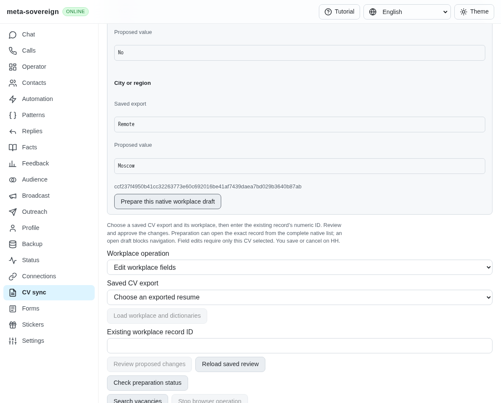
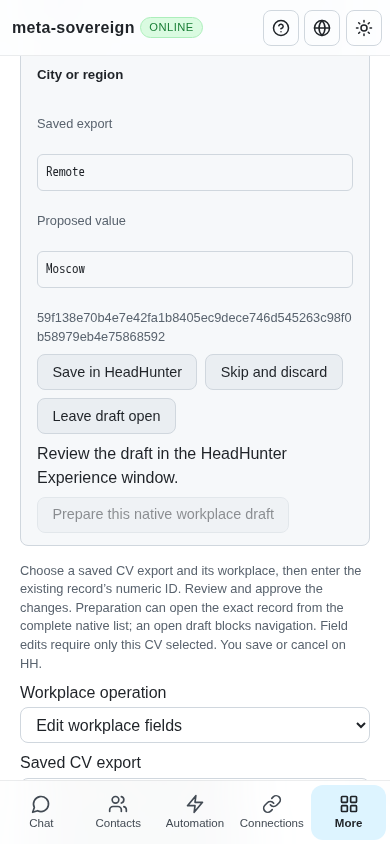
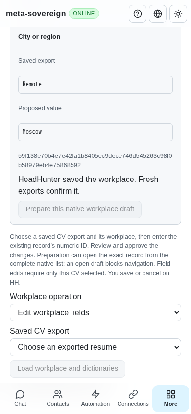

# Review a HeadHunter workplace in its own browser

An approved LinkedIn → HeadHunter Add or update can be prepared in the
workspace's `hh-experience-slot`. The approved fingerprint identifies the exact
change and the Jobs slot that supplied its verified CV export. On first use, the
Experience browser can copy HeadHunter session cookies from the running source
profile without navigating it. Sign in in the Experience window if its session
is unavailable. An existing editor or unexpected tab prevents preparation.

In **CV → Experience documents**, open a completed plan to HeadHunter. Select a
workplace proposal, enter the native record ID for an update, stage the review
and approve it. Choose **Prepare in Experience window**. Use **Save in
HeadHunter** to submit the selected draft once, **Skip and discard** to dismiss it
through the native dialog, or **Leave draft open** to disconnect while preserving
the form. The CLI accepts `y`, `s`, and `q` for these three actions. Closing stdin
leaves the draft.

```text
vacancies-cv-workplace-plan --experience-request-id=<id> --experience-fingerprint=<comparison-sha256> --experience-job-index=<index> [--record-id=<record>]
vacancies-cv-workplace-review --fingerprint=<draft-sha256>
cv-experience-hh-workplace-start --fingerprint=<reviewed-sha256> --request-id=<id>
cv-experience-hh-workplace-status --request-id=<id>
```

Use `--browser-slot` for a plan tied to a named Jobs export slot. The text and
binary Lino routes `hh-workplace-start`, `hh-workplace-status`,
`hh-workplace-decide` and `hh-workplace-stop` share the same private request.
The CV view recovers its request ID after reload and reads its status without
opening another form. A changed form loses preparation authority. A possible
Save with stale or unavailable export evidence stays unconfirmed and a second
request cannot replay that fingerprint.

The saved result requires a fresh native record and matching export evidence.
The verification checks résumé membership and retains the previous snapshots
if the export is stale. The single-workplace review uses the existing exact
workplace checks. It leaves unrepresentable proposal fields as review notes.

## Reproduction and tests

Run the isolated Chromium fixture with the built app bundle and a Chromium
executable. It makes no live provider requests. `HH_WORKPLACE_BEFORE=1` asserts
that the parent bundle is missing the dedicated preparation action. With the
updated bundle it verifies a lost Start reply, phone reload, isolated cookie
handoff, native discard, a preserved existing draft, and one Save with fresh
readback and the other résumé unchanged.

```sh
RUN_BROWSER_E2E=1 E2E_EXECUTABLE_PATH=/path/to/chromium node experiments/issue-56/hh-workplace-job-browser.mjs
node --test --test-concurrency=1 js/tests/cv-hh-workplace-job.test.js
```

An independent Playwright MCP check against `experiments/issue-56/hh-workplace-job-server.mjs`
recovered the prepared state after a lost Start reply and a reload at 390 pixels.
It observed one Start, all three actions, a review width of 348 pixels without
horizontal overflow, and the skipped status. This fixture simulates the review
worker so only the Chromium native fixture checks the provider dialog.





The fixtures establish single-workplace behavior. HH21 still requires the
automatic sequence from acquisition to queued review, reviewed About writes,
complete native acquisition and authenticated provider verification.
