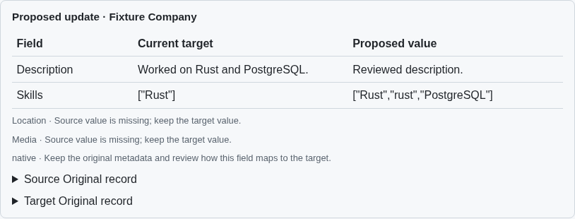
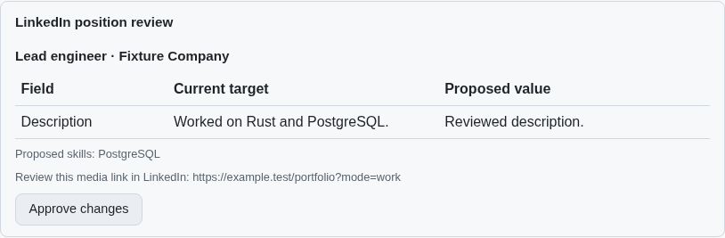
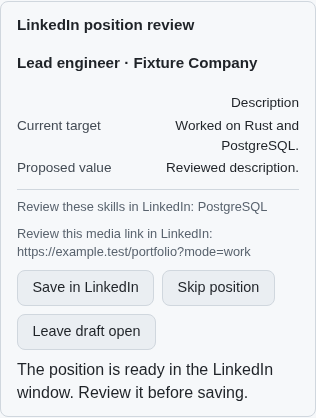

# Private LinkedIn position reviews

[PR #57](https://github.com/link-foundation/meta-sovereign/pull/57) can stage one
HeadHunter-to-LinkedIn comparison row by its request ID, reply fingerprint and
zero-based job index. Staging selects the exact native position link, or the
separately observed Add position link. Neither staging nor approving opens a
browser or saves the provider form.

The staged review replays the private, hashed LinkedIn browser evidence and
matches the canonical export against its acknowledged receipt. Imported
LinkedIn snapshots with pasted edit URLs, changed evidence, target-only
positions and stale comparison fingerprints cannot authorize a form. The
review keeps the source report intact, saves the exact proposed text and
dates, and lists eligible skill and website candidates. Existing identical
skills and website links are omitted from those candidates. The form still
needs to confirm the available controls, baseline, skills and media.

A separate approval produces its own private fingerprint. Recovering a staged
or approved fingerprint reads storage without browser work. Failed approval
leaves the original draft usable. An approved review is rechecked against the
export before native preparation.

`cv-experience-linkedin-position-stage`, `cv-experience-linkedin-position-review`
and `cv-experience-linkedin-position-stored` expose this workflow in the CLI.
The corresponding `linkedin-position-*` experience routes support text and
binary Lino. `cv-linkedin-position-review.test.js` exercises grouped roles,
standalone Add, immutable baseline and approval, corrupted native evidence,
imported targets, both encodings and trusted mutation admission. It counts
browser starts and confirms that staging and approval never add one.

## Native form preparation

The preparation adapter takes the same persistent `linkedin-experience` slot
lease and visibility policy as acquisition. It opens a visible window by
default and honors a configured headless slot for an already signed-in
profile. The focused job regression fails on `d90ef3aa`, which forced visible
mode even with the slot override. It observes the selected link again on the current
profile, requires one labeled native dialog and checks the editor baseline
before changing any fields. It preserves existing owner drafts in the slot,
checks the current draft before each field change, and leaves the browser
window open on detach. The adapter disables the position notification control
when it is on. It never submits the form.

The Chromium fixture in `linkedin-position-native.mjs` covers the exact
grouped role update, standalone Add, date fields revealed by the current-role
checkbox, and an untouched employment-type field. It reproduces the stale
description and a concurrent owner edit, then verifies both are preserved.
Two preparations complete and neither clicks Save. The fixture runs in the
existing LinkedIn browser scenario. It uses synthetic provider pages.

## Interactive decisions and save verification

`cv-experience-linkedin-position-start --fingerprint <approved-fingerprint>`
opens the reviewed position in the separate LinkedIn window. Once it is
prepared, `y` requests Save, `s` requests Skip, and `q` or closed stdin leaves
the draft open. The corresponding Lino start, status, decide and stop routes
use the exact operation request ID. A separate `status` command reads the
durable record, and starting an existing request returns its status.

The native decision checks that the form still belongs to the reviewed action
and that the owner has made no intervening input. A verified Save requires a
positive provider indication and a fresh export that matches the exact role
and approved fields. An owner Save is recorded separately from an explicit
CLI or API decision. Navigation away, an ordinary close and stale readback
leave `providerSaved` false. The job leaves any provider follow-up for the
owner, including invitations.

`linkedin-position-job-native.mjs` uses Chromium and intercepted provider
pages. It exercises Skip with the native discard confirmation, Stop with the
draft open, navigation without Save, an owner Save verified by a fresh
export, and an explicit Save where stale readback leaves the result
unconfirmed. The same request recovers its status without submitting again.
`cv-linkedin-position-job.test.js` checks the foreground keys and EOF,
acknowledgement before opening, and trusted Lino admission and recovery.

## Shared CV review

In CV → Experience documents, compare an HH export with a native LinkedIn
export and select **Review this position in LinkedIn** on a matching update or a
proposed addition. The review shows the current and proposed values and
requires approval before **Open LinkedIn editor** becomes available. When the
browser is prepared, the CV view offers Save, Skip or leaving the editor open.
It recovers an acknowledged job with a status read after a lost Start reply or
a reload. The same controls are available on desktop and phone in English,
Russian, Chinese and Hindi.

`linkedin-position-review-browser.mjs` checks the workflow in Chromium with
synthetic exports. It drops the Start reply after the server acknowledges it,
reloads at phone width and confirms one Start, one Skip and zero saves.

| Before                                                                                                   | Review                                                                                                  | Prepared on a phone                                                                                                         |
| -------------------------------------------------------------------------------------------------------- | ------------------------------------------------------------------------------------------------------- | --------------------------------------------------------------------------------------------------------------------------- |
|  |  |  |

## Native skill selection

Preparation checks the current LinkedIn profile’s Skills page before opening
the position. It uses one exact suggestion from the position’s skill picker
and confirms the checked skill in the draft. A skill that cannot be confirmed
in the profile or picker remains visible for manual review. If the plan only
requests unobserved skills, preparation reports that no changes are available
and skips opening the editor. The automation leaves existing skills selected
and does not add to the profile’s Skills section.

The native Chromium job fixture selects PostgreSQL while preserving Rust,
ignoring a longer suggestion and leaving the unlisted ClickUp for manual
review. It verifies one explicit skill-only Save, one unconfirmed Save when
the fresh export lacks the requested skill, and zero form opens for a change
containing only an unlisted skill. Running the same fixture with
`--import ./experiments/issue-56/linkedin-position-skills-before.mjs` against
the previous modules reaches the original prepared state and fails because
the exact skill was never selected.

## Native website attachments

The review recognizes an explicit company website field or a single unambiguous
website line. It retains the path, query and fragment and shows the URL and title
before approval. Preparation types the link and title in the owned position's
Media preview. It verifies the attachment in the draft without using the
position's Save button. A URL already in the fresh export or native Media list
produces no duplicate. A preview that cannot be verified stays open for the
owner. The console and shared CV controls distinguish the proposed attachment,
the prepared draft and the link verified in the saved position.

With the synthetic profiles, set an HH workplace's website to
`example.test/portfolio?mode=work`. Compare the HH and native LinkedIn exports,
then stage, approve and prepare the matched role. Observe the exact link in
the Media preview and the position's unchanged saved export. Choose **Save**
explicitly and check the new export for the link and its title on that role.
The Chromium fixture in `experiments/issue-56/linkedin-position-media-native.mjs`
checks this sequence, duplicate suppression, stale reads, a URL that appears
only in the description, and an unresolved preview. Run the same fixture with
`--import ./experiments/issue-56/linkedin-position-media-before.mjs` to reproduce
the previous omission of the website-only proposal.

## Existing company-named attachments

New reviews use a title derived from the exact URL. When the acknowledged
export contains one attachment to that URL still titled after the company, the
review shows the old and proposed titles. The native media preview must confirm
the URL and old title before typing. The title-only change remains in the
draft until the owner separately saves the position. A different preview URL or
an owner-updated title requires manual review. Previous approvals retain the
exact title the owner reviewed.

The native fixture opens a legacy edit link, checks the website exposed only in
the preview, then verifies one renamed attachment after an explicit Save and a
fresh export. It also checks a different preview URL and a more recent custom
title. The previous modules can be loaded with
`--import ./experiments/issue-56/linkedin-position-media-title-before.mjs`.
An interactive queue and authenticated verification remain open in
[HH21](experience-sync-plan.md).

## Hosted fixture checks

The [secret scan](https://github.com/link-foundation/meta-sovereign/actions/runs/45227515565/job/137888569334)
flagged the test's literal authenticated URL. The fixture now constructs the
same credential-bearing URL through URL properties and still asserts refusal.
The [CodeQL job](https://github.com/link-foundation/meta-sovereign/actions/runs/45235528388/job/137906098147)
flagged the independent browser fixture's generated script. The fixture now
uses the shared inspection generator to parse its configuration as data.
