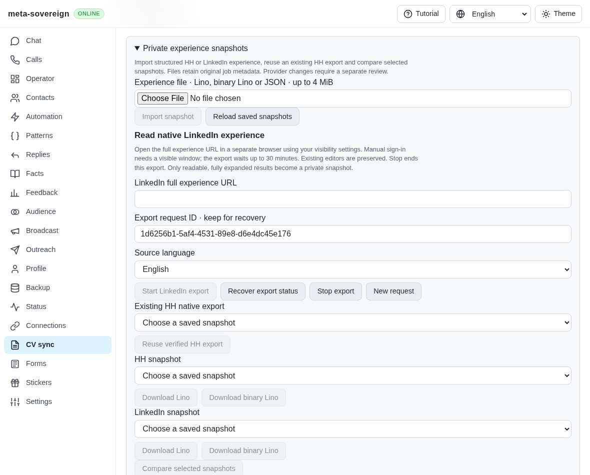
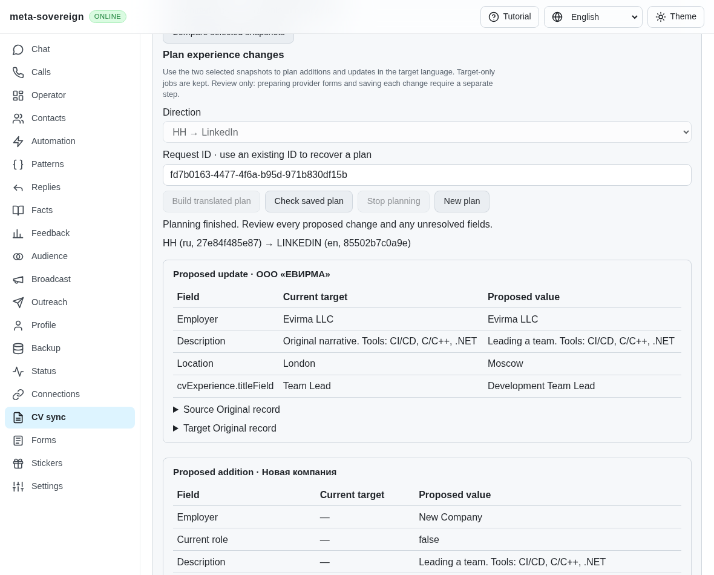
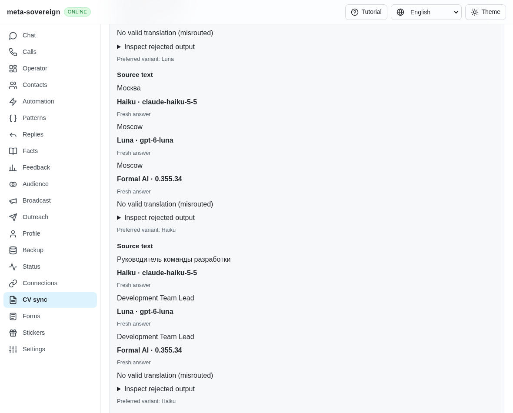
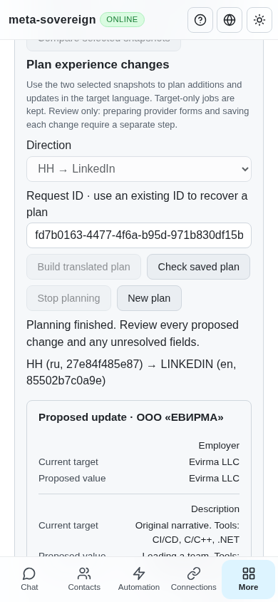

# Directed experience planning

This partial HH21/HH22 unit belongs to [PR #57](https://github.com/link-foundation/meta-sovereign/pull/57).
The complete issue and all 60 unchecked inventory rows remain unfinished.
Provider forms, per-change Save, saved-export verification and authenticated
acceptance remain required in this pull request.

Previously, comparing two private snapshots could identify differences but
could not prepare a directed, translated plan. Choose exact HH and LinkedIn
snapshot revisions, then choose HH → LinkedIn or LinkedIn → HH. Planning retains
both original records, every native metadata field and target-only jobs. Matching
uses the existing normalized-company and overlapping-period comparison. Unknown
periods and ambiguous matches become review items with no proposed fields.

Nonempty source values propose additions or updates. Missing source fields never
clear a target value. Skill/media proposals retain target-only array members;
provider-specific IDs and other unsupported fields remain visible in the original
records and review notes. Personal names receive separate review notes and are
never workplace changes. Profile About text is planned only when supplied in the
snapshots; this feature does not acquire missing About text.

The existing translator handles Russian/English workplace text in finite batches:
50 texts, 12,000 characters per text and 64,000 encoded bytes per batch. Oversized
text stays intact and unresolved rather than being truncated. Haiku, Luna and
Formal AI all contribute visible variants, including raw rejected responses,
model identity and cache state. The first accepted result in that order supplies
the proposed field. Script/refusal checks provide a conservative guard, not a
translation quality certificate. Every result still requires owner review.
Skills and media retain their literal native data.

Moving model descriptors resolve once per explicit planning job. Accepted caches
bind provider, exact model/version, direction and exact source text. New model
versions miss old cache entries; invalid responses are retried only in a new
explicit request. Requests, comparisons and caches use `secret:` store keys and
are excluded from ordinary peer reconciliation. The browser stores only the
request ID for recovery. These files follow existing store encryption settings.

Start acknowledges a private durable record before translator work. Repeated IDs
return their saved state and conflicting options refuse. Status never launches a
provider. Lost responses recover by GET; reload retains the acknowledged ID.
Stop and shutdown abort and drain the owned translator and retain variants
already produced by earlier providers. Partial comparisons never supply ready
field values. A new owner reports an interrupted job without replay; independent
read-only CLI inspection reports unverified ownership as unknown.

The CLI adds `cv-experience-plan-start --hh=REVISION --linkedin=REVISION
--to=hh|linkedin [--as-of=YYYY-MM] [--request-id=ID]`, plus status and Stop commands.
Foreground Start drains Ctrl+C/SIGTERM before closing its store. Status opens the
store read-only. The local API adds Start/status/Stop under
`/api/cv/experience/plan-`, with trusted mutations, private/no-store responses and
both default Lino encodings. The shared CV panel exposes these controls in
English, Russian, Hindi and Chinese, original records, proposed field values,
all variants, and private text/binary Lino plan downloads. Existing snapshot
selections survive refusal and recovery. No provider Save is implied.

Verification uses synthetic records and injected translators:

- The exact published parent `5e54935e` fails the new public planning regression;
  the experiment restores the draft facade in `finally`.
- Twenty-nine focused core/API/CLI/controller checks pass, including the affected
  native LinkedIn acquisition checks after extracting shared owned-job logic.
  They cover both directions, missing/ambiguous metadata, bounds, exact field
  binding, private caches, model changes, flush refusal, interrupted recovery,
  lost acknowledgement, late reads, owned Stop, partial variants and shutdown.
- Forty-seven existing CV CLI, lightweight command admission, structured document
  and locale parity checks pass. The admission check exposed missing command
  names in the first draft; all three commands now pass the ordinary CLI gate.
- The focused mandatory-browser helper verifies lost-response recovery without
  Start replay, retained selections, all three variants, two downloads, Stop,
  reload, four languages and a 390 px phone. It joins the existing hosted CV
  translation browser group. The full browser/runtime matrix runs in CI.
- Independent Playwright MCP repeats before/after verification against the shipped
  SPA and an isolated fixture. It reports no page exceptions and no phone
  horizontal overflow. The intentional HTTP 503 exercises response uncertainty.

The [hashed archive](data/experience-planning.tar.gz) retains focused logs,
source and nine screenshots. Browser and fixture resources were closed.
Exact-head hosted acceptance remains required. The parent has four successful
workflows while its checks/release runtime and browser matrix is still running.
No synthetic result certifies authenticated provider behavior, completes HH21 or
authorizes a native write. The pull request remains draft and unmerged.
