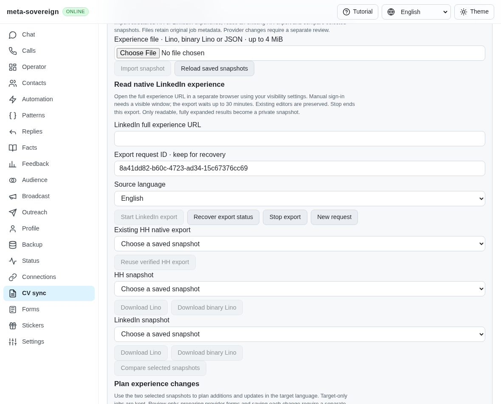
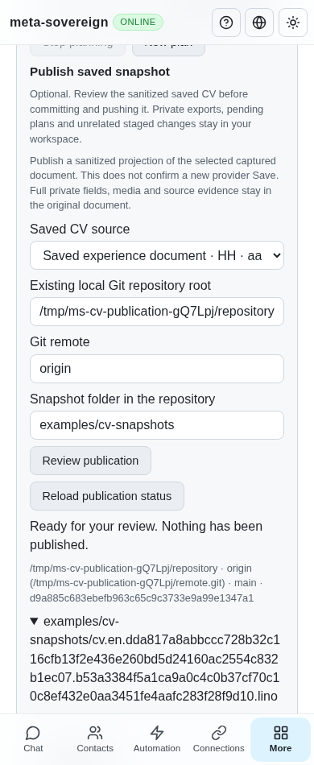
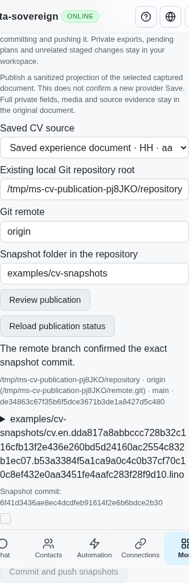

# Review and publish an immutable experience document

HH23 requires sanitized Git publication as part of the wider CV workflow. The
published parent `b868a82b4a2c26f1f285965037aedd43467babd9` supports observed
owner Saves and verified native HH exports. Saved HH and LinkedIn experience
documents cannot be selected as publication sources. The parent regression
refuses their revision before Git, and the parent UI has no publication review
inside Experience documents.

An explicit `experienceRevision` now selects one immutable private document
through the foreground CLI, text/binary Lino API and shared four-language CV
review. The publication projects only the existing public CV allowlist, applies
the existing contact/birth-date/salary filter and displays the exact Lino bytes
and Git destination before separate owner consent. Its source identity includes
the captured document revision and time. Switching sources clears consent;
changed, missing or corrupted private bytes refuse before further Git work.
Missing required public fields and incomplete native industry metadata also
refuse. A missing profile title uses the neutral Experience heading, never an
invented job title. See the [user guide](../../CV-SNAPSHOT-PUBLICATION.md).

The existing publication engine still isolates the Git index, preserves private
originals and unrelated staged changes, binds the reviewed target and confirms
the exact remote commit. Immutable documents retain their unknown fields,
per-job skills, media and provenance. Status, restart and repeated confirmed
requests never replay a push. A captured source is not evidence of a new
provider Save; pending plans are never used as public snapshots.

```sh
PYTHONDONTWRITEBYTECODE=1 E2E_EXECUTABLE_PATH=/usr/bin/google-chrome python3 experiments/issue-56/experience-publication-before.py
node --max-old-space-size=384 --test --test-concurrency=1 js/tests/cv-publication-experience.test.js js/tests/cv-publication-exports.test.js js/tests/cv-publication-controls.test.js js/tests/cv-publication-boundaries.test.js js/tests/cv-experience-document-web.test.js
node --max-old-space-size=384 js/scripts/build-web.mjs
RUN_BROWSER_E2E=1 E2E_EXECUTABLE_PATH=/usr/bin/google-chrome node --max-old-space-size=384 experiments/issue-56/experience-publication-browser.mjs
```

Six new portable checks exercise both source platforms, real local Git
repositories, foreground CLI execution, both wire encodings, source confusion,
corrupted/deleted originals and four-language consent. The selected 28-check
set includes legacy export, owner-save, destination and offline boundaries.
The native browser scenario verifies both source choices, four languages,
390-pixel layout, exactly one local push, intact private originals, no provider
sessions and reload without another effect. It is also registered in the
existing mandatory Chromium/WebKit publication group; full matrices run in CI.

Independent Playwright MCP verification uses another owned production server
and two local repositories. Its network receipt contains one plan POST and one
publish POST, followed by read-only status recovery. The server confirms one
push and preserved originals on shutdown. The MCP console retains a missing
favicon and a browser cache-write error for the bundle during reload; the
recovered DOM and source receipt pass, and the native scenario has no page
errors. Those diagnostics are preserved rather than presented as an empty
console. Every owned browser, server and temporary repository is closed.

Before, the experience section offers stored documents without publication:



After, the selected captured source and sanitized review are explicit:





This is a partial HH23 implementation. Add/copy editing, new provider
identities, full CV sync and all other unchecked original requirements remain
required. No acceptance row changes: 58 accepted, 60 unchecked, 118 total.
[PR #57](https://github.com/link-foundation/meta-sovereign/pull/57) stays draft.

[Source snapshots, raw checks and screenshots](data/experience-publication.tar.gz)
and [hash manifest](data/experience-publication.tar.sha256.json).
