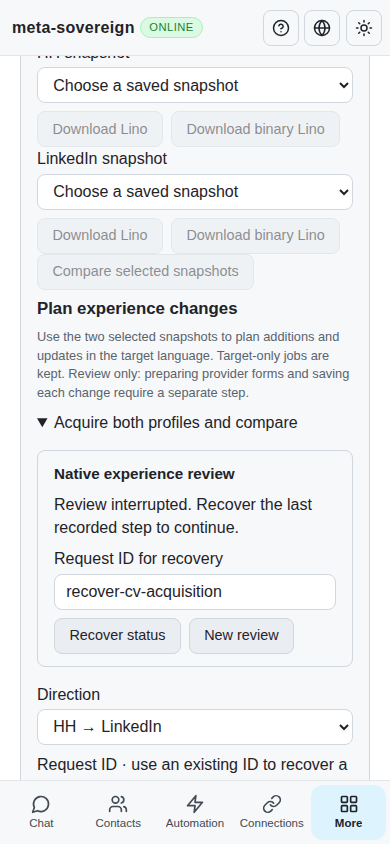
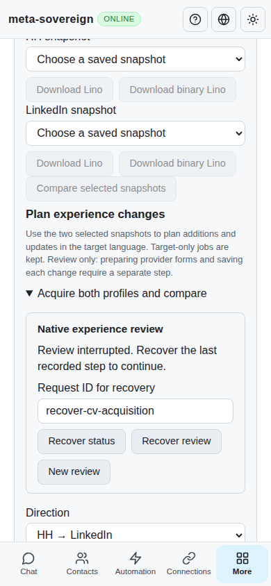
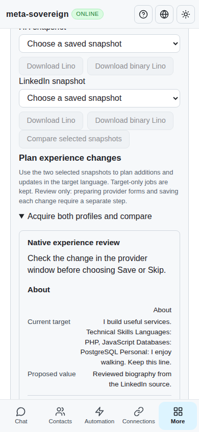

# Recover a reviewed CV queue after both profiles were acquired

On `da1a6ff1`, an interruption could leave the parent review at `acquiring` after the private HeadHunter and LinkedIn snapshots and directed comparison were already acknowledged. The CV view offered status recovery, and its resume route returned HTTP 409. The focused regression restores that exact interrupted state with the verified acquisition still available.

```sh
node --test --test-concurrency=1 --test-name-pattern='exact automatic acquisition' js/tests/cv-experience-review.test.js
```

Status now checks the saved acquisition and its comparison. The original review options must match the review's own acquisition request. A separately selected acquisition uses its explicit request ID. The comparison must match both immutable revisions, the direction and the fingerprint. The shared CV view offers **Recover review** when that preparation is available. The CLI and both Lino encodings use the same check. Recovery records the existing preparation before opening the first editor. Missing or mismatched preparation remains interrupted and leaves the stored review intact.

Node and Deno each passed 17 focused checks. The Lino regression verifies both request modes, the read-only status projection, the refused missing and mismatched preparation, and one editor per recovery. Chromium opens the shared CV view at 390 pixels and recovers the original comparison. An independent Playwright MCP session confirms the same phone layout, one native editor, one Skip, zero Saves and fixture shutdown.

| Interrupted on the parent revision                                                                       | Interrupted with verified preparation                                                                       | First editor ready for review                                                                                       |
| -------------------------------------------------------------------------------------------------------- | ----------------------------------------------------------------------------------------------------------- | ------------------------------------------------------------------------------------------------------------------- |
|  |  |  |

[Focused tests](../../../js/tests/cv-experience-review.test.js) · [Logs](data/experience-review-acquisition.tar.gz) · [SHA-256 manifest](data/experience-review-acquisition.tar.sha256.json)

Authenticated CV and recovery while an acquisition itself is incomplete remain open under HH17.
