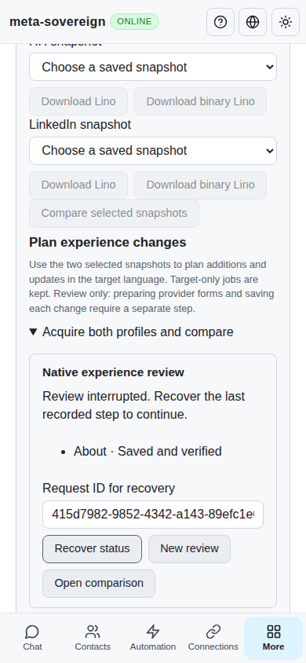
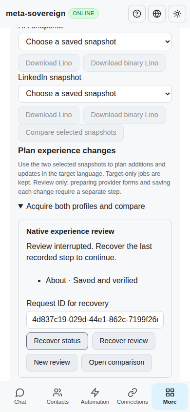

# Recover a CV review between native editors

On `7cba79fb`, an interruption after the queue acknowledged a verified Save could leave CV showing “Review interrupted” with only a status check. `cv-experience-review-resume` and both Lino routes refused the same request at that checkpoint. The completed item and updated comparison were already stored, and the next editor had yet to open.

Run the focused test to replay an interrupted queue with a saved About receipt and a second position ready for review. Reading status leaves both provider records untouched. Explicit recovery opens the second editor once with the verified HeadHunter revision and its own native request ID, then records the owner's Skip.

```sh
node --test --test-concurrency=1 js/tests/cv-experience-review.test.js
```

The shared recovery guard now admits the durable item-selection phase. That checkpoint requires an empty current editor, so a record carrying an unresolved Save fails validation. Recovery uses the stored comparison and receipts. An empty queue completes without opening another native editor or fetching another export. A second concurrent recovery is refused.

The parent returns `cv-experience-review-conflict` in the focused reproduction. On the fixed code, Node and Deno each pass the three review tests. The HTTP test also checks an empty checkpoint after verified Save or Skip, through text and binary Lino. Native Chromium reproduces the missing Recover review action on the bundled parent and confirms that the action completes the fixed queue with the same receipt and one original provider Save.

Independent Playwright at 390 × 844 confirmed the same saved revision before and after recovery, one editor opening, one owner Save and zero cancels. The browser connection drained. The page had no horizontal overflow or JavaScript exceptions. The standalone fixture returned 404 for its default favicon.





[Completed queue](../../screenshots/issue-56-experience-review-checkpoint/checkpoint-completed.png) · [Independent phone check](../../screenshots/issue-56-experience-review-checkpoint/checkpoint-phone.png) · [Logs](data/experience-review-checkpoint.tar.gz) · [SHA-256 manifest](data/experience-review-checkpoint.tar.sha256.json)

The review checks use isolated native and storage fixtures. Authenticated cross-provider batch recovery remains open under HH17.
