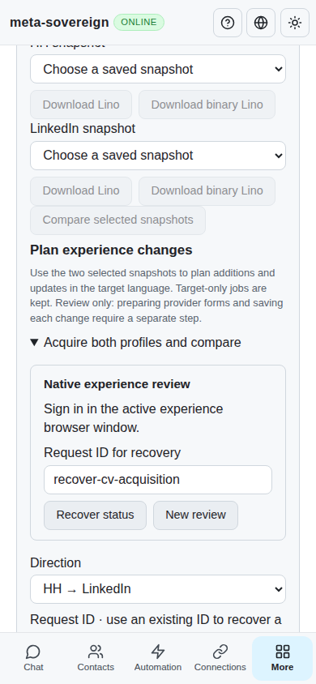
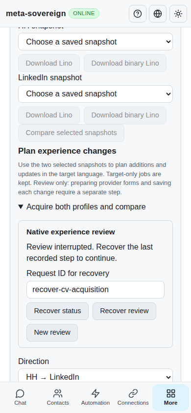

# Recover the CV review's own interrupted acquisition

On `99c20eef`, the native review queue could recover a completed comparison. If both profile exports were acknowledged and the comparison was still unadmitted, the phone view could keep showing an obsolete sign-in instruction and offer only **Recover status**. The regression models that checkpoint in the original review's private acquisition.

```sh
node --test --test-concurrency=1 --test-name-pattern='review resumes its unfinished acquisition' js/tests/cv-experience-review.test.js
```

To reproduce in the browser fixture, retain both acquisition receipts, restore the review-owned acquisition just before the comparison and reload the CV view with the same review ID. The parent has no **Recover review** action. The updated view shows the interruption and offers **Recover review**. One click continues the same private acquisition, records the confirmed comparison and opens the first native editor. **Skip this change** records the owner's decision and closes the review. A separately referenced acquisition must already be complete before the review can adopt it.

Node and Deno each passed 19 focused checks. Both Lino encodings verify that status and a repeated Start leave the parent and acquisition unchanged. Explicit recovery keeps both source revisions and the deterministic comparison request ID. The comparison's receipt is read back before opening the native editor. Chromium and independent phone Playwright verify one resume, one total LinkedIn read, one editor, one Skip and zero Saves in the isolated fixture. Playwright reported no page exceptions and one fixture favicon 404.

| Interrupted on the parent revision                                                                                             | Recovery from the acknowledged exports                                                                                |
| ------------------------------------------------------------------------------------------------------------------------------ | --------------------------------------------------------------------------------------------------------------------- |
|  |  |

[Focused tests](../../../js/tests/cv-experience-review.test.js) · [Logs](data/experience-review-owned-acquisition.tar.gz) · [SHA-256 manifest](data/experience-review-owned-acquisition.tar.sha256.json)

HH17 and HH21 still require authenticated provider and full batch verification.
