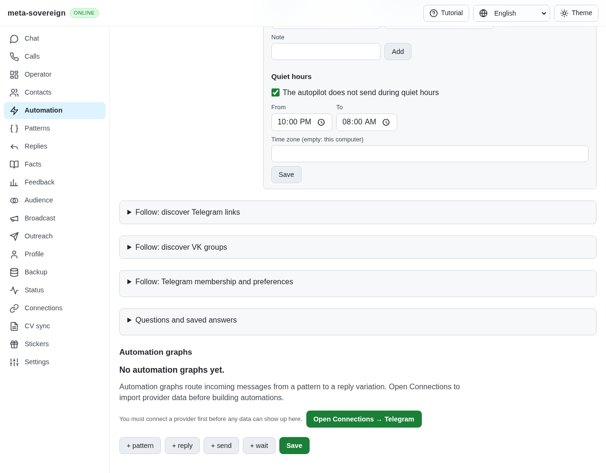
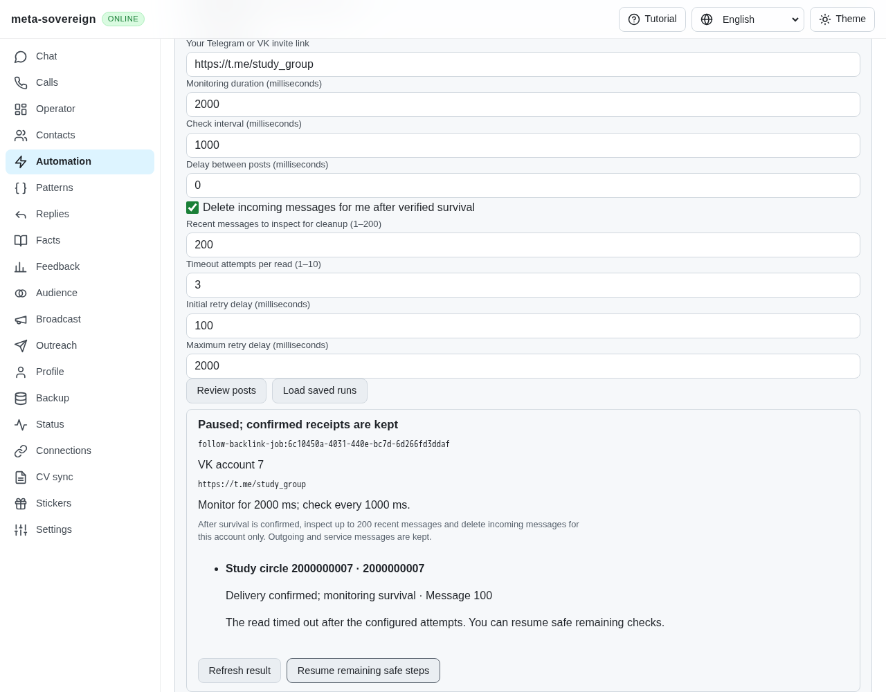
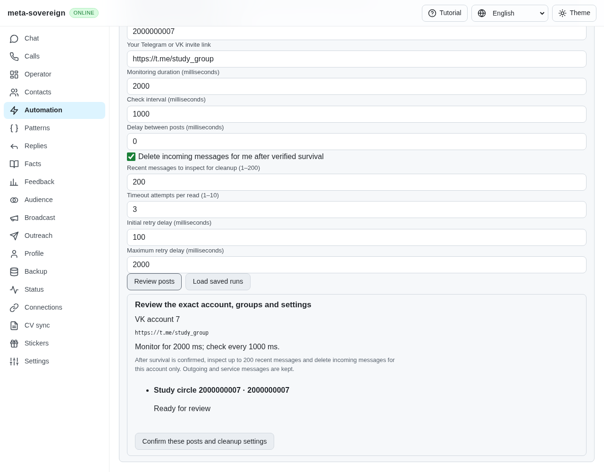
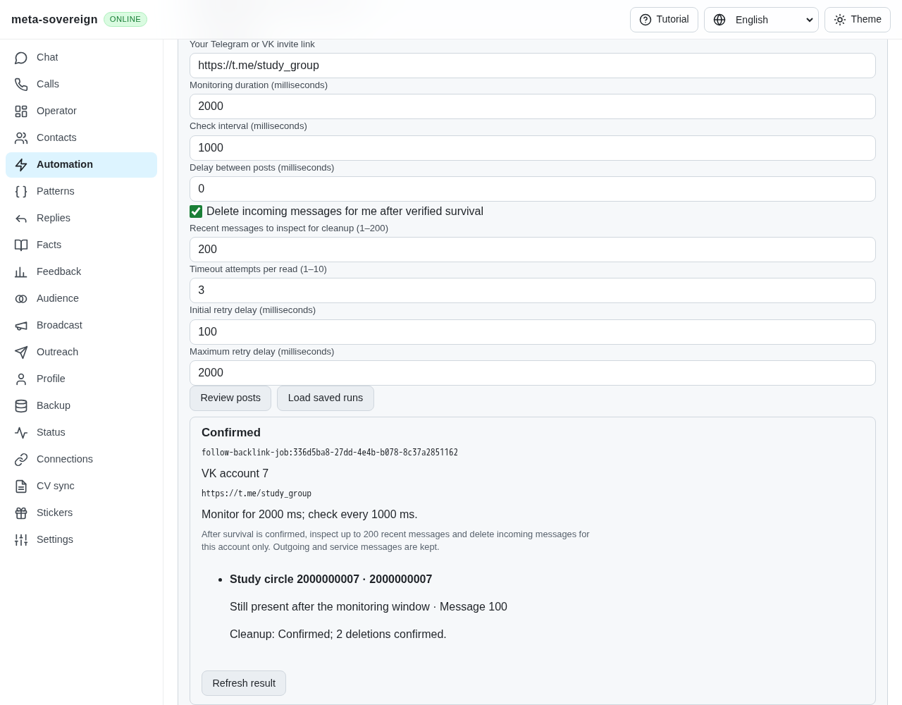
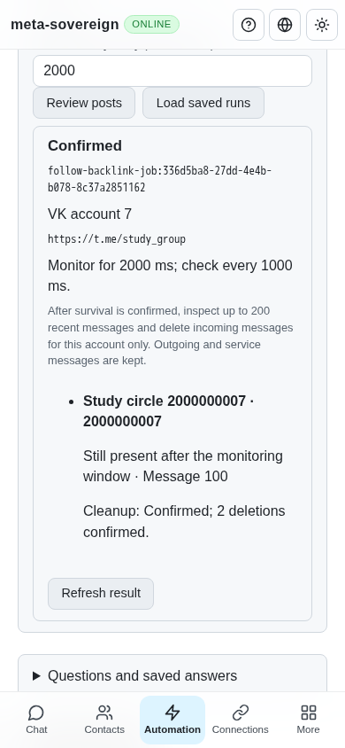

# Reviewed Follow backlinks

Issue: <https://github.com/link-foundation/meta-sovereign/issues/56>. Draft PR: <https://github.com/link-foundation/meta-sovereign/pull/57>.

FL06 now provides reviewed backlink posting into selected VK source conversations through CLI, default text/binary Lino HTTP and the common React Automations screen. Both Telegram and VK invitation backlinks are accepted. FL08 has bounded timeout-only read retries in this workflow. Telegram source conversations, the rejected-chat automatic loop and the broader retry/lifecycle audit remain unfinished under FL07–FL09. Every other unchecked issue-wide criterion remains required; PR 57 stays draft and unmerged.

## Behavior and configuration

A read-only preview freezes the connected user, exact group peer IDs, backlink, monitoring window, pacing and optional cleanup. Apply consumes one explicitly confirmed plan. Jobs persist flushed send intents before provider writes, retain positive message IDs and monitor those exact messages for the entire requested window. A missing or malformed response never counts as survival. A removed message is rejected; the reference's Russian five-other-links notice is retained as a skip-retry hint, without asserting that its author is an administrator.

Incoming cleanup defaults off. When selected, it reads at most the configured recent history, excludes outgoing and service messages, and checks the account and surviving backlink again after that read, immediately before deletion. VK deletion uses `delete_for_all: 0`. Only individually acknowledged IDs are projected into the local normalized message cache. A missing, partial or lost acknowledgement stays uncertain and is never replayed automatically. The [official VK method schema](https://github.com/VKCOM/vk-api-schema/blob/master/messages/methods.json) documents the send, lookup, history and deletion operations; tests exercise the production adapter against protocol fixtures rather than claiming live VK confirmation.

The supported bounds are 1–100 distinct VK group peer IDs; monitoring 1 second–1 hour (default 200 seconds); inspection interval 1 second–5 minutes (default 30 seconds); inter-post delay 0–60 seconds; and cleanup history 1–200 messages. Read retries allow 1–10 total attempts (default 3), initial delay 0–60 seconds (default 100 milliseconds) and capped exponential delay up to 5 minutes (default 2 seconds). VK rate limits, permissions, captcha, invalid invites and ordinary provider errors are not timeout retries. Ambiguous sends/deletions are not repeated. Default-off `MS_FOLLOW_DEBUG=1` emits retry/storage phase metadata without credentials or message text.

Terminal preview:

```sh
meta-sovereign automations follow backlinks post --source=vk \
  --chats=2000000001 --backlink=https://t.me/example_group
```

Add `--confirm` to apply and wait for the final receipt. Optional flags are `--monitor-ms`, `--interval-ms`, `--delay-ms`, `--delete-incoming`, `--history-limit`, `--attempts`, `--retry-delay-ms` and `--retry-max-delay-ms`. `list` supports `--limit`/`--offset`; `status`, `resume --confirm` and `cancel` accept `--job-id`. Output defaults to readable Links Notation, with explicit `--json` compatibility. HTTP uses `/api/automations/follow/backlinks`: GET the collection or `/status`, and POST `/preview`, `/apply`, `/resume` or `/cancel`. The shared UI exposes every configuration field, exact review, confirmed progress, saved-run pagination and recovery in all four locales.

Jobs retain server ownership when the browser navigates away. Cancellation interrupts waits, preserves receipts and awaits actual issued writes; shutdown also owns pending preview, startup and persistence work. Resume returns a queued snapshot and continues read-only monitoring without sending the saved backlink again. A new plan cannot replay an uncertain durable intent after reopening the real Lino store.

## Reproduction and corrections

Run `node experiments/issue-56/follow-backlinks-ui.mjs` and open the printed isolated free-port address. In Automations, open Follow backlinks, select group `2000000001`, a Telegram backlink, a 2-second window and a 1-second interval. Enable incoming cleanup, review and apply. Enter `timeout` in the fixture terminal before applying to exhaust inspection retries; the UI retains message 100 and pauses. Enter `recover`, then Resume: it automatically reaches Confirmed using the same message ID, with two acknowledged incoming deletions. Enter `quit` to await shutdown and remove the temporary directory. Production server, adapter, Lino routes, bundle and controls execute normally; only external VK HTTP replies are mocked. No real provider writes are performed.

The first browser draft exposed a missing production remote-method whitelist: preview never reached HTTP. The next draft exposed a recovery defect: Resume returned a snapshot still marked paused, so the browser stopped polling while the server continued. `follow-backlinks-resume-before.log` preserves the regression's `paused !== queued` failure; the service now persists and returns queued before launching the worker. The normalized-cache regression also failed before correcting the projection to use actual `msg:` records, source/chat IDs, `raw.out`, service markers and acknowledged provider IDs. Outgoing and service records remain intact.











## Verification and limits

- All 25 focused retry, service, CLI, real text/binary Lino HTTP, normalized-cache and shared control checks pass serially. They cover frozen one-use review, full-window survival, removal/notice handling, unknown-write protection across actual Lino reopen, finite timeout exhaustion, queued resume without resending, changed accounts, malformed peers, partial deletion, removal during history reading, flush-before-write failure and shutdown races.
- Another 50 existing VK source, publication and locale compatibility checks pass. The production Chromium browser check passes read-only review, duplicate-click protection, monitoring/cleanup, saved-run loading, deduplication, timeout recovery, retained receipts after malformed status and mobile width. The new check is registered in the existing Chromium/WebKit CI matrix; the full matrix is not run locally.
- Independent Playwright MCP captured the preceding production UI, the paused recovery defect, reviewed configuration, automatic confirmed recovery and mobile receipts. PNG types were validated and images visually inspected. The final mobile viewport/document both measure 390 pixels. Fixture totals are one send and one cleanup request per applied recovery flow. Console evidence contains a missing favicon; no application exception is observed. All owned browsers and fixture servers were closed.
- Strict focused lint, formatting, production bundle, secret and whitespace checks accompany the evidence archive and source hashes. The mocked provider confirms protocol behavior, not real-account permissions or live delivery. Exact-head CI remains a separate gate.

Evidence: [archive](data/follow-backlinks.tar.gz), [verified manifest](data/follow-backlinks.tar.sha256.json). Follow behavior was studied at pinned commit `af8fbb80cec26a7b5b205c93314372d1d92cec1f`, including its backlink monitor, automatic loop, Lino tests and client cleanup, without executing or copying its implementation.

## CI investigation accompanying this slice

The preceding exact-head `4b3dc3e2` workflows were created at 2026-11-10 05:52:29 UTC. Four workflows pass. [Checks 42764827897](https://github.com/link-foundation/meta-sovereign/actions/runs/42764827897) fails the legacy session browser's immediate mobile-width assertion in Chromium and WebKit at complete-log lines 20,150 and 22,494. The isolated `legacy-follow-mobile.mjs` experiment measures 401 pixels immediately after resizing to 390, then 390 after two animation frames in the unchanged application. Commit `d3305841` uses the existing finite condition waiter for settled responsive layout; its focused production Chromium rerun passes. This does not relax persistent-overflow detection. The complete failed workflow and four superseded cancelled `1c8fbe4d` workflows are preserved. Neither those cancellations nor earlier successful heads verify the new commit.
