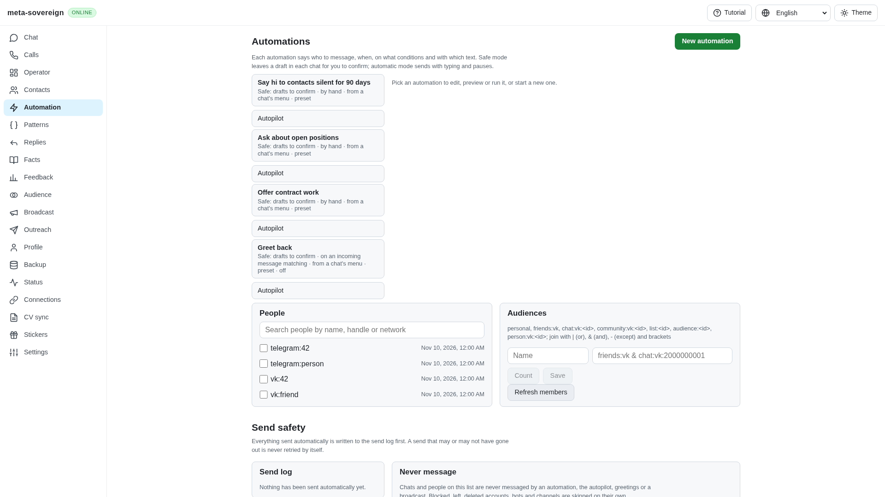
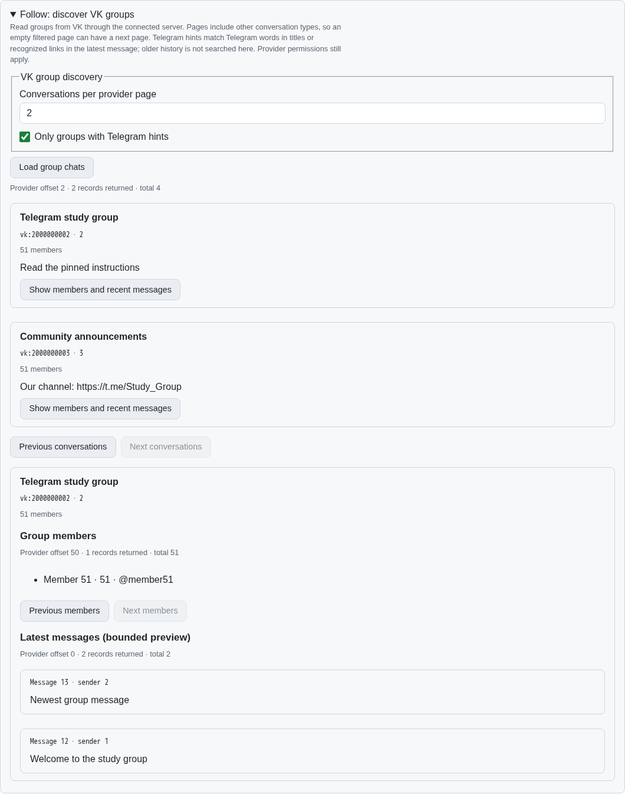
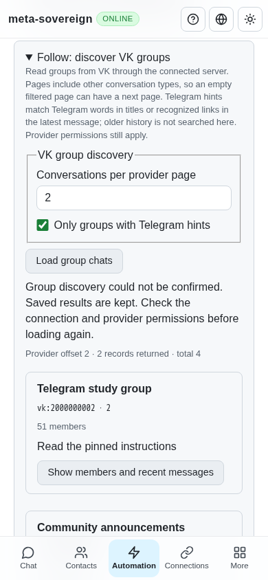

# Follow group discovery

FL01 now shares explicit read-only VK group discovery through the CLI,
default Lino HTTP API and React Automation screen. Each result shows its title,
full peer ID, local chat ID, reported member count and latest message.
Details load a bounded recent-message preview and paged members with their
names, IDs, screen names and owner/administrator roles when VK supplies them.
FL03–FL09 and the other issue-wide workstreams remain unfinished.

## Research and behavior

The pinned Follow reference's
[group listing](https://github.com/konard/follow/blob/af8fbb80cec26a7b5b205c93314372d1d92cec1f/vk-list-chats.mjs)
and [VK helper](https://github.com/konard/follow/blob/af8fbb80cec26a7b5b205c93314372d1d92cec1f/vk.lib.mjs)
were read without executing or copying their implementation. The reference
filters Telegram words in group titles. These controls also recognize Telegram
links in the latest message. They state that older history is not searched;
the separate [cached incoming-link extraction](follow-links.md) handles that
archive. Filtering does not verify Telegram membership or access.

VK's official schema was checked at
[`333481bd082ad747d4873ef4a77f9247097eeef0`](https://github.com/VKCOM/vk-api-schema/blob/333481bd082ad747d4873ef4a77f9247097eeef0/messages/methods.json).
Both conversation and member reads accept offsets and counts. The application
caps both at 200 records; message previews default to 10 and cap at 100.
The existing VK adapter keeps its request pacing and network time budget.
Follow's stricter configurable timeout-only retry policy remains FL08 work.

Pagination advances over the raw provider conversation page before filtering
out private conversations and unmatched groups. Thus an empty filtered page
can still have a next page. Results expose raw offset, count, reported total,
next offset and coverage. An unexpectedly empty provider page before its
reported total stops pagination and explicitly retains incomplete coverage.
Lists are bounded; no background provider scan starts on opening the panel.

The existing connection and Automation patterns from
[PR 33](https://github.com/link-foundation/meta-sovereign/pull/33) and
[PR 34](https://github.com/link-foundation/meta-sovereign/pull/34) were reviewed.
Saved VK credentials stay on their owning server. Credential changes are read
before every explicit operation. A browser without a configured server reports
that one is required. Access restrictions, missing credentials, captcha,
rate limiting, malformed replies and permission errors remain failures.
HTTP error responses omit private provider diagnostics and retain a numeric
provider error code when available. Loaded UI results survive failed reads;
changing the scope clears previous results. No join, send or delete is issued.

## Reproduce and verify

```sh
meta-sovereign automations follow chats --source=vk --telegram-only --limit=50 --offset=0
meta-sovereign automations follow details --chat=2000000002 --member-offset=0 --member-limit=50 --message-limit=10
```

The corresponding reads are `GET /api/automations/follow/chats` and
`GET /api/automations/follow/details`, with camel-case query options
`telegramOnly`, `memberOffset`, `memberLimit` and `messageLimit`.
Text and binary Lino use the existing default transport. Open **Automation →
Follow: discover VK groups** for the shared UI. Use
`node experiments/issue-56/follow-chats-ui.mjs` for an isolated offline fixture;
press Enter to stop its server and remove its temporary data.

- 46 focused checks: nine new discovery/CLI/transport/render checks, twelve
  existing Follow checks and twenty-five locale checks. They cover empty
  filtered pages, details, member paging, ID validation, malformed replies,
  wrong peers, incomplete coverage, real adapter form parameters, credential
  rotation and redacted provider failures.
- The production Chromium test verifies the actual shared API and controls,
  empty-page navigation, title/message filters, member pagination, latest
  messages, result retention after disconnection, changed scopes and mobile
  overflow. The flow is registered in the existing CI browser catalog.
- Independent Playwright MCP verifies two groups after advancing from an
  empty filtered page, 50 members followed by the final member, recent
  messages and retained groups/details after an empty 400 response. The
  mobile document and viewport are both 390 pixels wide. Its only incidental
  console error is the missing fixture favicon; the deliberate 400 is expected.
  Browser and isolated server are closed after verification.
- Changed JavaScript passes strict lint and secret scanning; formatting,
  diff checks and the inexpensive web bundle pass. Full matrices stay in CI.

A draft regression found that an HTTP 200 response with only a `more` flag
passed validation without the offsets/counts needed by the UI. The focused
`successful HTTP status with incomplete discovery pagination is rejected before rendering`
case fails before the correction with `Missing expected rejection` and now
passes. Both discovery result shapes require complete pagination metadata;
malformed replies cannot replace the retained results.

Logs, schema research, source/image hashes and MCP observations are preserved
in [the verified archive](data/follow-chats.tar.gz) and
[manifest](data/follow-chats.tar.sha256.json).

The earlier Automation screen has no group discovery panel:



The new panel shows provider pages, group identities and member/message details:



The same controls and retained-error state fit a phone:


