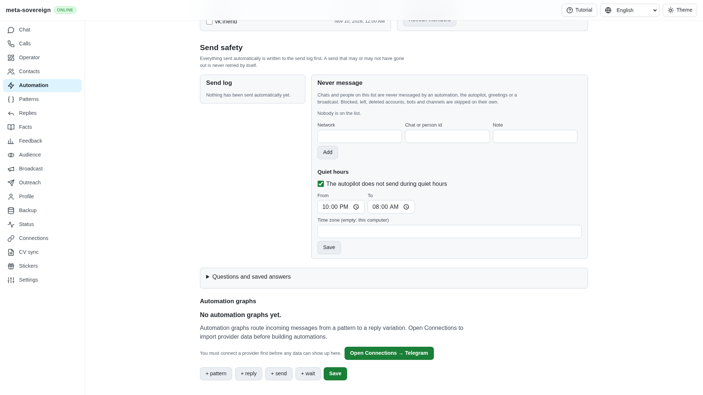
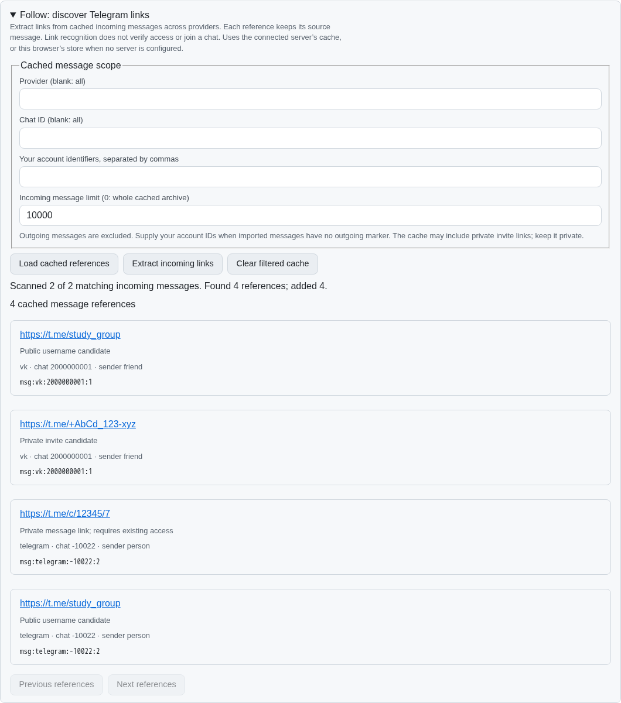
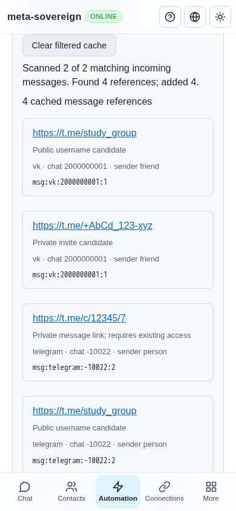

# Follow link discovery and provenance

FL02 now has one implementation behind `automations follow`, the default Lino
HTTP API and the shared React Automation screen. It extracts public usernames,
private invite hashes, public message links and private message links from
incoming cached messages across providers. Every cached reference retains its
provider, chat, sender, message ID and timestamp. The same URL in two messages
keeps both provenances; aliases within one message collapse to one reference.

This completes extraction and clearable caching, not the remaining Follow
workflow. FL01 is covered in [group discovery](follow-chats.md); FL03–FL09 still require provider operations,
session migration auditing and the reviewed resumable cross-provider runner.
Recognizing a link never claims membership, access or delivery.

## Reference and protocol research

The Follow reference was read without executing its code. Its current pinned
commit is `af8fbb80cec26a7b5b205c93314372d1d92cec1f`:
[README](https://github.com/konard/follow/blob/af8fbb80cec26a7b5b205c93314372d1d92cec1f/README.md)
and [extractor](https://github.com/konard/follow/blob/af8fbb80cec26a7b5b205c93314372d1d92cec1f/vk-extract-telegram-links.mjs).
The new parser and cache are original implementations. The
[Telegram link specification](https://core.telegram.org/api/links) supplies the
alias, invite and message-link distinctions. Candidates still need provider
resolution before any later join operation.

Static review also found that the reference extractor loses the hash of legacy
`joinchat` invitations. [Follow issue 17](https://github.com/konard/follow/issues/17)
contains the pinned source analysis and a bounded, credential-free regression
for its maintainer. It is explicitly a static finding; upstream was not run.

## Controls and storage

```sh
meta-sovereign automations follow extract --source=vk --chat=2000000001 --self=42 --limit=0
meta-sovereign automations follow links --source=vk --limit=25 --offset=0
meta-sovereign automations follow clear --source=vk --chat=2000000001
```

The API is `GET /api/automations/follow` and
`POST /api/automations/follow/extract|clear`. Both default text and binary Lino
encodings use the existing transport. `source` and `chat` select scope;
`self` supplies imported account identifiers when direction metadata is absent.
The connected server owns its cache. With no configured server the same React
controls operate on this browser's store. A failed connected server never
silently changes the selected storage location.

References are ordinary `follow-link:` records in the universal store and
persist in its Lino file. Clearing removes only matching references. Source
messages and secret records remain. This is an observed-link cache: a limited
refresh or a later message edit does not erase previously observed references.
Private invite links are private user data and are not logged or fetched.

Production scans stream batches of 32. Extraction defaults to 10,000 matching
incoming messages; zero scans the complete cached archive in storage order.
Each message has finite field, text, candidate and reference limits, reported
in coverage. The UI lists 25 references per page; API pages are capped at 200.
Compatibility stores without `scan` can materialize their matches. Operations
on one store are exclusive so extraction and clearing cannot race.

## Failure investigation and verification

An independent MCP probe found that an empty HTTP error response took the
generic nullable API fallback and operated on the browser cache. The regression
`an empty or malformed server response never mutates the browser cache` fails
before the correction with `Missing expected rejection`. Follow now uses the
existing raw request gateway, retains HTTP status and validates the result
shape. Empty/malformed success and error responses fail explicitly. The
production browser test also covers an empty 400 response and preserved rows.

- 37 focused checks pass: 12 Follow parser/storage/CLI/API/rendered-control
  cases and 25 existing locale checks. The Lino reopen case verifies extraction
  survives reopening and clearing remains cleared after reopening again.
- The production Chromium flow passes extraction, provenance, reload,
  idempotent refresh, structured and empty error recovery, cancelled/filtered
  clearing, retained source messages and a 390 × 844 viewport.
- Independent Playwright MCP finds four references from two incoming messages,
  four retained after an empty 400 response and reload, two retained after
  cancelling clear, and two Telegram references after clearing VK. Mobile has
  no horizontal overflow. The only incidental console error is the fixture's
  missing favicon; the deliberate 400 is expected. The browser and isolated
  server are closed after verification.
- Changed JavaScript passes strict lint; changed files pass formatting and the
  inexpensive production web bundle build. Full runtime/browser matrices stay
  in CI.

Evidence, source hashes and the failure reproduction log are in
[the verified archive](data/follow-links.tar.gz) and
[manifest](data/follow-links.tar.sha256.json).

Before, the Automation screen has no Follow discovery controls:



After, every reference has a kind and source-message provenance:



The same controls fit a phone viewport:


