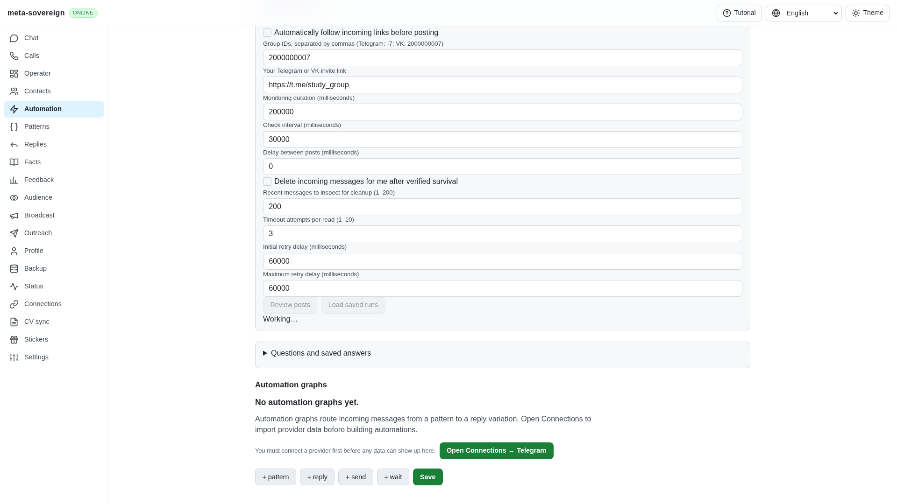
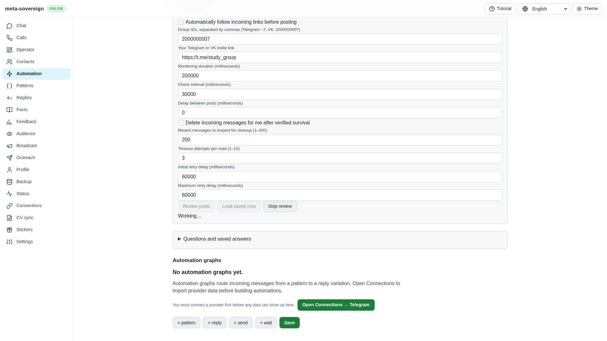
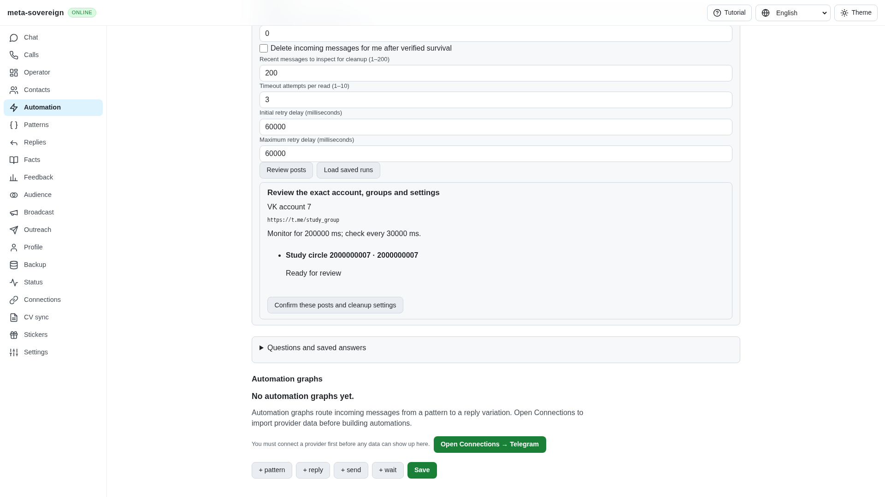
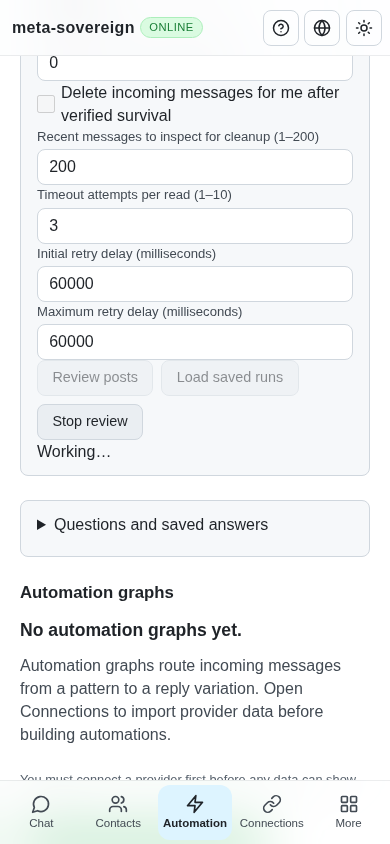

# Cancelling a pending Follow review

Work for [issue 56](https://github.com/link-foundation/meta-sovereign/issues/56)
in [PR 57](https://github.com/link-foundation/meta-sovereign/pull/57).
This completes the remaining Follow preview cancellation audit. The other
unchecked issue-wide requirements remain required; PR stays draft and unmerged.

## Reproduction and cause

Open Automations, expand monitored backlinks and enter a group and invitation.
Set the initial and maximum read delays to 60,000 ms. Make the first provider
read return a typed timeout, then select Review posts. Previously the screen
disabled every control and offered no Stop action. API cancellation expected a
completed plan or saved job; it could not select a still-pending preview. A CLI
interrupt consequently could not wake its retry delay either.

Five focused regressions fail against preceding `c80df8b0`. The production
browser regression also fails because Stop review is absent. Complete before
logs and the production screenshot are preserved.

## Correction

Each preview now owns a validated request ID and uses the same finite read
controller as standalone Follow discovery. Scoped cancellation wakes its
backoff, prevents another attempt and prevents a late result from publishing a
plan. Other previews retain their plans. Cancellation and shutdown await an
already-issued provider read rather than discarding its eventual result.

The common localized React controls expose Stop review while reviewing. An
unconfirmed stop displays recovery guidance and keeps Stop available. Leaving
the screen cancels only its pending preview. Completed reviewed jobs continue
under their existing saved-run lifecycle. CLI SIGINT/SIGTERM selects the pending
preview until a job exists and returns a structured cancelled result after owned
work settles; signal handlers are removed.

## Verification

The focused provider, lifecycle, controls and locale group passes 103 checks:

```sh
node --test --test-concurrency=1 js/tests/follow-preview-cancel.test.js js/tests/follow-backlinks.test.js js/tests/follow-vk-cleanup.test.js js/tests/follow-backlink-controls.test.js js/tests/follow-telegram-backlinks.test.js js/tests/follow-telegram-backlink-lifecycle.test.js js/tests/follow-telegram-backlink-controls.test.js js/tests/follow-auto.test.js js/tests/follow-auto-lifecycle.test.js js/tests/follow-auto-persistence.test.js js/tests/i18n.test.js
```

The five new cases cover long-backoff cancellation, independent concurrent
previews, duplicate/malformed IDs, shutdown ownership, actual text/binary Lino
HTTP routes and a real CLI process signal. The timeout-only policy/provider
group additionally passes 13 checks. Existing membership, durable write receipts,
uncertain-result protection and all four automatic provider pairs remain covered.

Three CI-registered production Chromium flows pass sequentially: VK backlinks,
Telegram backlinks and automatic Follow. The extended VK flow checks failed
cancellation recovery, successful Stop after one provider call, absence of a
late plan, navigation cancellation and the previous monitored cleanup, history,
deduplication, timeout recovery and mobile interactions.

Independent Playwright MCP checks use the isolated production fixture
`experiments/issue-56/follow-preview-ui.mjs`. Desktop and 390 × 844 mobile both
show an enabled Stop during a 60-second backoff, settle promptly after Stop and
restore the review controls. Desktop then successfully reviews the same target.
Mobile has no horizontal overflow (`scrollWidth === 390`). The fixture records
five read calls across the two cancelled reviews and recovered review, with no
provider writes. The browser and fixture are closed. Expected cancelled HTTP
responses and the existing favicon 404 produce console network messages.

Before:



After:



Recovered review:



Mobile:



Scoped strict lint, formatting, secret scanning, whitespace checks and the
production web build pass. Raw logs, preceding-head CI snapshots and source
hashes are in [follow-preview.tar.gz](data/follow-preview.tar.gz), with a
[SHA-256 manifest](data/follow-preview.tar.sha256.json). Exact new-head CI remains
required. No live provider account actions are claimed.

## Follow requirement mapping

FL08's finite timeout-only policy and error preservation are verified in
[telegram-follow-retry.md](telegram-follow-retry.md) and
[follow-read-policy.md](follow-read-policy.md). The final incoming cleanup boundary
is verified in [follow-vk-cleanup.md](follow-vk-cleanup.md). This study closes its
pending-preview lifecycle gap. These studies plus the linked membership,
backlink and automatic-round studies complete the inventoried FL01–FL09 behavior
through CLI, default text/binary Lino API and shared React controls. Broader
question automation, HH, VK automation and device architecture requirements
remain unfinished.
