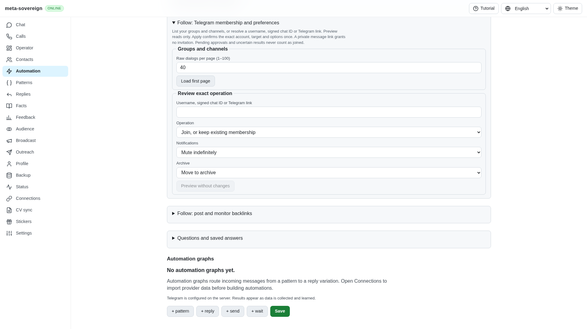
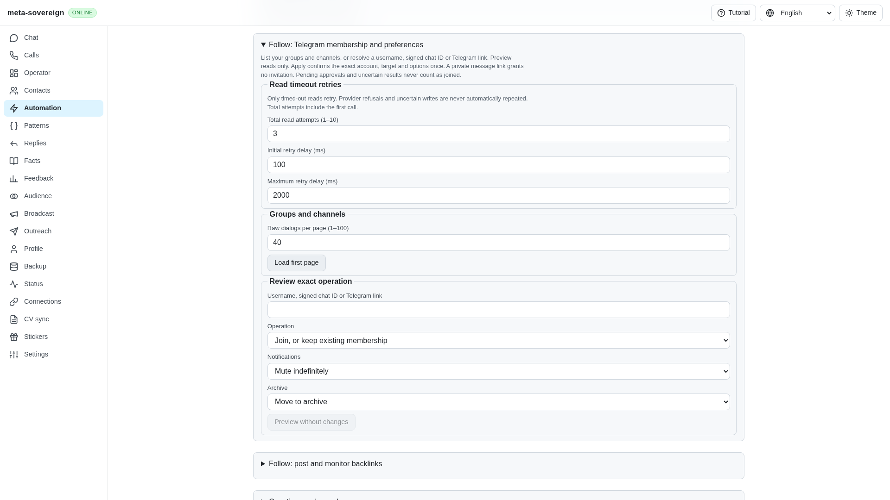
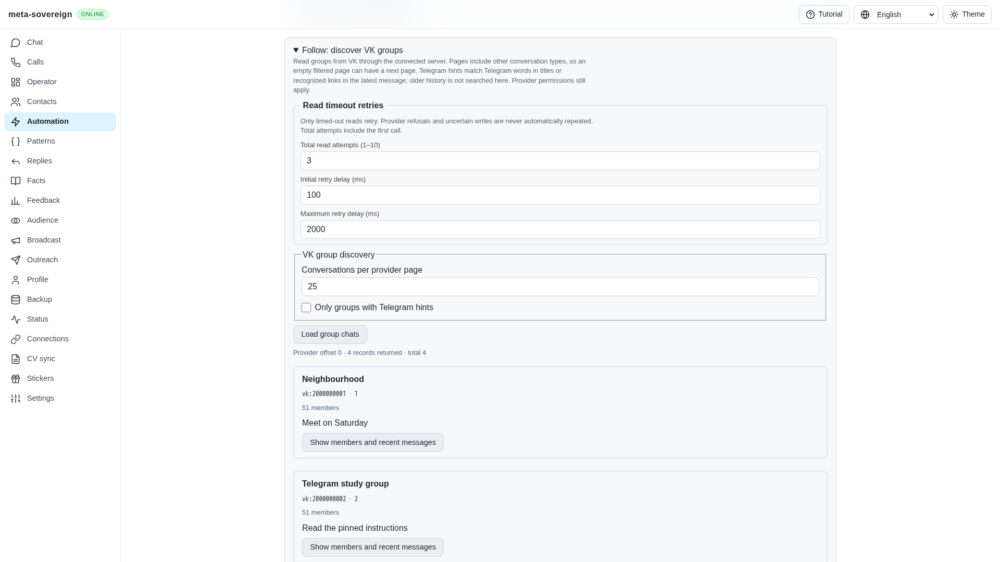
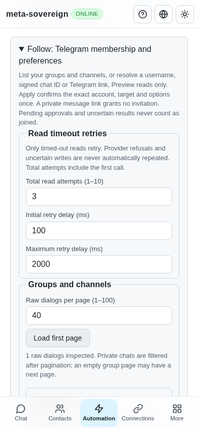

# Configurable Follow read retries and owned cancellation

Work for [issue 56](https://github.com/link-foundation/meta-sovereign/issues/56)
in [PR 57](https://github.com/link-foundation/meta-sovereign/pull/57).
This completes standalone discovery and Telegram membership read configuration.
The wider FL08 cleanup/lifecycle audit and every other unchecked issue-wide
criterion remain unfinished. PR 57 remains draft and unmerged.

## Reproduction and causes

Open Follow, configure two read attempts with zero delay, and make VK discovery
or Telegram group listing return a typed timeout. Previously neither standalone
surface exposed the policy. VK discovery also used the general adapter, whose
internal rate-limit retries bypassed Follow's timeout-only rule. Telegram
membership reads had no independently configurable finite retry budget.

The browser regression exposed another cause: after the provider exhausted its
finite budget, shared HTTP recovery treated these GET endpoints as recoverable
connection reads and repeated them indefinitely. The screen stayed busy instead
of displaying the exhausted timeout. Before correction both production browser
flows fail waiting for that error. A separate small HTTP regression fails on the
same classification. Cached Follow-link reads retain their ordinary recovery.

The initial five provider regressions fail against preceding `70a5f489` (four
failures and one bounded test cancellation). Their complete log and the two
browser failures are preserved in the evidence archive. The fixtures use no
live credentials or provider writes.

## Resulting behavior

CLI, default text/binary Lino API and common React controls share these defaults
and validated bounds:

| Setting                               | Default | Bounds                |
| ------------------------------------- | ------- | --------------------- |
| Attempts, including the first request | 3       | 1–10                  |
| Initial delay in milliseconds         | 100     | 0–60,000              |
| Maximum delay in milliseconds         | 2,000   | Initial delay–300,000 |

CLI flags are `--attempts`, `--retry-delay-ms` and `--retry-max-delay-ms`. API
bodies accept typed `retry: { attempts, delayMs, maxDelayMs }`; query endpoints
use `attempts`, `retryDelayMs` and `retryMaxDelayMs`. Invalid values are rejected
before account startup or provider calls. Delays double up to the configured
cap. Only typed timeouts qualify: permission, invite, flood-wait and VK rate-limit
refusals propagate after one call. VK discovery uses `callOnce` and checks
credentials again after the limiter. Telegram requests disable SDK retries.

Each operation owns its request ID and abortable delay. Stop wakes a long backoff
immediately and prevents the next RPC. It does not abandon an issued provider
request: cancellation and server shutdown retain ownership until that request
settles. Scoped cancellation leaves unrelated operations running. CLI signal
handlers are removed after settlement. The server also drains owned discovery
work after its HTTP client disconnects.

Telegram review freezes the read policy with the account and target. Editing it
discards that review. Automatic Follow retains its parent policy without nesting
another retry budget. Membership/preference writes retain one issued call,
durable intents and uncertain receipts. The browser respects provider exhaustion
and displays the error instead of starting a second HTTP recovery loop.

## Verification

A 100-check focused group covers seven provider regressions, CLI/default Lino
compatibility, existing Telegram membership/discovery controls, automatic Follow
lifecycle/persistence and all four locales:

```sh
node --test --test-concurrency=1 js/tests/follow-read-controls.test.js js/tests/follow-read-policy.test.js js/tests/follow-telegram.test.js js/tests/follow-telegram-retry.test.js js/tests/follow-chats.test.js js/tests/follow-telegram-controls.test.js js/tests/follow-auto.test.js js/tests/follow-auto-lifecycle.test.js js/tests/follow-auto-persistence.test.js js/tests/i18n.test.js
```

After the browser exposed HTTP recovery, two additional regressions cover exact
HTTP exhaustion and server-close ownership. The resulting controls/recovery
pair passes all 15 checks:

```sh
node --test --test-concurrency=1 js/tests/follow-read-controls.test.js js/tests/request-recovery.test.js
```

The real VK transport regression confirms error 6 issues one HTTP call and
credential rotation while awaiting the limiter prevents a request. Scoped
Telegram cancellation preserves another preview. Shutdown waits for a deferred
provider result. A 60-second retry delay is stopped after one call without
waiting for that timer.

The existing CI-registered Telegram, VK discovery and automatic Follow Chromium
flows pass sequentially against the production bundle. They verify exhausted
timeouts, stopping long delays, review invalidation and the previous membership,
preferences, history and pagination interactions. Scoped strict lint, formatting,
secret scanning and the production web build pass.

Independent Playwright MCP verification uses the isolated production fixture
`experiments/issue-56/follow-retry-ui.mjs`. Desktop shows the three defaults and
one Telegram group; VK discovery shows three groups. Mobile at 390 × 844 has all
three fields and no horizontal overflow (`scrollWidth === 390`). Browser and
fixture are closed. Only the existing favicon 404 appears in the console.

Before:



After, Telegram:



After, VK:



Mobile:



## CI and evidence limits

All five workflows for preceding `70a5f489d309fb340dfc4944f0c55e6ba1d6f4af`,
created at 08:19:40 UTC on 2026-11-10, pass. The exact SHA and timestamp snapshot
is preserved. New-commit CI remains required; local Chromium is not a passing
remote browser/runtime matrix. The fixtures verify finite failure behavior
without claiming live account actions succeeded.

Raw logs, run snapshots, browser observations and source hashes are in
[follow-read-policy.tar.gz](data/follow-read-policy.tar.gz), with a
[SHA-256 manifest](data/follow-read-policy.tar.sha256.json). The broader cleanup
boundary audit and all other unchecked issue requirements remain required.
