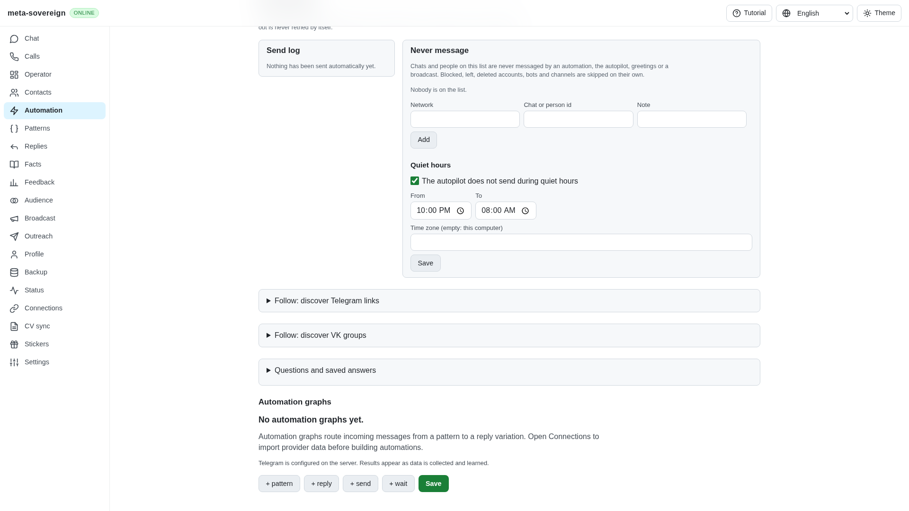
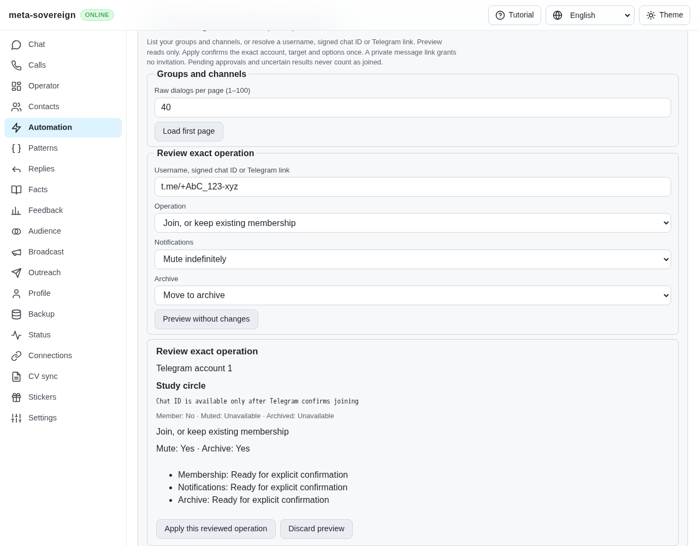
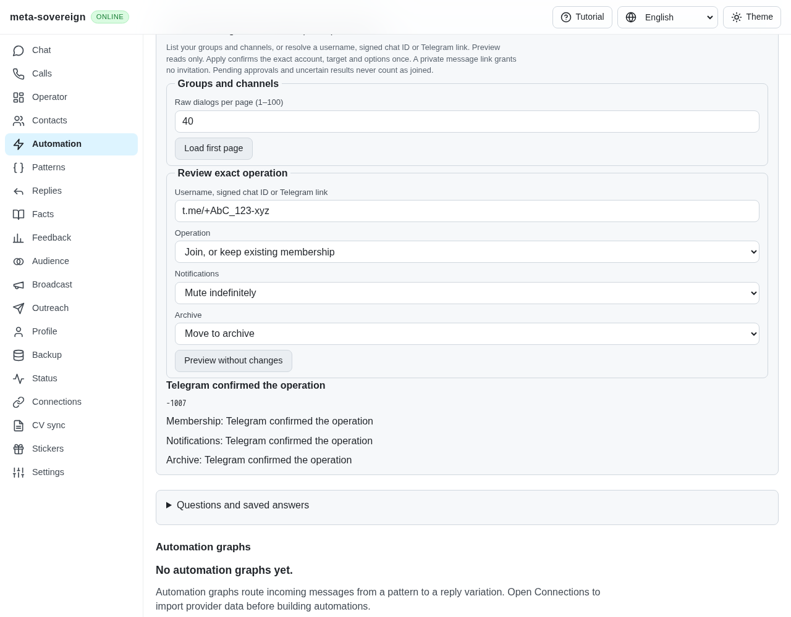
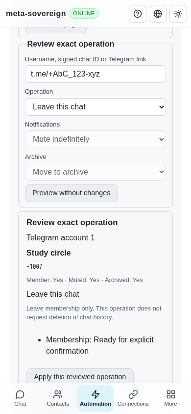

# Reviewed Follow membership and preferences

Issue: <https://github.com/link-foundation/meta-sovereign/issues/56>. Draft PR: <https://github.com/link-foundation/meta-sovereign/pull/57>.

Follow now lists Telegram groups/channels and previews exact-account joins, leaves and independently chosen mute/archive settings through CLI, default text/binary Lino API and common React Automation controls. The [shared leave correction](shared-leave-receipts.md) completes the existing Chat/Operator acknowledgement paths required by FL03. FL03/FL05 are verified; FL04 migration is verified in [legacy-follow-sessions.md](legacy-follow-sessions.md). FL06–FL09 remain required, and issue-wide delivery is unfinished.

## Reproduce and inspect

Previously Automation had link extraction and VK discovery, without a reviewed Telegram Follow workflow. Open Automation → Follow: Telegram membership and preferences. Loading a page and previewing an operation only read Telegram. A username, signed chat ID, public message URL or private invitation resolves to a typed target. A private message URL cannot grant an invitation. Raw pagination is bounded to 1–100 dialogs and advances before filtering private chats; an unusable continuation remains explicitly incomplete.

Choose join, leave or preferences, then review the account, target, observed state, frozen options and individual phases. Apply consumes that exact five-minute plan once. Joining confirms membership before optional preferences. Notifications and archive each have unchanged/on/off choices. Leave issues a membership request without requesting history deletion. Existing confirmed states skip their RPCs.

Terminal examples (preview unless explicitly confirmed):

```sh
meta-sovereign automations follow telegram list --limit=40
meta-sovereign automations follow telegram join --target=study_group --mute=true --archive=true
meta-sovereign automations follow telegram preferences --target=-1007 --mute=false --archive=false --confirm=true
meta-sovereign automations follow telegram leave --target=-1007
```

Routes: `GET /api/automations/follow/telegram`, `POST .../preview`, `POST .../apply` with `{ planId, confirm: true }`, and `POST .../cancel`. Cancellation with a plan ID discards only that preview; cancellation without one stops remaining phases. The CLI defaults to Links Notation; JSON output requires `--json`. No server/account produces a capability error rather than a browser-side write.

## Receipts, recovery and ownership

Each phase rechecks account, active client, exact target and actual membership/preferences before writing. A private invite receipt must match the previewed peer kind. Only checked join/leave updates, notification `true`, or valid folder updates confirm a change. Pending approvals, bot web views, missing/mismatched replies and transport/internal timeouts retain distinct results. A confirmed earlier phase survives a later uncertain phase.

The journal writes and flushes an intent before an RPC. An uncertain or pending phase blocks replay through a new preview/controller or a reopened Lino file. A positive fresh observation may skip an already-applied state. The installed teleproto SDK's per-call `maxRetryCount: 0` prevents its internal automatic retry of these writes. SDK request resolution and serialization are tested for public/private joins, basic/channel leaves, mute and archive. Account startup, identity reads and in-flight results remain owned through cancellation/shutdown, including after a shared queue deadline. Broader timeout and final client teardown policies remain part of FL08.

The browser consumes a plan before sending apply, rejects malformed/contradictory responses, blocks double clicks and never replays a lost response. Dismissing an old preview cannot cancel a newer one. Stop remaining steps keeps an already-issued result visible. Navigating away dismisses the owned preview or stops remaining apply steps. Diagnostics use the existing opt-in `MS_TELEGRAM_MEMBERSHIP_DEBUG=1` metadata logger; they omit private request contents.

## Verification

- All 64 focused core, CLI, actual text/binary Lino routes, client validation, real file reopen, four-language rendering, locale and existing Follow checks pass; see the evidence archive's test log.
- Finite failing-before probes restore the earlier unflushed journal and global preview dismissal separately. Both fail their regression assertions; corrected sources are restored in `finally`. Run `python3 experiments/issue-56/follow-telegram-regression.py`.
- Production Chromium `e2e-follow-telegram-browser.mjs`: read-only listing/preview, double-click confirmation, independent preferences, history-preserving leave, uncertain replay blocking, cancellation with retained receipts, and mobile width. Registered in the existing CI browser checks.
- Independent MCP: exact private invite preview, joined/muted/archived confirmation and mobile leave preview/application. All screenshots were validated as PNGs and visually inspected. The only initial console resource error was the fixture's missing `/favicon.ico`; the automated browser flow reported no page errors.
- Strict changed-file lint, production bundle, formatting, secret scan and whitespace checks are recorded with source hashes. No full local test suite or runtime/browser matrix was run. All five workflows passed for the preceding pushed `b6e497e6` at 2026-11-10 04:31:25–26 UTC; the new commit's complete CI is separately required.

The first browser draft correctly failed because the common browser API omitted the new method bridge; exposing it made the same production flow pass. Initial SDK serialization failures identified missing methods in the offline test client; those stubs now model the actual SDK identity/dialog/notification helpers. No live credentials or provider mutations were used.









Evidence: [archive](data/follow-telegram.tar.gz), [manifest](data/follow-telegram.tar.sha256.json). Reusable fixture: `experiments/issue-56/follow-telegram-ui.mjs`. Reference behavior was learned from pinned `konard/follow` commit `af8fbb80cec26a7b5b205c93314372d1d92cec1f` and its recent PRs; upstream implementations were neither executed nor copied. Telegram's [dialog pagination](https://core.telegram.org/method/messages.getDialogs), [partial dialog response](https://core.telegram.org/constructor/messages.dialogsSlice) and [basic-group removal update](https://core.telegram.org/constructor/updateChatParticipantDelete) establish raw offsets and exact leave receipts. Shared Chat/Operator removal receipts are verified separately in [shared-leave-receipts.md](shared-leave-receipts.md). Every other unmet criterion remains required; PR 57 stays draft and unmerged.
