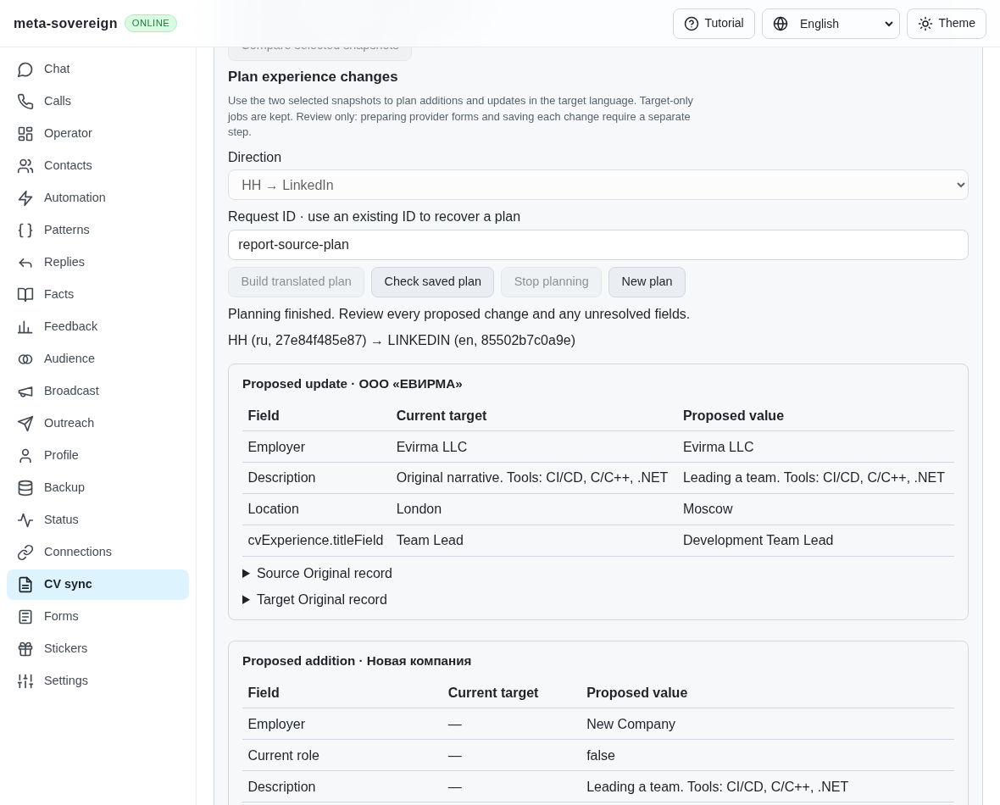
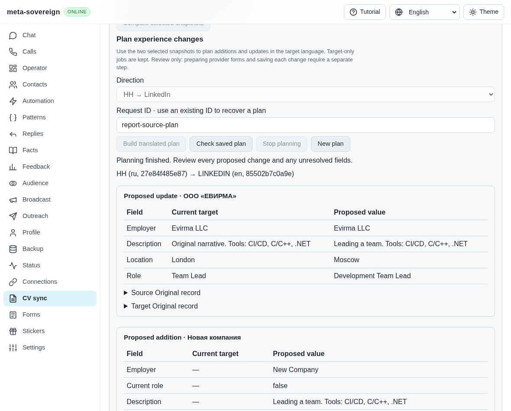
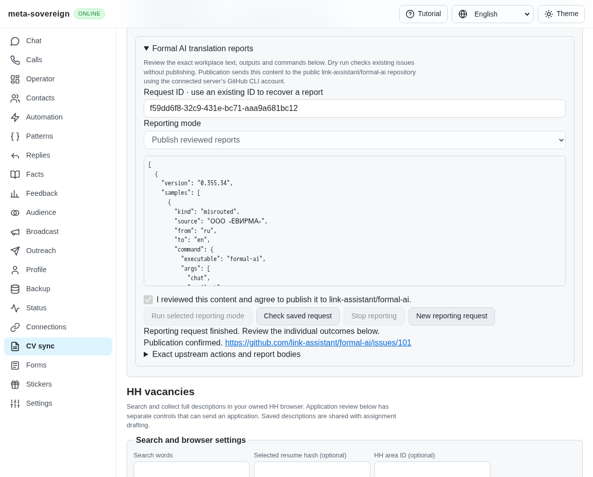
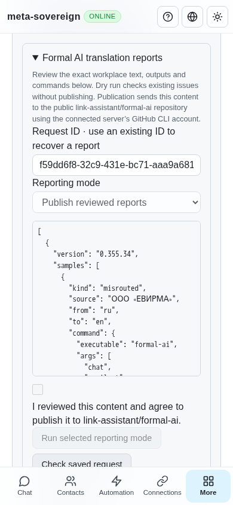

# Reviewed Formal AI workplace reports

This continues HH21/HH22 in [PR #57](https://github.com/link-foundation/meta-sovereign/pull/57).
All 60 unchecked inventory rows remain required. This unit supplies the pinned
experience-sync reference's failure-reporting workflow; native provider editing,
owner-Save readback and authenticated live acceptance remain unfinished.

## Behavior

Previously an acknowledged experience plan retained failed translations but had
no reporting operation. The new private preview selects only failed Formal AI
outputs for actual workplace fields. It includes the exact source, resolved
version, executable arguments and environment, output, expected behavior and
Haiku/Luna answers. Profile About, process failures, CLI usage errors and texts
all three translators deliberately retained unchanged are excluded. Short phrase
gaps stay reportable. The preview digest binds publication to the exact saved
plan and evidence reviewed by the owner.

Reporting defaults to dry run. Disabled reporting performs no GitHub reads or
writes. Publication requires explicit consent and the preview digest. The UI
identifies the public destination and the connected server's GitHub CLI account.
All test publications use a synthetic adapter; no fabricated report is sent to
the actual repository.

Search reads both issue bodies and comments with pagination, first using current
markers, then the existing HH automation markers, then known failure phrases.
Incomplete search refuses publication. Related kinds on one open issue share
one version comment. Existing owned version comments receive new samples in
place, retaining previous evidence and legacy prose. Foreign, ambiguous or
malformed comments refuse an update. A fresh read immediately before write intent
refuses a comment changed or created during planning. Closed matches become
explicit regression references on a new issue.

The fixed-repository adapter uses structured stdin bodies and bounded private
process pipes, without shell evaluation or write retries. It returns actual
acknowledged issue/comment URLs. A private durable intent precedes each write;
lost acknowledgements remain unknown, including after restart or a new request
ID. An acknowledged per-version/kind issue binding avoids duplicate publication
while GitHub search indexing catches up. This local ownership mechanism does not
claim a transaction across unrelated external publishers.

CLI, protected text/binary Lino routes and all four CV interface languages share
one durable Start/status/Stop owner. Preview/status are read-only. Stop and
shutdown drain owned work; status recovery never replays publication. Reload
restores the request identity without reusing consent.

## Reproduction and checks

On parent `83101692`, the public report preview is absent. The experience plan
also renders the raw `cvExperience.titleField` key for Role. The bounded parent
probe substitutes the two published modules, runs the selected regressions and
restores the drafted modules in `finally`; both cases fail before the change.

The three `cv-formal-report*.test.js` files provide 18 focused checks covering
the report exclusions and exact commands, search precedence, legacy comments,
merged kinds, regression lineage, concurrent comment changes, consent, durable
unknown outcomes, Stop/shutdown, storage failure, forged receipts, CLI parsing,
both Lino encodings, trusted mutation admission and all four locales. Five existing planning-surface checks also pass after fixture consolidation. The Role
key regression now resolves the existing localized `cvExperience.role` label.

`formal-report-browser.mjs` verifies actual Chromium behavior on an isolated
fixture, together with the two existing plan/document scenarios sharing fixture setup. Its scenario is also part of the mandatory CV translation browser lane.
Independent Playwright MCP captures verify parent/final states, default dry run,
publication consent, a lost Start response recovered without replay, exactly one
mock publication, reload in four languages, drained Stop and a 390px phone view
with no horizontal overflow. The browser and fixture are closed afterward.

Strict lint, formatting, secret scanning, SPA build and the existing 6.5%
duplication gate are required before publication. Full runtime/browser checks
run on GitHub CI; exact-head hosted acceptance is recorded separately. The
hashed archive preserves source snapshots and finite evidence. These synthetic
checks do not establish live model quality or authenticated provider acceptance.

## Screenshots

These are synthetic private workplace fixtures. The displayed issue 101 URL is
a mock acknowledgement, not an upstream issue filed by this test.

Before: experience plan with the unresolved Role label and no reporting controls.

After: the existing localized Role label resolves.

After: reviewed reporting controls and a synthetic publication acknowledgement.

