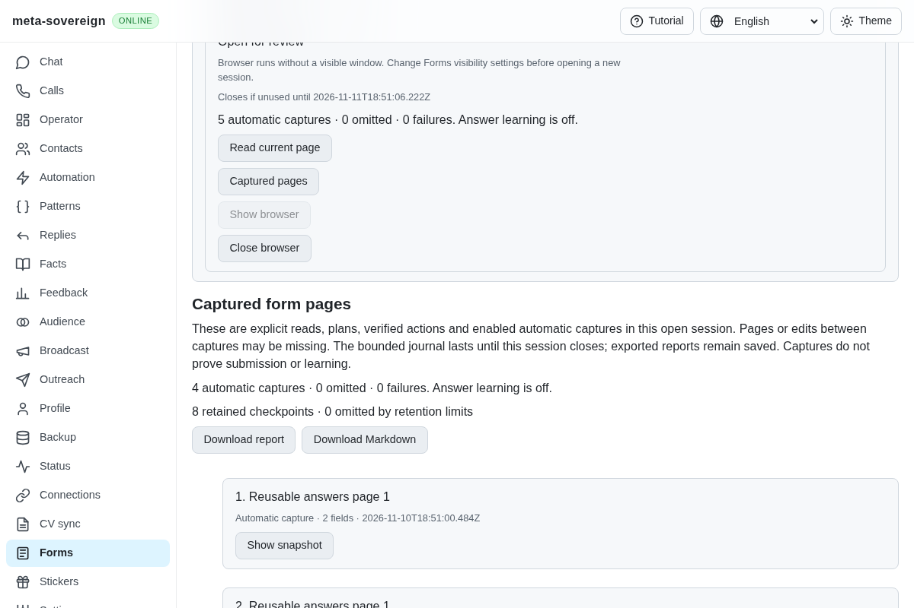
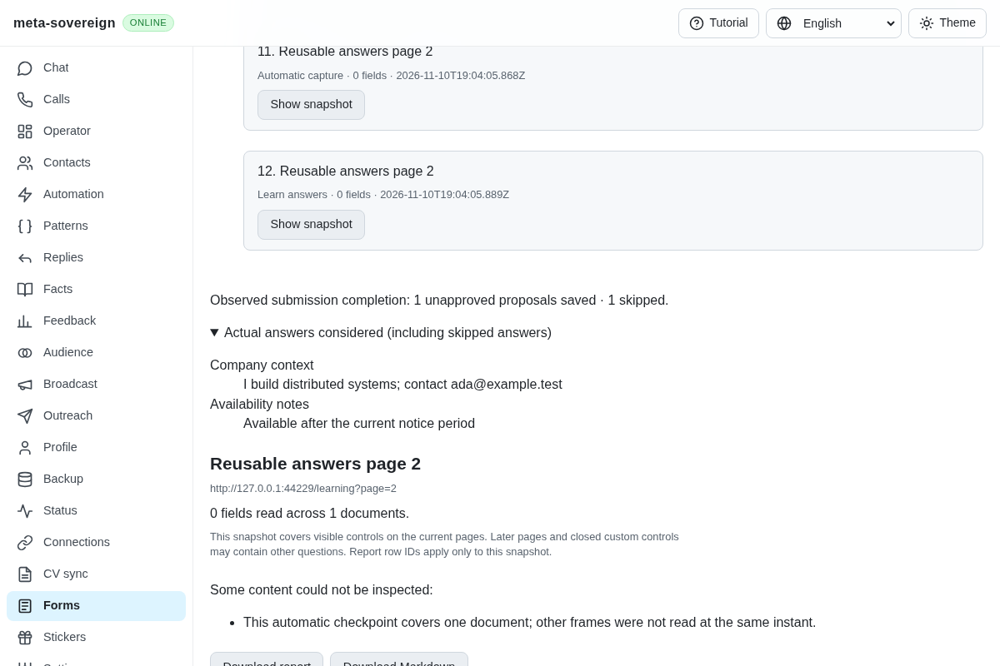
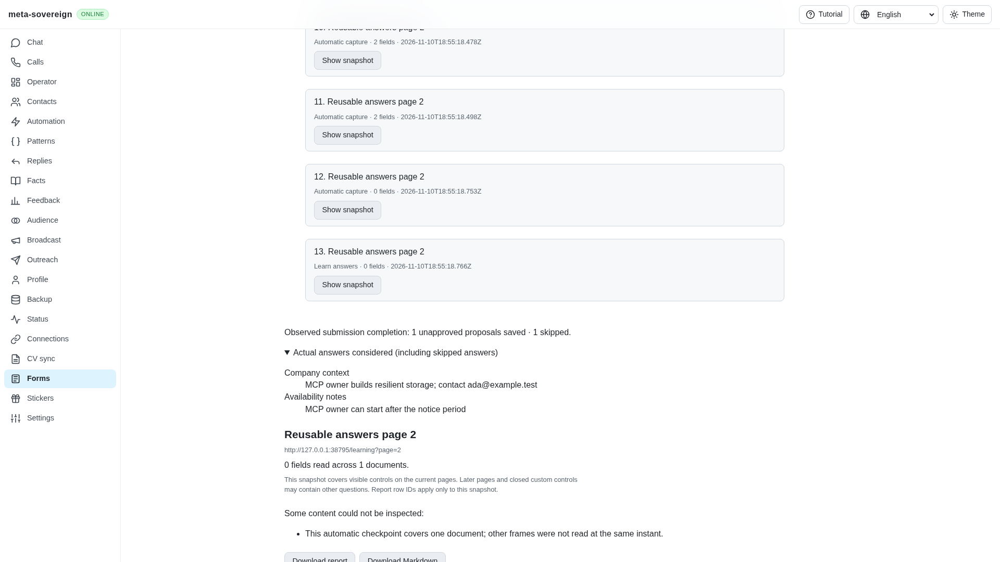
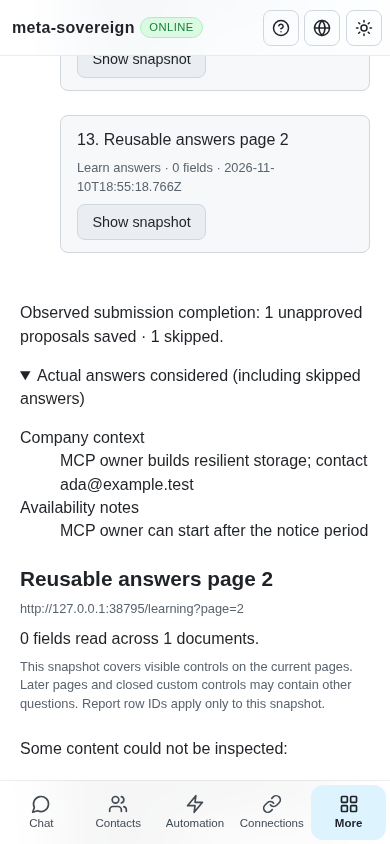

# Learning actual answers in an owned form review

[PR 57](https://github.com/link-foundation/meta-sovereign/pull/57) extends automatic capture with unapproved answer proposals from explicitly planned form pages. Previously, capture preserved answers but never learned them. The production-browser baseline against the preceding UI and disabled learning reproduces the missing proposal after both a stable owner edit and a completed two-page submission.

Learning defaults on when the review has a knowledge store and automatic capture is enabled. Plan a page to establish its actual-value baseline; repeat Read and Plan after opening each later page. The learner retains actual answers from all those planned pages. It saves proposals when an owner change remains unchanged for one minute, or when an observed owner Send attempt is followed by same-frame completion within two minutes. Completion evidence distinguishes a new multilingual confirmation, the Google Forms response URL and a disappearing form. HTTP navigation errors do not establish completion. Neither learning nor capture clicks Send or Next.

CLI `forms-review --no-learn` disables learning before launch. API `learn: false` and the shared four-language checkbox provide the same opt-out; disabling capture also disables learning. The production interval is 60,000 milliseconds. The bounded browser fixture injects an 800-millisecond interval through the service test dependency; fake-clock regression tests verify the full production minute.

Stable learning requires a trusted edit on the particular control, a value different from the planned or confirmed applied baseline, and live readback. It rechecks that readback inside the shared knowledge writer queue immediately before storage. A simultaneous script change in a different field is not an owner edit. A programmatic `requestSubmit()` can produce a trusted native SubmitEvent: the observer also requires a preceding owner click or Enter gesture. Next, synthetic Send clicks and repeated completion observations cannot trigger another submission proposal.

The shared answer policy excludes empty values, clarification placeholders, questions back to the recruiter, assignments, salary questions, rejected or canonically corrected alternatives, unchanged profile contacts and already-known answers. Current profile contacts become placeholders. Protected inputs are not read. All new proposals remain unapproved and preserve observation evidence; learning does not invent provider delivery receipts. Existing approved knowledge keeps its approval policy.

State is bounded to 1,000 answer pairs / 2 MiB, with bounded control and intent metadata and one pending stability operation. Incomplete capture invalidates learning until another explicit plan. Three consecutive storage failures stop automatic retries and expose a failed state. Partial writes retain the number of confirmed proposals. Closing a review cancels timers, awaits issued learning and capture/report work, then closes its owned browser. This unit remains tied to the owned review service lifetime; detached per-slot watchers remain required.

The journal shows tracked, saved, skipped, omitted and failed counts, completion evidence, private report failures and inspectable actual question/answer pairs, including skipped candidates. Its Markdown export retains this evidence separately from proposals and browser action receipts.

## Verification

- Thirty-nine focused Node checks pass across learning, document observation, monitor/session behavior and existing answer correction/merge policy. Eighteen focused Deno checks pass for the new learner, document observer and four-language UI contracts.
- Regression cases cover the full unchanged minute, changed-back and programmatic edits, applied-prefill baselines, all planned pages, expired or mismatched completion, HTTP errors, duplicate observations, incomplete capture, opt-outs, shutdown, current knowledge/profile after a writer wait, an undelivered edit during storage and confirmed partial-write counts.
- Focused production Chromium verifies native event trust, owner Enter/Send/Next behavior, stable learning before any submission, contact contraction, actual second-page learning after Vietnamese confirmation, unapproved rules with count one, password exclusion, inspectable journal evidence and desktop/mobile rendering. The old behavior fails the same learning assertion before the change. The fixture records exactly one owner submission and acknowledged browser closure.
- Independent Playwright MCP verifies a saved stable-edit proposal with zero submissions, then both actual answers after the owner submits page two. Both rules remain unapproved with count one. The journal reports two proposals, one skipped known answer and no omissions or failures. At 390 pixels, content width equals viewport width and no tutorial overlay appears. The owned browser and fixture close cleanly.
- Strict changed-code lint, formatting and the production bundle build pass. All five hosted workflows pass for preceding commit `321058d3`; the new commit requires its own hosted runtime/browser/build matrix.

| Before: capture without answer learning                         | After: actual proposals and considered answers                |
| --------------------------------------------------------------- | ------------------------------------------------------------- |
|  |  |

The [evidence archive](data/forms-answer-learning.tar.gz) and [manifest](data/forms-answer-learning.tar.sha256.json) preserve focused logs, fixture receipts, source/test snapshots and screenshot hashes. The reusable collector is [collect-forms-learning.py](../../../experiments/issue-56/collect-forms-learning.py).

## Remaining required scope

This implements owned-session submission and stable-edit learning for B11/B14/B23/B24 and inventory QA21/QA25. Detached default-on per-slot watchers, configured résumé selection, optional models, assignments and complete provider workflows remain unfinished, along with every other unchecked issue requirement. PR 57 stays draft and unmerged.
