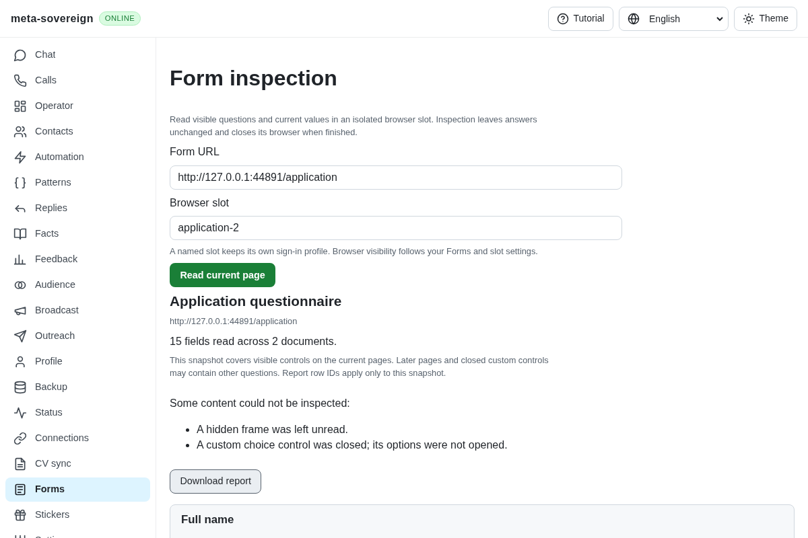
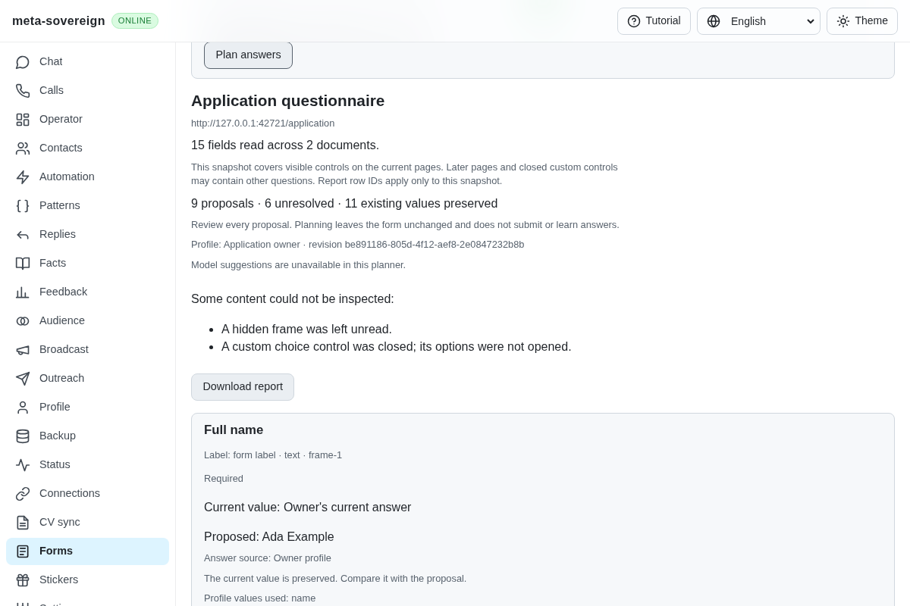
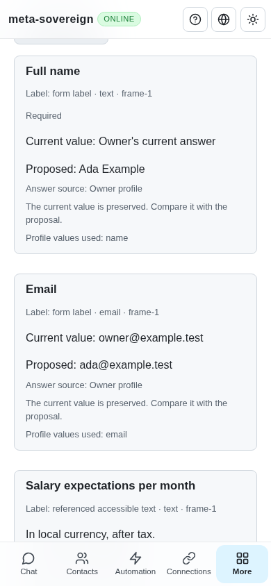

# Shared form answer plans

Implementation and verification for [PR 57](https://github.com/link-foundation/meta-sovereign/pull/57), extending QA21/QA25 with read-only proposals. Reviewed prefilling, persistent sessions, multipage traversal, submission/edit learning and optional model proposals remain required.

## Reproduction and behavior

The preceding application (`946e4f87`) reads external forms but offers no per-field answer plan. `experiments/issue-56/forms-plan-before.py` temporarily serves that production bundle in the isolated fixture, captures the rendered report and fails the missing planning-control assertion. It restores the current bundle in a `finally` block. Two field-label regressions also fail against the old question engine: short form labels were excluded by chat-only question recognition.

The Forms screen now offers a saved-answers-only mode or an explicit named owner profile, approximate matching and an explicit planning action. A plan shows each proposed value or selection beside its current state, its actual source, matching score, saved question, profile keys, evidence and unresolved reason. It exports the actual plan and preserves the report, selected profile and previous proposal on a failed request. Changing planning inputs clears stale proposals. Loading, retry and mobile layout follow the shared controls in all four locales.

The same operation is available through `meta-sovereign forms-plan --file=inspection.json --profile-id=<id>`, the `meta-sovereign/forms` library export and `POST /api/forms/plan`. Text/binary Lino negotiation, the trusted-origin gate and typed refusal handling are shared with inspection. Planning remains available when browser execution is unavailable. The CLI closes its store on success and rejected input.

## Shared engine and evidence

Planning resolves the current named profile once, applies explicit local overrides and reads one bounded answer-knowledge snapshot. It reuses the existing approved/scoped exact and approximate matching, substitution, rejection policy, choice checks and structured salary calculations. Form-label recognition is explicitly enabled for this caller; ordinary chat recognition keeps its existing gate.

Contact labels in English, Russian, Hindi and Chinese resolve explicit profile fields. Missing values stay unresolved, first names are never guessed by splitting a full name, employer contacts are excluded and boolean questions are not replaced with profile links. Profile proposals identify used keys and the saved profile revision. Exact and approximate answers retain actual matched questions, evidence and similarity; profile substitutions do not invent a similarity score. Salary number controls use the structured amount and retain its calculation evidence.

Unique enabled options, separate radio groups, explicit checkbox lists, dates, numbers, email and HTTP(S) URL formats are checked before proposing values. Duplicate labels do not merge separate groups. Multiple selects, mixed checkboxes, protected/disabled/read-only controls, missing labels and incompatible values remain unresolved. Password/file values are neither read nor proposed. Native contenteditable and mixed/multiple states retain their actual type and state.

Every proposal requires review. No planning operation opens a browser, changes a control, submits a form or learns an answer. Existing text and selection states remain evidence beside proposals, including conflicting owner values. Snapshot row identifiers remain unsuitable as durable fill targets. Optional model generation is explicitly unavailable rather than attributed to saved answers.

## Bounds and ownership

Reports are validated before private knowledge is read: at most 200 fields, 10 documents, 100 options per field and bounded strings/serialized input. Stored answer knowledge is capped at 4 MiB, and a shared finite similarity budget leaves exhausted approximate searches unresolved while retaining later exact matches. One plan per service instance is allowed; shutdown refuses new plans and waits for issued work. Requests are not implicitly repeated by connection recovery.

## Verification

- Forty-six focused Node checks cover the shared planner, field-label recognition, reader/report compatibility, context and salary behavior. Seventeen Deno checks cover the planner, field mode and four-locale reports. Strict lint and formatting run only on changed files.
- The production Chromium flow reads 15 fields across a real cross-origin frame and produces nine proposals, six unresolved rows and 11 preserved current values. It verifies actual profile/saved-question provenance, radio choices, current versus proposed values, exported JSON, typed request refusal, explicit retry and stale-plan clearing. Finite DOM probes cover separate same-label groups, mixed checkboxes, multiple selects and contenteditable controls. Both mandatory browser lanes remain in hosted CI.
- Independent Playwright MCP review verifies desktop and 390px layouts, actual proposed values, zero console errors and retained source evidence. Its isolated fixture records zero input/change/click/submit events and zero submissions, then confirms owned browser shutdown. No real account, scheduler or running application data is used.
- A focused lifecycle regression holds one knowledge read, verifies concurrent-plan refusal and confirms shutdown waits until the issued read completes. Finite malformed-report and matching-budget regressions verify refusal without applying partial knowledge.

Before:

After:

Phone:

The [evidence archive](data/forms-answer-plan.tar.gz) and [verified manifest](data/forms-answer-plan.tar.sha256.json) preserve reproductions, focused checks, hosted-run snapshots, MCP observations and exact source hashes. This unit does not establish authenticated Google/Yandex, persistent prefilling or complete provider parity; those criteria remain unfinished in the draft PR.
