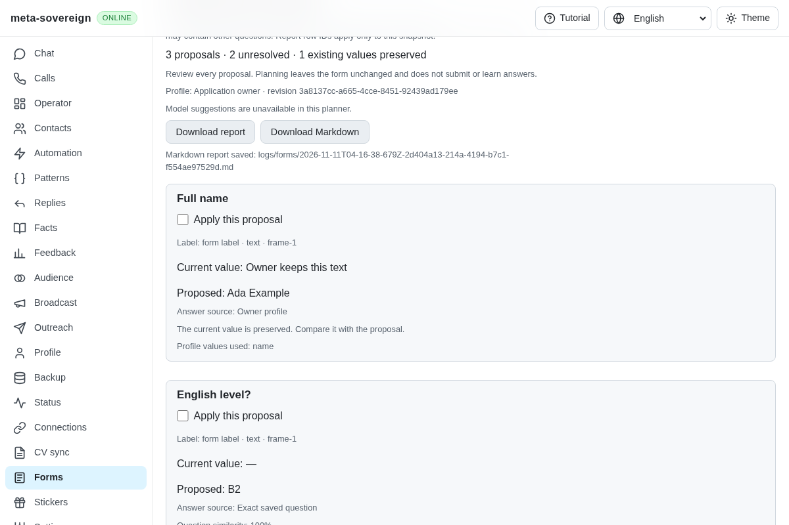
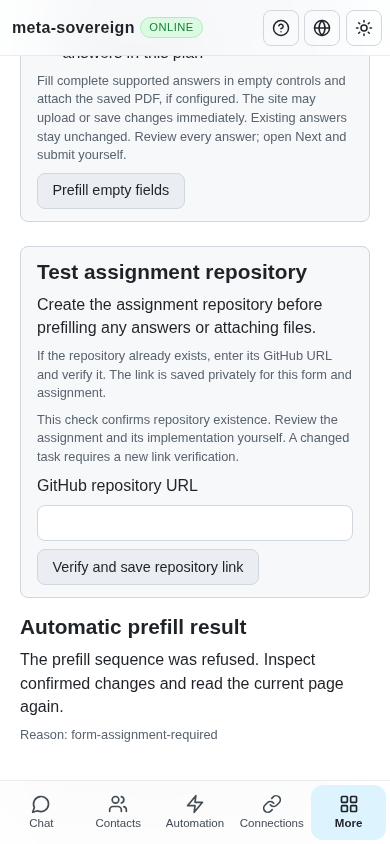
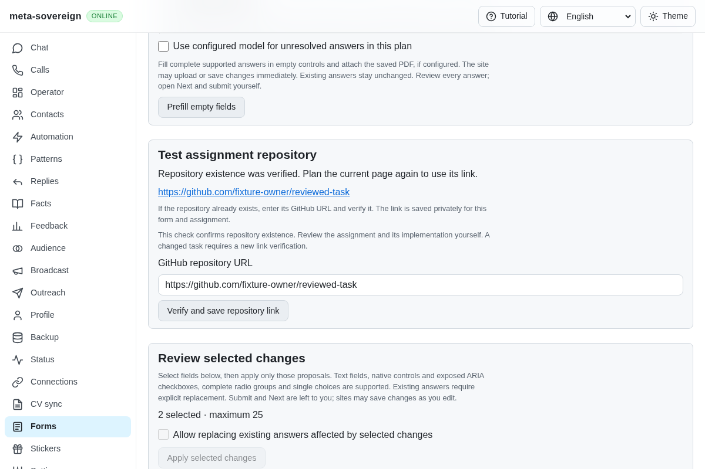

# Assignment repository prerequisite

[PR 57](https://github.com/link-foundation/meta-sovereign/pull/57) now holds a recognized test-assignment form before proposing or applying ordinary answers or attaching a PDF. An explicit GitHub existence check can associate an existing repository with that form and assignment revision. This implements the prerequisite mechanism for B17/B18; automatic repository/issue creation, English restatement, template selection, vacancy association and written deliverables remain required.

Visible task markers and result-link labels are recognized in English, Russian, Hindi and Chinese. Only bounded inspection text is used; linked documents are not fetched. The private version-1 `form-assignment:` namespace stores the canonical form URL, description fingerprint, optimistic revision and verified repository metadata. URL fragments do not create separate assignments. Later pages without the original task retain the hold. A changed recognized description clears the repository and changes the revision. This is a new namespace; existing records and their schemas are unchanged.

The hold precedes deterministic/profile/model proposals and automatic field/PDF actions. Reviewed PDF attachment checks it independently. Frozen review guards read current metadata without overwriting it with an older task description. Reverification invalidates all reviewed fields, including pages with no result-link field. Take-home exercise links are excluded from reusable answer learning.

`forms-assignment-link --file=inspection.json --repository=https://github.com/owner/repository --revision=…` verifies a repository after `forms-plan` has recorded the task and returned its revision. The bounded CLI inspection loader is shared with ordinary planning. The service issues one argument-vector `gh api --method GET repos/owner/repository` read, with a bounded response and deadline. A positive numeric repository ID, matching identity and canonical GitHub URL are required. No repository is created or modified by this check. Missing/malformed receipts, cross-form associations, changed revisions and cancellation cannot confirm the link. Process errors do not expose credential output. Shutdown aborts and drains the owned verifier before store cleanup.

The trusted POST `/api/forms/assignment/repository` uses both existing Lino transports. The browser requires a matching positive association receipt and has no local fake-verification fallback. Shared four-language controls preserve the owner's URL on failure and discard the old UI plan after verification. A new plan proposes the verified URL only for an assignment-result field, with assignment provenance and revision. Existing owner content remains protected. Existence is a point-in-time check, not confirmation that the task is implemented or correct.

## Reproduction and verification

On parent `50ddab328ff15b8185ce993681d1bf5905c4aaa4`, a form with a visible test assignment still offers ordinary saved/profile answers, automatic filling can write fields and attach the configured PDF, and reviewed attachment can upload a selected PDF. [forms-assignment-before.py](../../../experiments/issue-56/forms-assignment-before.py) temporarily loads that pinned parent, reproduces three failures and the production UI problem, and restores every working source in `finally`.

```sh
NODE_OPTIONS=--max-old-space-size=384 node --test --test-concurrency=1 js/tests/forms-assignment.test.js js/tests/forms-review-upload.test.js js/tests/forms-auto-prefill.test.js js/tests/forms-review-prefill.test.js js/tests/i18n.test.js js/tests/ci-contracts.test.js
deno test --v8-flags=--max-old-space-size=384 --allow-all --no-check js/tests/forms-assignment.test.js js/tests/forms-review-upload.test.js js/tests/forms-auto-prefill.test.js js/tests/forms-review-prefill.test.js js/tests/i18n.test.js js/tests/ci-contracts.test.js
RUN_BROWSER_E2E=1 FORMS_GROUP=forms-assignment FORMS_ASSIGNMENT_SCREENSHOTS=1 E2E_EXECUTABLE_PATH=/opt/google/chrome/chrome NODE_OPTIONS=--max-old-space-size=384 node js/tests/e2e-forms-reader-browser.mjs
```

Ninety-five focused checks pass in Node and Deno. They cover whole-form/model exclusion, real configured/selected PDF refusal, positive readback, cross-form isolation, later pages, malformed storage, task changes during verification, frozen revisions, cancellation, CLI lifecycle, origin rejection, both Lino formats, no offline acknowledgement and four-language rendering. Existing upload, automatic/reviewed filling and locale checks remain passing.

Production Chromium verifies zero held proposals and no automatic writes, preserves a failed repository URL, confirms verification, then applies and reads back exactly the selected English-level and task-link fields. The owner name stays unchanged; the unrelated GitHub field stays empty. The owned review closes with no PDF or submission. The scenario has a separate mandatory browser group in both hosted lanes with the existing process deadline, rather than extending the larger Forms group. CI contracts verify its dispatch and mandatory status.

Independent Playwright MCP repeats the real production controls at desktop and 390-pixel phone widths. Its result contains the two actual field receipts. The fixture server independently records the owner name, `B2`, the expected repository, an empty unrelated GitHub field, zero files, zero submissions and a closed browser. GitHub responses are injected synthetic fixtures; no live repository or account is changed.







The [evidence archive](data/forms-assignment-prerequisite.tar.gz) and [hash manifest](data/forms-assignment-prerequisite.tar.sha256.json) preserve source snapshots, the pinned parent, failing-before logs, focused tests, browser/MCP results, server observations and screenshot hashes. Recollect with [collect-forms-assignment.py](../../../experiments/issue-56/collect-forms-assignment.py). Local checks use limited concurrency; hosted CI retains the full runtime/browser matrices.

Complete assignment publishing and deliverables, external document acquisition, authenticated provider/model execution and every unchecked issue-wide criterion remain unfinished. PR 57 stays draft and unmerged.
