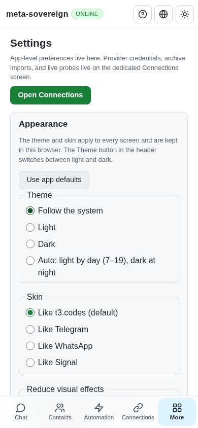
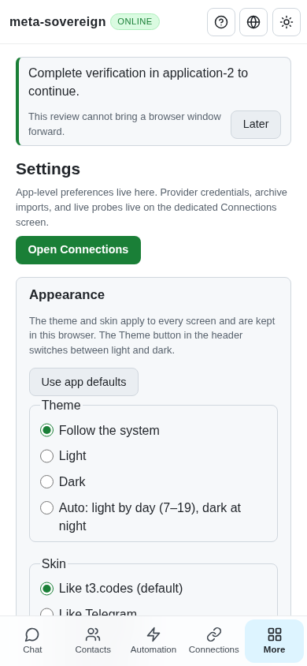
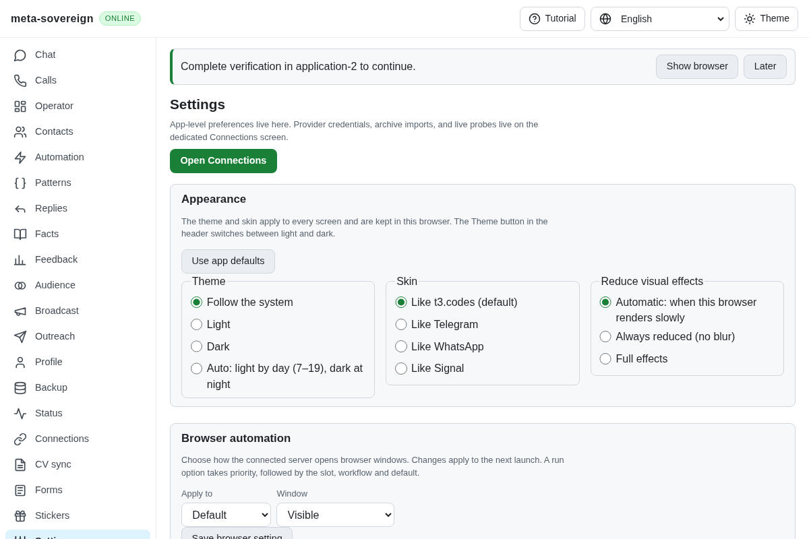
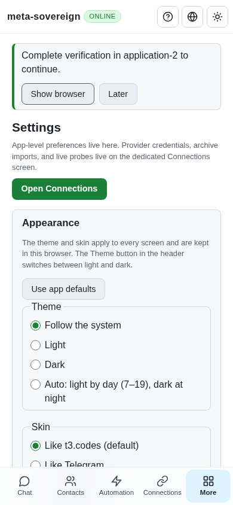

# Keep manual verification accessible across views

The pinned notifier alerts the owner while an active browser waits, brings the exact browser forward, repeats unanswered alerts after five minutes and offers a fifteen-minute deferral. The previous Forms UI showed the verification wait while Forms was open. Navigate to Settings and the notice disappears. The focus route also accepted a stale request ID and brought the newer window forward. [Pinned notifier](https://github.com/konard/hh-job-application-automation/blob/fa0991b8c2d0896fb3b4be6c69947f0590094b15/src/notify.mjs) · [PR #57](https://github.com/link-foundation/meta-sovereign/pull/57).

The server now publishes a read-only wait receipt containing the session, named browser slot, prefill request, expiry and availability of browser focus. Both Lino encodings return the same receipt with `Cache-Control: no-store`. A notice can focus only the active request in that session. Closing, cancellation, expiry and replacement remove the receipt immediately. Existing Forms focus still works for an explicit session selection. [Session implementation](../../../js/src/forms/review-attention.js) · [Focused regression](../../../js/tests/forms-attention.test.js).

The app shell displays the current wait across views. **Later** snoozes only that wait for fifteen minutes in the current page. **Show browser** is available for a confirmed visible-window capability. Successful focus keeps the banner visible and defers sound and system notifications for fifteen minutes. The in-app notice stays available with system notifications disabled or denied. A permitted browser notification shows generic text and its click uses the same guarded action. The shared sound preference controls the chime independently of permission. A headless wait stays visible with an explanation. No challenge content or answer appears in a notification.

## Reproduction and verification

Open the synthetic CAPTCHA form in a review slot. Read the page, select the fixture profile and choose **Prefill empty fields**. After the wait appears, navigate to Settings. The previous production bundle at `d8a7d7e1` shows no notice there. The revised bundle keeps the notice above Settings. In the browser regression, grant notification permission through the fixture, exercise the two focus entry points, advance the clock and complete the owner's synthetic verification. [Browser regression](../../../js/tests/helpers/e2e-form-attention.mjs).

```sh
node --test --test-concurrency=1 js/tests/forms-attention.test.js js/tests/forms-captcha.test.js js/tests/forms-review-sessions.test.js js/tests/i18n.test.js
deno test --no-check -A js/tests/forms-attention.test.js js/tests/forms-captcha.test.js js/tests/forms-review-sessions.test.js js/tests/i18n.test.js
RUN_BROWSER_E2E=1 FORMS_CAPTCHA_ONLY=1 node js/tests/e2e-forms-reader-browser.mjs
```

- Five checks on the previous source reproduce the missing receipt, stale focus and HTTP 405 for both Lino routes. The revised scope passes 57 tests in each runtime. The added tests cover privacy of the receipt, stale IDs, headless focus refusal, expiry, Close and the existing origin check.
- Production Chromium verifies the in-app fallback with denied permission, independent sound, generic notification text, the exact-window click and the five- and fifteen-minute intervals. The fixture changes the advertised capability to exercise the visible-window path in a headless host and records calls to the actual Playwright browser page. Notification permission and sound use browser test doubles. After one synthetic owner completion, the original screen records one verified email write with zero challenge-answer reads and zero submissions.
- Independent Playwright MCP confirms the headless banner at 390 pixels and that **Later** stays in effect after navigating to Operator. The fixture records one input event, one owner completion, zero private challenge reads, zero submissions and a closed review. The console recorded missing optional Telegram routes in Settings, a missing favicon, a waiting-receipt warning at HTTP 200 and an event stream disconnect during server shutdown.







## Reminder timing after browser focus

In the focused Chromium run, leave the first notification unanswered for five minutes, choose **Show browser** and advance five more minutes. The production bundle at `f8df6183` fails because it emits another external reminder at that point. The revised run keeps the Settings banner visible and issues the next alert at fifteen minutes. Clicking the notification follows the same rule. The separate **Later** scenario verifies that navigation preserves its snooze and the notice returns after fifteen minutes. These checks advance a synthetic clock in Chromium and observe the browser Notification API through a test double. [Regression](../../../js/tests/helpers/e2e-form-attention.mjs).

At 390 pixels, an independent Playwright MCP session saw no repeat at five minutes after focus and one repeat at fifteen. The active banner and controls fit the viewport. The fixture recorded one focus, one manual owner completion, zero private challenge reads and zero submissions. The console logged missing optional Telegram routes, a missing favicon, a waiting-receipt warning at HTTP 200, browser cache warnings and an event stream disconnect at shutdown. The page recorded zero uncaught errors. [Fixture](../../../experiments/issue-56/forms-focus-reminder-mcp-server.mjs) · [Timing evidence](data/forms-show-ack.tar.gz) · [Per-file checksums](data/forms-show-ack.tar.sha256.json).



Additional assignment document formats, authenticated provider verification, native OS actions while the app is closed and owner alerts in the other job workflows remain required. QA24 and HH01 remain open. [Evidence archive](data/forms-attention.tar.gz) · [Per-file checksums](data/forms-attention.tar.sha256.json).
