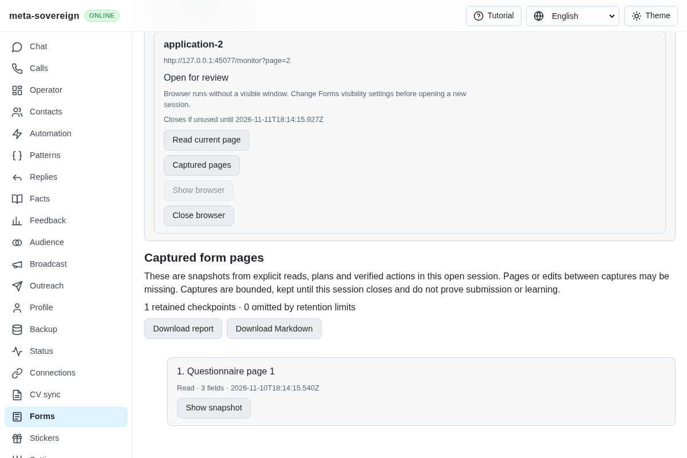
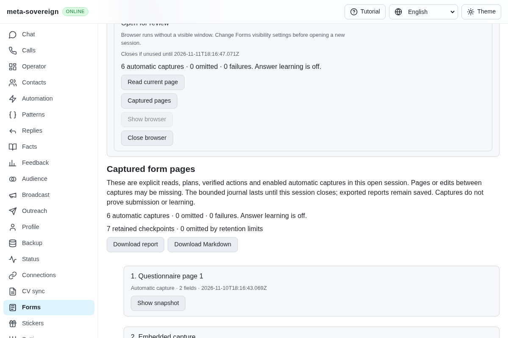
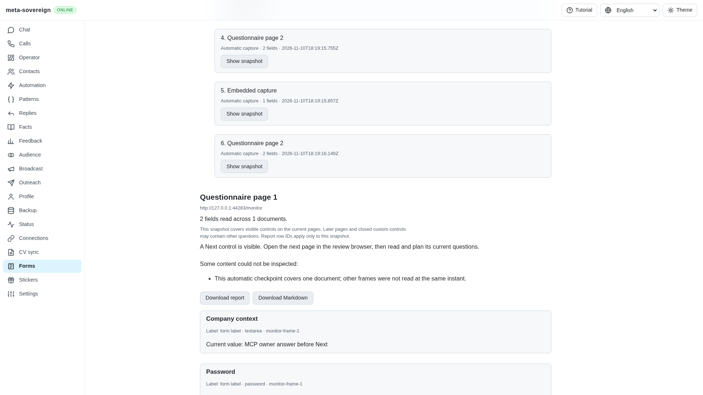
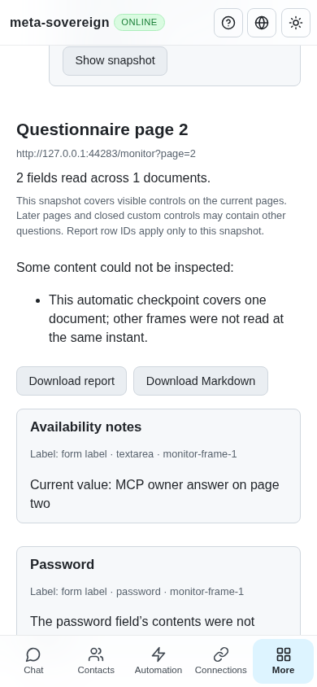

# Automatic capture across owner-opened form pages

[PR 57](https://github.com/link-foundation/meta-sovereign/pull/57) now captures visible form documents automatically inside an owned review browser. Previously, an owner could edit page one and immediately select Next, losing that answer from history unless they explicitly reread it first. Against `2e1d1c9f`, the focused regression lacks an automatic checkpoint and the production browser loses the first-page answer. [forms-monitor-before.py](../../../experiments/issue-56/forms-monitor-before.py) preserves both reproductions and restores the working files afterward.

Capture is enabled by default. CLI `forms-review --capture-pages=false`, API `autoCapture: false` and the shared localized checkbox disable it before opening a session. The same bounded reader observes initial load, debounced edits, relevant DOM changes, clicks before page handlers run and pagehide. An urgent pre-navigation checkpoint is delivered even while an earlier callback awaits acknowledgment. Capturing performs no DOM writes, submits no forms and creates no learned rules. Recognized visible Next controls, including Vietnamese, are reported without being clicked.

Each automatic checkpoint covers one document at its capture time. It explicitly reports that other frames were not sampled simultaneously. Visible child frames are captured separately; hidden frame ancestors and hidden controls are excluded, and password/file contents remain unread. Automatic callbacks cannot create or replace plan authority. Opening their historical snapshots exposes no field selection or apply action. Existing owner-edit and knowledge guards still apply to live plans.

The document coalesces pending ordinary captures; the host accepts at most eight pending callbacks, ten distinct frames and 2 MiB per callback. Existing journal retention remains 32 checkpoints / 4 MiB. Oversized callbacks, excess work and failed capture or private report writes have separate visible counters. Status distinguishes active, disabled, unavailable and stopped capture, and explicitly states that answer learning is off. Closing the owned review waits for accepted captures and report writes before releasing its browser. Journal retention ends on close; downloaded and saved reports remain available.

## Verification

- Twenty-eight focused Node checks cover the monitor and existing session, journal and Markdown behavior. Nine focused Deno checks cover the new monitor and localized document/UI contracts.
- Unit cases verify the fast-Next race, coalescing, finite oversized input, hidden ancestors, callback/frame limits, unchanged live-plan authority, failed installation and report persistence, opt-out validation before launch, shutdown ownership, both Lino encodings and all four UI languages.
- Production Chromium preserves the owner answer immediately before Next and captures the second-page answer without an explicit second-page read. It checks visible cross-origin capture, excluded hidden/password canaries, zero omissions/failures, unchanged stored answer rules, zero submissions and acknowledged browser closure. The existing manual-history flow also passes independently.
- Independent Playwright MCP confirms six automatic checkpoints with no explicit read, both actual owner answers, the first-page Next hint, no historical selection/apply controls, no tutorial overlay and a 390-pixel layout without horizontal overflow. The fixture records unchanged rules, zero submissions and closed owned browsers. Its only console error is a missing favicon.
- Strict focused lint and the production bundle build pass. Duplication remains 6.49% under the unchanged 6.5% gate. The full runtime/browser matrix runs in hosted CI.

The first patched browser probe exposed missing UTF-8 metadata in the new Vietnamese fixture, preventing the test locator from recognizing its label. Adding the fixture's explicit charset resolved that probe; the passing browser flow uses the real non-ASCII label.

| Before: page-one edit missing from history                     | After: automatic page checkpoints                            |
| -------------------------------------------------------------- | ------------------------------------------------------------ |
|  |  |

The [evidence archive](data/forms-automatic-capture.tar.gz) and [manifest](data/forms-automatic-capture.tar.sha256.json) retain reproductions, focused logs, source snapshots and screenshot hashes.

## Hosted download regression

All five workflows for `2e1d1c9f` have completed. Pages, desktop, security and links pass. The Checks workflow fails the existing plan-download filename assertion in Chromium and WebKit: complete preserved log lines 21,671 and 19,177 of [run 42869759767](https://github.com/link-foundation/meta-sovereign/actions/runs/42869759767). Other runtime tests pass. The preceding Markdown-export change unintentionally renamed `form-plan-…` to `form-answer-plan-…`. The shared download helper now preserves the existing prefix. The original browser assertion fails before this correction and passes afterward, without weakening the test. The next exact-head hosted matrix must verify both browser engines.

## Remaining required scope

This extends the [explicit journal foundation](forms-review-journal.md) for B11/B12 and inventory QA21/QA25. Edits between captures or beyond retention limits can still be missing; checkpoints do not prove submission. Default-on detached per-slot watchers, confirmed-submission learning, stable owner-edit learning, configured résumé selection, optional models, assignments and complete provider parity remain required. These and all other unchecked issue criteria stay unfinished. PR 57 remains draft and unmerged.
