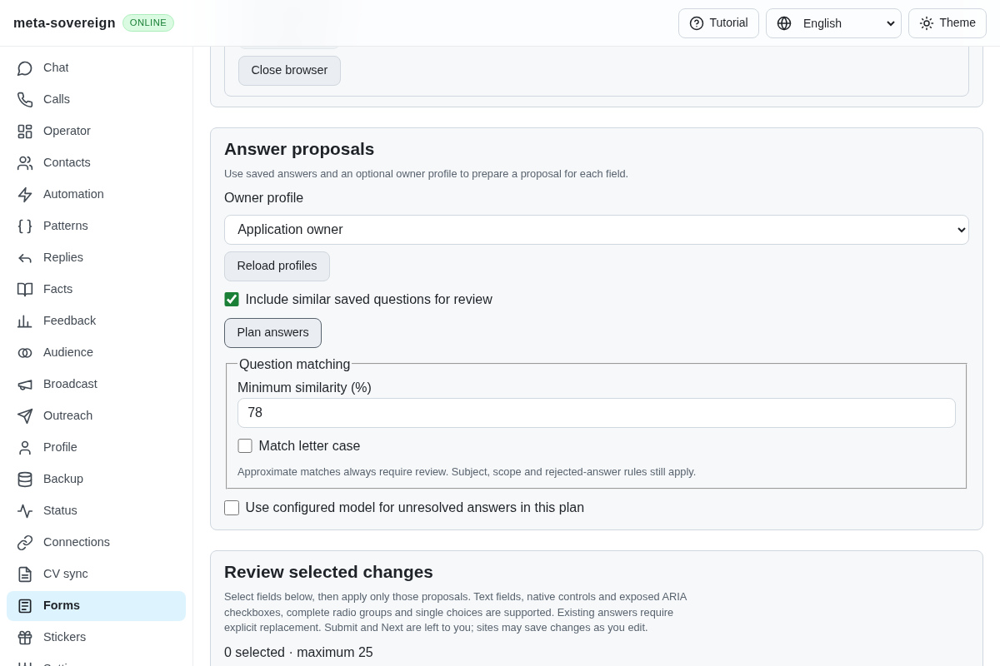
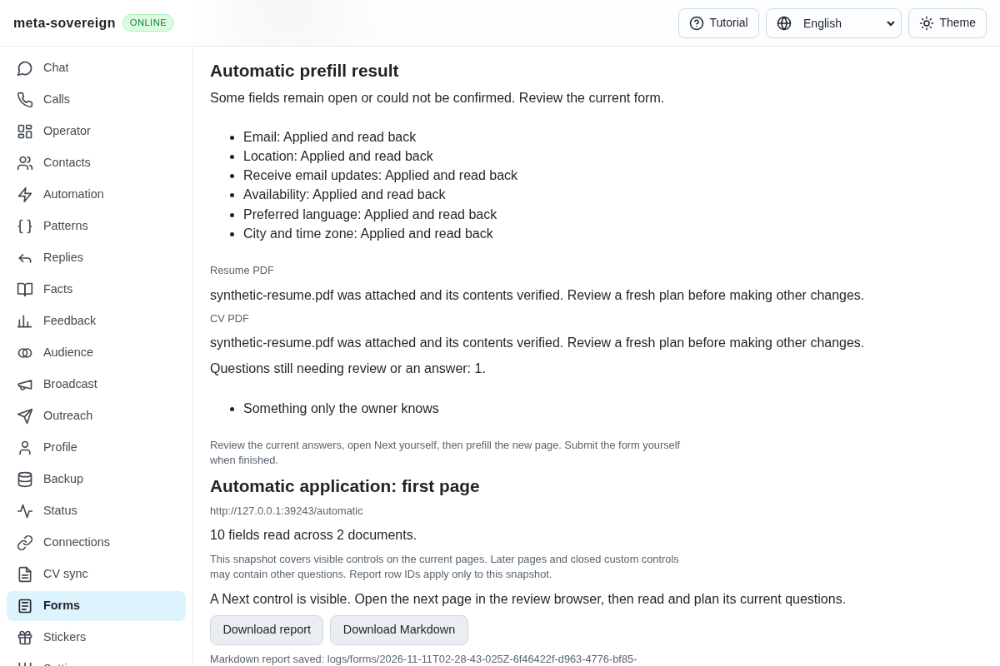
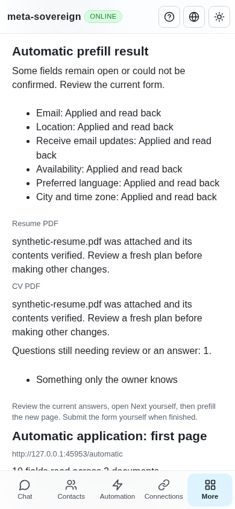

# Automatic prefill controls and recovery

[PR 57](https://github.com/link-foundation/meta-sovereign/pull/57) exposes the [automatic current-page operation](forms-automatic-prefill.md) in the shared Forms UI. This closes the earlier visual-control gap for supported owned review sessions. Full provider workflows and every other unchecked issue requirement remain required.

After opening and reading a review, choose the owner profile, question matching settings and optional model, then click **Prefill empty fields**. The control is shown only when the server advertises automatic prefilling and the report belongs to an owned review session. Invalid matching settings and busy sessions disable a new operation. The explanation discloses that the site may save changes or upload the configured PDF immediately; the owner reviews answers, opens Next and submits manually.

The previous selected-field plan is cleared before the request. A distinct request ID and a deep copy of the original settings remain frozen until the server returns the matching owned-session receipt. A network failure, malformed response, mismatched ID or foreign session retains **Recover prefill result**. Changing the visible profile does not change that pending request. Recovery uses the server's cached outcome and does not issue new field writes. The browser makes no automatic retry. A confirmed terminal outcome permits a later, distinct request.

Results show the actual field receipts, separately labelled PDF receipts and verified metadata, unresolved questions, current-page coverage and manual Next/submission guidance. The existing report retains actual values, original proposal provenance and Markdown downloads. The copy and history action are translated into English, Russian, Hindi and Chinese. Existing shared layout and controls remain in use.

## Reproduction and focused verification

Against preceding commit `08411c499d522ecabc497a8676a29043a46f5e84`, the planner renders no automatic prefill button. [verify-automatic-controls-before.py](../../../experiments/issue-56/verify-automatic-controls-before.py) reproduces this with one failing server-rendered regression and restores the source afterward. The production browser independently captures the missing button before the change.

```sh
NODE_OPTIONS=--max-old-space-size=384 node --test --test-concurrency=1 js/tests/forms-automatic-controls.test.js js/tests/forms-auto-prefill.test.js js/tests/i18n.test.js
deno test --v8-flags=--max-old-space-size=384 --allow-all --no-check js/tests/forms-automatic-controls.test.js js/tests/forms-auto-prefill.test.js js/tests/i18n.test.js
RUN_BROWSER_E2E=1 E2E_EXECUTABLE_PATH=/opt/google/chrome/chrome FORMS_AUTOMATIC_ONLY=1 NODE_OPTIONS=--max-old-space-size=384 node js/tests/e2e-forms-reader-browser.mjs
```

Forty-three focused checks pass in Node and the same forty-three in Deno. Six new checks cover lost-response recovery against the actual reader, five malformed/foreign receipt variants, frozen settings, overlap and session protection, terminal refusal, capability gates and rendering actual receipts/provenance without file bytes.

The production Chromium flow holds an actual completed response and checks that planning controls are disabled. It then withholds the receipt, changes the selected profile and recovers using an identical original request body. The old manual plan is absent, six real field writes and two PDFs are confirmed, owner and unknown answers remain intact, and a manually opened second page is filled by a fresh request. No automatic Next click or submission occurs, and the owned browser closes normally. The same flow runs in the hosted Forms sequence.

Independent Playwright MCP clicks the real production UI control, verifies six field receipts/two attached PDFs and actual current values, captures desktop and phone layouts without horizontal overflow, and closes the owned review. The isolated server separately records the native/cross-origin controls, preserved owner/unknown values and zero submissions. No live provider account or model is used by this fixture.







## Evidence and remaining requirements

The [archive](data/forms-automatic-controls.tar.gz) and [manifest](data/forms-automatic-controls.tar.sha256.json) preserve source snapshots, failing-before and focused logs, actual browser/MCP receipts and screenshot hashes. Recollect with [collect-forms-automatic-controls.py](../../../experiments/issue-56/collect-forms-automatic-controls.py). Changed-code lint, scoped formatting, the production web bundle and the unchanged duplication threshold pass locally; the full runtime/browser/native matrices run in GitHub CI.

CAPTCHA waiting, assignment repositories/issues, automatic contact/path discovery, chat/model automation, complete hh/shared-reader parity, authenticated provider/model execution and every other unchecked criterion remain unfinished. PR 57 remains draft and unmerged. These bounded checks do not complete issue 56.
