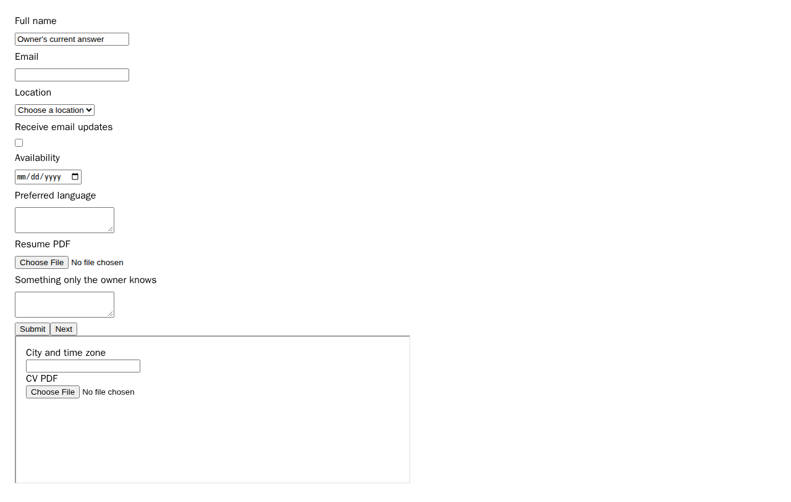
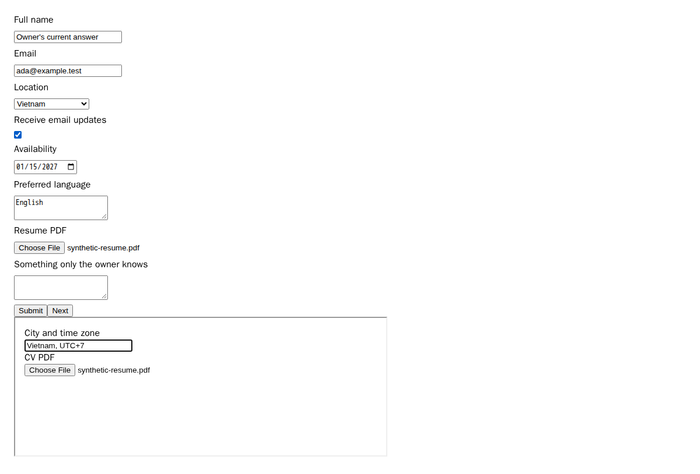
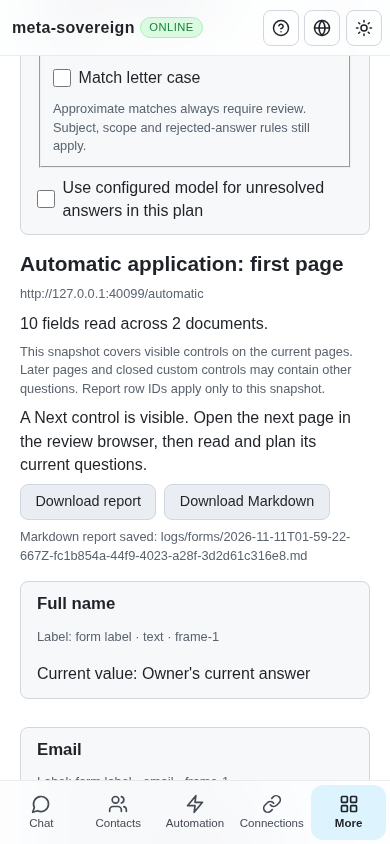

# Automatic current-page form prefilling

[PR 57](https://github.com/link-foundation/meta-sovereign/pull/57) adds explicit automatic prefilling to the existing multi-URL review CLI and owned-session API. This implements the supported current-page mechanism in reference B1/B8/B10/B11; complete provider parity and the remaining issue requirements stay open.

Previously, `forms-review --prefill` silently opened browsers without filling them. Each application required a separate plan and a manual selection of at most 25 fields. The new command prefills each opened form sequentially, retains its browser for owner review, and accepts `prefill <slot>` after the owner opens a later page. Existing manually selected application retains its separate 25-field limit.

```sh
meta-sovereign forms-review --prefill --profile-id=<profile> https://example.test/form-one https://example.test/form-two
```

Choose a PDF with the existing `--resume-pdf` option or save the configured résumé once. Existing question matching, salary and explicit `--model-draft` settings apply. Learning remains default on with the existing `--no-learn` opt-out and detached per-slot lifetime. The CLI validates the whole URL batch before launch and opens/fills browsers sequentially. Capacity remains owner-configurable.

The corresponding trusted POST is `/api/forms/sessions/prefill`, with `id`, a distinct `requestId`, and optional planning settings and selected PDF. It supports negotiated text and binary Lino. The shared web client exposes `formsPrefillReview`; this step does not add a visual prefill button. Existing Read/History controls display actual filled values and saved provenance. Server refusals never fall back to an offline write.

## Write and recovery boundaries

Only complete supported proposals for empty controls are selected. Existing owner values, existing files, incomplete drafts, unknown facts and a radio selection that would clear another answer are preserved. Optional models run once for the initial plan; attachment replanning does not make another model request. Model answers with missing facts stay unresolved. Each actual write retains the existing document, exact-control and current-knowledge guards and verifies readback. An uncertain or refused write stops the sequence before later controls or files.

PDF uploads use the selected bytes or the initially frozen configured revision, verify actual browser metadata and SHA-256, and refuse changes between text writes and attachment replanning. The initial document/control boundary remains authoritative across upload plans. Receipts retain file metadata rather than copies of every page report. One operation owns the session throughout planning, writes and attachments; other operations receive the normal busy refusal.

A repeated request returns its cached outcome without another write. Changing its settings is refused. Once another request replaces the cached receipt, an older ID cannot be replayed on a later page. A session remembers at most 1,000 request IDs and requires a fresh session after that limit. Current-page inspection and existing bounded journal/report limits still apply; `partial` never establishes complete form coverage.

Results retain per-field original proposal provenance alongside actual returned values, confirmed/unchanged/uncertain receipts, file receipts, unresolved questions and next-page guidance. The owner opens Next and reruns prefill. The owner submits the form. Results explicitly record `submissionAttempted: false`; they do not claim a provider delivery.

## Verification

Two focused regressions fail against preceding commit `b1206126`: the automatic reader action is absent, and the CLI emits zero prefill outcomes. [verify-auto-prefill-before.py](../../../experiments/issue-56/verify-auto-prefill-before.py) restores every temporarily replaced file even after a failure. The final checks pass:

```sh
NODE_OPTIONS=--max-old-space-size=384 node --test --test-concurrency=1 js/tests/forms-auto-prefill.test.js js/tests/forms-review-prefill.test.js js/tests/forms-configured-resume.test.js
deno test --v8-flags=--max-old-space-size=384 --allow-all --no-check js/tests/forms-auto-prefill.test.js js/tests/forms-review-prefill.test.js js/tests/forms-configured-resume.test.js
RUN_BROWSER_E2E=1 E2E_EXECUTABLE_PATH=/opt/google/chrome/chrome FORMS_AUTOMATIC_ONLY=1 NODE_OPTIONS=--max-old-space-size=384 node js/tests/e2e-forms-reader-browser.mjs
```

Thirty checks pass in Node and the same thirty in Deno. They exercise 27 text fields beyond the manual selection limit, configured/selected PDF verification, preserved owner answers/files, unknown questions, next-page reporting, changed pages/answers, uncertain writes, request recovery/conflicts/expiry, session ownership, a single model request with unresolved clarification, actual multi-URL CLI dispatch, both Lino formats and trusted-origin enforcement. Saved Markdown includes provenance and the automatic outcome. The browser client preserves refusals without local fallback.

Production Chromium reads back six filled text/choice controls and two verified PDFs across a native form and cross-origin iframe. It preserves the owner's name and an unknown answer, records no automatic Next click or submission, checks desktop/phone overflow, and returns the same receipts without new events on recovery. After the test manually clicks Next, a fresh request fills the second page's language field. The owned browser closes normally. This flow also joins the normal hosted Forms sequence.

Independent Playwright MCP uses the built production web client, confirms six receipts/two PDFs and recovered receipts, then renders the actual values through Read on desktop and phone and closes the owned browser. The fixture's actual control snapshots independently confirm the values and zero submissions. Its log contains two closed reviews because an initial report-text assertion was corrected before the successful run; neither review submitted the form.







## Evidence and remaining requirements

The [verified archive](data/forms-automatic-prefill.tar.gz) and [manifest](data/forms-automatic-prefill.tar.sha256.json) retain source snapshots, failing-before and focused logs, actual browser/MCP receipts, pinned reference requirements and screenshot hashes. Recollect with [collect-forms-automatic-prefill.py](../../../experiments/issue-56/collect-forms-automatic-prefill.py). Changed-code lint, scoped formatting, the production web bundle and the unchanged 6.5% duplication gate pass. All five workflows for preceding SHA `b12061261ee168d3a119e924e024d05e850584ea` pass; this change needs its own exact-head matrix on GitHub.

CAPTCHA waiting, assignment repositories/issues, automatic contact/path discovery, visual prefill controls, complete hh/shared-reader parity, live provider/model validation and every other unchecked criterion remain unfinished. PR 57 stays draft and unmerged. Issue 56 is not complete.
