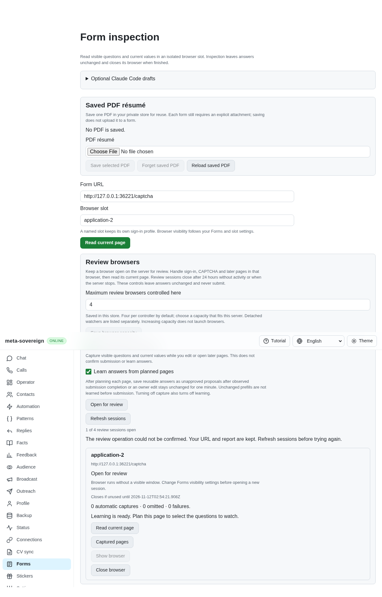
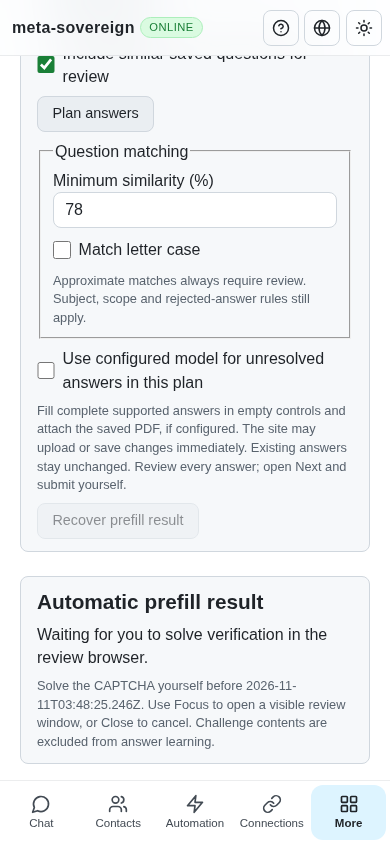
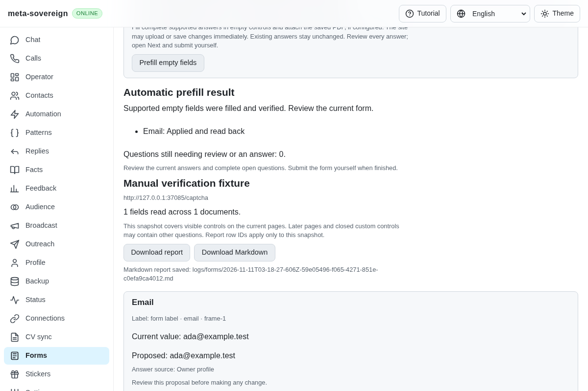

# Manual verification during automatic prefilling

[PR 57](https://github.com/link-foundation/meta-sovereign/pull/57) adds a bounded manual CAPTCHA wait to the shared owned-form operation. The mechanism covers recognized visible challenge documents/widgets and known CAPTCHA frames. Full authenticated provider coverage and all unchecked issue requirements remain required.

A recognized challenge yields metadata and zero answer fields. The document reader does not extract its title, instructions or answer values; known child challenge frames are omitted without reading their DOM. Response tokens are checked only for completion, never returned as answer evidence. CAPTCHA reports refuse deterministic/model planning before answer knowledge is read, and passive capture excludes challenge learning evidence. An empty inspection can no longer be reported as a completed prefill.

An explicit prefill request returns `waiting-owner` promptly while one owned server operation waits for the owner to solve verification in the review browser. Its receipt includes the deadline, up to 30 minutes. Only that bounded wait pauses the ordinary operation deadline; the remaining ordinary budget resumes afterward. A hard deadline cancels and closes a stuck owned browser. Normal polling expiry can return a `form-captcha-timeout` refusal without closing the browser. Neither path fills after expiry.

Only one inspection is pending at a time. Closing or stopping a session cancels its delay and drains the operation. Focus remains available for a visible waiting browser, and Close remains available during the wait. No challenge is solved or clicked by production code. A fresh guarded plan runs only after verification clears on the intended form, including a destination check before automatic writes. A changed destination, unavailable inspection or newly changed page refuses continuation.

`GET /api/forms/sessions/prefill?id=…&requestId=…` reads a snapshot of the original request. It cannot start filling. Text and binary Lino use the same status route. A repeated POST with the original ID/settings recovers that owned request; conflicting settings and another request are refused while it owns the session. The UI polls status reads, retains the frozen original settings after a lost response, clears stale waiting output if status becomes unavailable, and never retries a writing operation automatically. The CLI waits using the same read-only status operation and logs state transitions. English, Russian, Hindi and Chinese explain the manual wait and deadline.

## Reproduction and verification

The preceding committed reader attempts to inspect the private CAPTCHA answer as a normal input, causing the isolated fixture's throwing getter to fail the read. Its automatic operation also returns success for an empty inspection. [verify-forms-captcha-before.py](../../../experiments/issue-56/verify-forms-captcha-before.py) restores the preceding sources temporarily, reproduces both failures and restores the working files in `finally`.

```sh
NODE_OPTIONS=--max-old-space-size=384 node --test --test-concurrency=1 js/tests/forms-captcha.test.js js/tests/forms-auto-prefill.test.js js/tests/forms-automatic-controls.test.js js/tests/forms-document-identity.test.js js/tests/forms-monitor-document.test.js js/tests/i18n.test.js
deno test --v8-flags=--max-old-space-size=384 --allow-all --no-check js/tests/forms-captcha.test.js js/tests/forms-auto-prefill.test.js js/tests/forms-automatic-controls.test.js js/tests/forms-document-identity.test.js js/tests/forms-monitor-document.test.js js/tests/i18n.test.js
RUN_BROWSER_E2E=1 FORMS_CAPTCHA_ONLY=1 E2E_EXECUTABLE_PATH=/opt/google/chrome/chrome NODE_OPTIONS=--max-old-space-size=384 node js/tests/e2e-forms-reader-browser.mjs
```

Sixty-three focused checks pass in Node and Deno. They cover private DOM getters, empty inspection, bounded time, ordinary-deadline suspension, cancellation, one pending inspection, request recovery/conflicts, unknown reads, changed destinations before and after release, model/knowledge exclusion, visible Focus, UI state and both Lino formats. The 30-minute ceiling is exercised with an injected clock, without a real 30-minute local wait.

Production Chromium opens the synthetic gate, loses the actual initial waiting response, recovers an identical original request and verifies usable Close. Before owner completion, the private answer getter has zero reads and the fixture has zero input/change/submission events. The test owner then clears its synthetic gate. One actual email write is read back, the UI reaches `prefilled`, and the owned browser closes with zero submissions. This scenario also runs in the normal hosted Forms sequence.

Independent Playwright MCP clicks the real production UI. A separate fixture-only stdin action simulates the owner clearing the gate; no such control is exposed by the application. The server independently captures one owner completion, zero private-answer reads, the actual `ada@example.test` field, one input event and zero submissions. Desktop and phone screenshots capture the waiting and verified states without horizontal overflow.







## Hosted timeout investigation

The preceding exact-head Checks run [42947012763](https://github.com/link-foundation/meta-sovereign/actions/runs/42947012763), created at 2026-11-11 02:35:04 UTC for `ee447589d14829aacd692cb0a9e7d98f17479723`, failed only WebKit and its dependent pipeline gate. Its preserved full log reports `spawnSync … ETIMEDOUT` at line 25317, after the existing pay scenario passed; line 25324 records 180735 ms. This was the aggregate three-minute process budget, rather than a failed form assertion. Other workflows and runtime/browser checks passed.

The mandatory browser registry now runs reader/control, capture/learning/model and answer/automatic/CAPTCHA groups in separate fixture processes. Every existing scenario remains covered in both lanes; default direct execution still runs all scenarios. The original three-minute per-process limit is unchanged. Scenario start/end logs identify future stalls. The new answers group passes production Chromium, and 17 focused CI contract checks pass in both Node and Deno. A small isolated preceding-runner probe reproduces the missing group environment without launching browsers. Hosted WebKit confirmation remains required for the new commit.

## Evidence and remaining work

The [archive](data/forms-captcha.tar.gz) and [manifest](data/forms-captcha.tar.sha256.json) preserve source snapshots, failing-before and focused logs, production browser/MCP receipts, independent server observations and screenshot hashes. Recollect with [collect-forms-captcha.py](../../../experiments/issue-56/collect-forms-captcha.py). No full local suite or browser matrix is used; hosted CI provides those checks.

This synthetic evidence does not establish every provider's challenge markup, authenticated SmartCaptcha behavior or live model execution. Unknown challenge implementations can require manual intervention; refusal and partial coverage remain visible. Complete provider workflows, assignment repositories/issues, contact/path discovery, chat/model automation and every unchecked acceptance criterion remain unfinished. PR 57 stays draft and unmerged.
