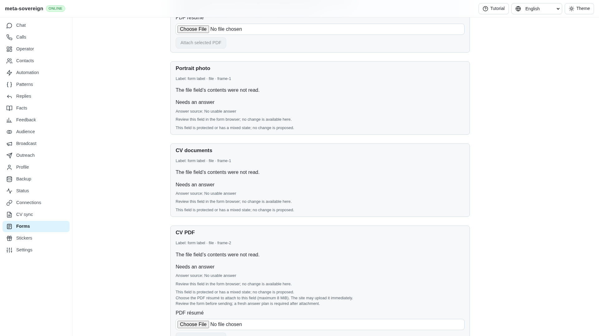
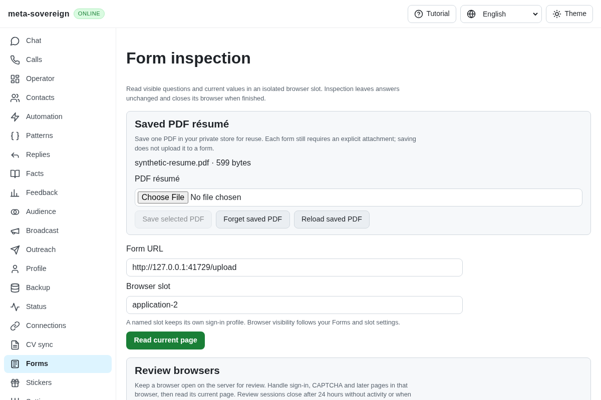
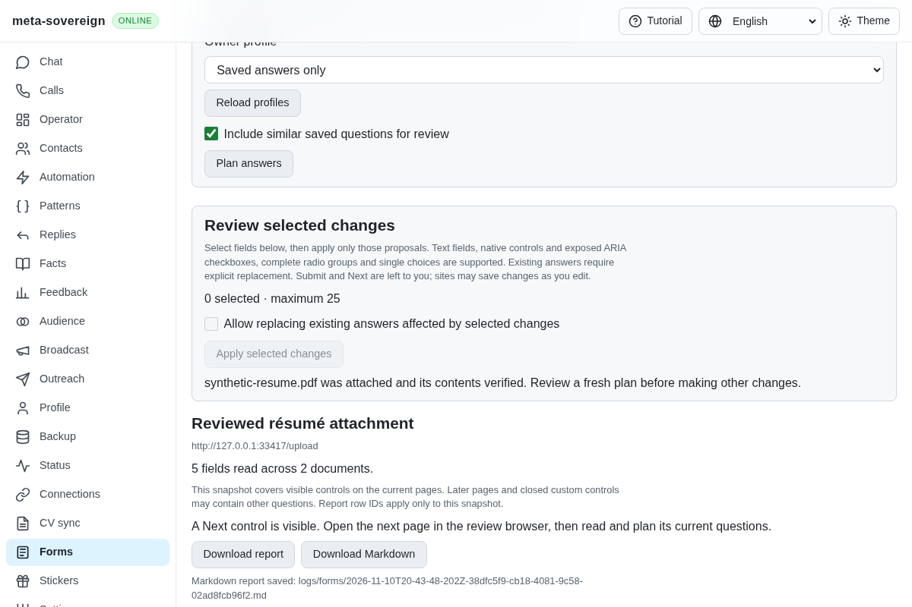
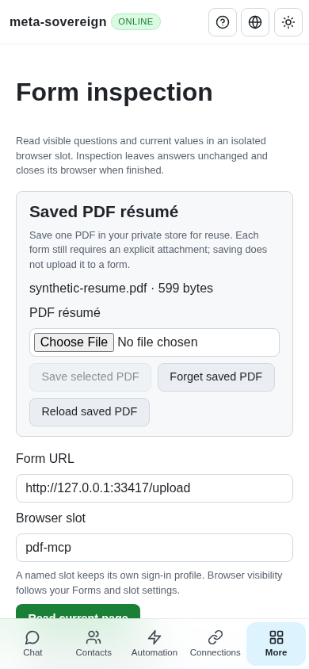
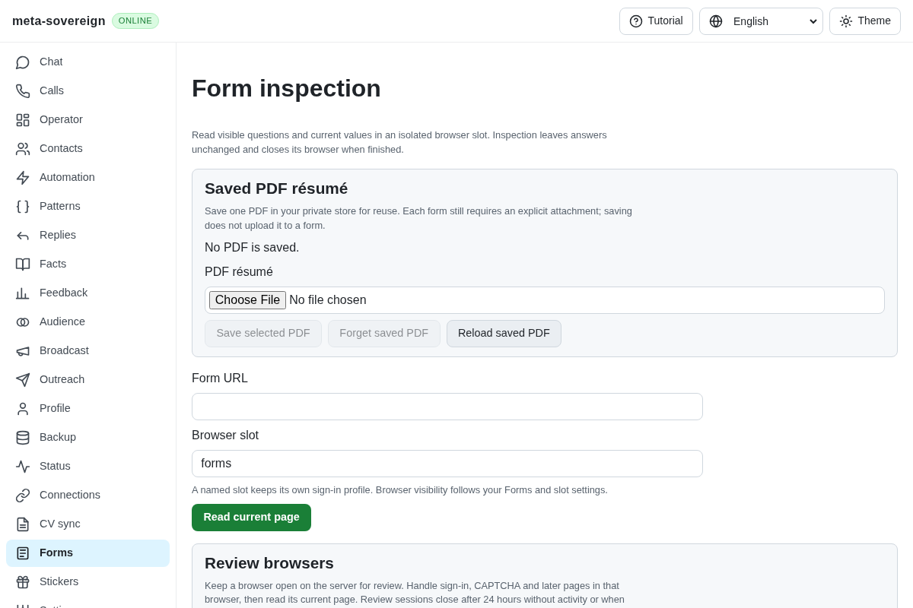
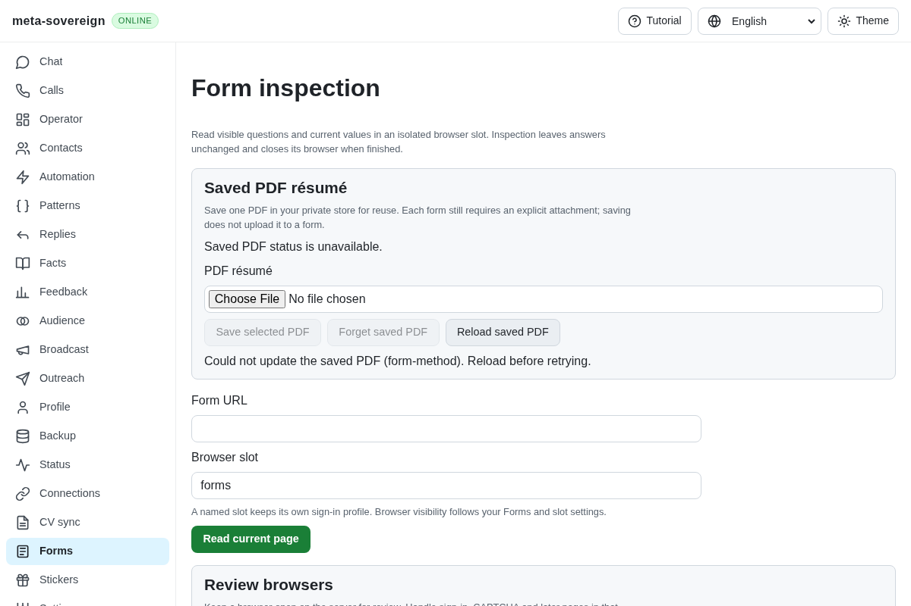

# Reuse a reviewed saved PDF résumé

[PR 57](https://github.com/link-foundation/meta-sovereign/pull/57) adds a single owner-selected PDF to the private store. Previously each reviewed attachment required choosing a local file again. Saving `data/resume/resume.pdf` once now supplies a reusable selection to subsequent plans through CLI, text/binary Lino and the shared Forms UI. Saving alone never uploads it.

The additive record holds bounded PDF bytes, SHA-256 metadata and a revision. Status and plans return metadata only. Save and Forget require the current revision; a changed selection requires a reload. Attachment binds the exact selection reviewed in the plan, verifies the stored bytes again and holds the existing owner-writer queue through the browser operation. A concurrent replacement waits. A changed selection, changed page/control or missing replacement permission refuses before upload. Issued outcomes retain actual digest readback and the existing uncertain/consumed-plan behavior. Cached recovery returns the original receipt even after the saved selection is forgotten, without another upload.

The browser regression exposed a second root cause: the generic status reader collapsed an HTTP refusal into `null`, then selected an empty offline store. This falsely displayed “No PDF is saved.” The dedicated reader now preserves the refusal; the panel displays unavailable status, disables mutation and offers Reload. Offline configuration still uses the browser's store when no server origin exists. Remote refusals never trigger a local save/delete fallback.

## Reproduction and controls

Save a selected file once with `meta-sovereign forms-resume --action=save --file=data/resume/resume.pdf --store=<directory>`. Use `--action=status` to inspect metadata. Replacing or deleting the selection requires `--revision=<current-revision>`; deletion uses `--action=delete`. `forms-review --url=<url> --store=<directory>` can then `plan form-1` and `attach form-1 <plan-id> <field-id>` without `--resume-pdf`. Existing files still require the separate `replace` consent. The explicit `--resume-pdf` path remains supported.

In Forms, choose and save one PDF, open/read the intended review browser and plan its current page. A supported single résumé field offers “Attach saved PDF” with its name and size. Review a new plan after any attachment. Forget affects future selection; it does not remove a file already attached to a website.

The regression `forms-configured-resume.test.js` seeds the saved record and executes actual CLI plan/attach commands. Before the implementation it observed zero uploads instead of one; afterward it confirms the attachment. `forms-resume-read-before.mjs` rebuilds only the original missing status-reader argument to reproduce the false-empty panel against an isolated server refusal. The automated browser read-refusal assertion also fails before the correction and passes afterward.

## Verification

Forty-six focused Node tests and the same 46 Deno checks pass with a 384 MiB heap. They cover durable dual-store reopen, portable/Node hash agreement, optimistic save/delete, serialized selection/replacement, stale plans, tampered bytes, separate replacement consent, cached recovery after deletion, bounded CLI files, trusted HTTP mutations, both Lino transports, offline persistence, explicit remote refusal and mismatched acknowledgements. Changed-code lint/format and the production web build pass.

The production Chromium regression saves once, reloads the UI, refuses a status read, recovers explicitly, attaches matching bytes to native and cross-origin fields, preserves owner text and an unrelated file control, forgets the selection, confirms a future plan offers no saved PDF, retains the website's actual attachment and closes the owned browser with zero submissions. It is registered in the mandatory shared form-reader CI lane; local execution selects only this flow with `FORMS_CONFIGURED_RESUME_ONLY=1`.

Independent Playwright MCP confirms the native attachment receipt and byte digest, 390px layout, the same failing/fixed status read and explicit recovery. Screenshots use synthetic data and isolated fixtures; all fixture servers and browsers are closed afterward.

The [evidence archive](data/forms-configured-resume.tar.gz) and [manifest](data/forms-configured-resume.tar.sha256.json) retain focused logs, public receipts, relevant sources/tests and screenshot hashes. No private PDF, account or browser profile is included.

## Remaining required scope

This implements the configured-PDF selection and reviewed reuse mechanism from B8. It does not automatically discover `data/resume/resume.pdf`, automatically fill every field, submit a form or establish complete authenticated Google/Yandex/provider parity. Unlimited configurable slots, optional model context, assignment handling and all other unchecked issue criteria remain required. The requirement ledgers remain partial; PR 57 stays draft and unmerged. The preceding `38b69101` commit passes all five hosted workflows; this new unit requires its own exact-commit matrix.
