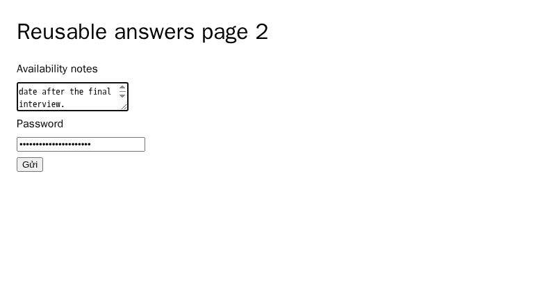
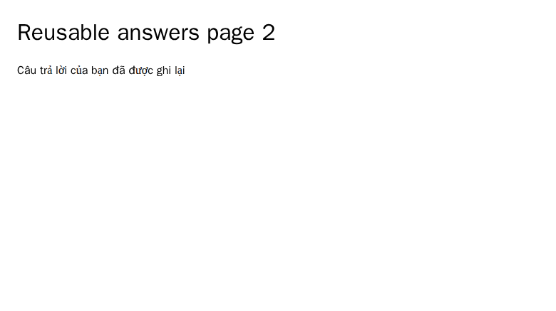

# Detached form-answer watchers

[PR 57](https://github.com/link-foundation/meta-sovereign/pull/57) extends the existing planned-page learner beyond the initiating CLI process. Previously, quitting `forms-review` closed its browser and stopped capture. A durable-store review now starts one separate CDP watcher for its isolated browser slot by default. Quitting or reaching EOF disconnects the CLI while the browser and watcher remain available. `--no-learn` retains the previous owned-session lifetime.

The watcher attaches to the exact Browser Commander profile and target. Reopening the same slot reuses the watcher and current page without navigating over the owner's answers. Each page still needs an explicit Plan before learning. The existing policy saves unapproved actual-answer proposals after observed owner submission completion or an unchanged one-minute edit; it never clicks Next or Send.

The worker opens a short-lived knowledge writer only when no writer is active. Otherwise, its bounded authenticated local Lino channel uses the active writer's existing queue. Live-answer and current-policy guards run before storage, including after queue waits. A temporarily unavailable writer produces a retryable busy state, without claiming saved proposals or overwriting another writer's data.

Status polling does not extend the 24-hour activity deadline. Trusted browser interaction and explicit owner commands do. The worker owns that deadline and the page observer; attaching another CLI adds neither a competing idle timer nor another page observer. Explicit Close, watcher Stop, browser closure and idle expiry stop capture, drain accepted learning/report work and close the owned browser. Cleanup failures remain visible. The SDK's browser watchdog also bounds lifetime if the watcher process crashes.

Private replaced files retain at most 32 checkpoints / 512 KiB, rather than an append-only log. Explicit read, plan, apply, disclosure and attachment receipts join observed pages and learned answers. History remains readable after Stop and identifies saved checkpoints separately from a live watcher. Control messages are bounded to 4 MiB, metadata reads to 16 KiB and concurrent control connections to four. Authentication tokens stay in private files and are absent from process arguments and public status.

## Reproduction and controls

Open a synthetic or owner-selected form with `meta-sovereign forms-review --url=<url> --store=<directory>`. Run `plan form-1`, edit a planned answer in the browser, then `quit`. After one unchanged minute, inspect the unapproved proposal with `meta-sovereign forms-watchers --action=history --browser-slot=form-1 --store=<directory>`. The same command supports `list`, `status` and explicit `stop`. Reopening `forms-review` for that slot keeps its current page.

The reusable [example](../../../examples/forms-detached-review.mjs) starts an isolated HTTP fixture, actual CLI subprocesses, persistent Chromium and a detached worker. It verifies two planned pages, initiating-process exit, the full production minute with zero submissions, exact-worker reuse without losing page-two answers, storage through a reattached CLI writer, one owner Send, two unapproved proposals with count one, retained history and acknowledged Stop. It closes all fixture processes and browsers. CI runs it from the mandatory Chromium form-reader lane; the shared form reader continues in both Chromium and WebKit.

Sixty-two focused Node checks and 45 Deno checks cover isolated profile/target reuse, detach versus Close, passive idle expiry, bounded persisted journals, saved-history access, private control status, current-policy writer coordination, transient writer contention, pause/drain behavior, final replies received before disconnect and existing learning/capture/browser-policy behavior. The [startup CI investigation](ci-forms-bridge-startup.md) retains failing-before reproduction and the correction to immediate Close/deadline ownership. Full runtime/browser/build matrices remain hosted checks.

These screenshots show the synthetic owner's second page before Send and its confirmation after Send; they are evidence of the new workflow, not a comparison of changed visual styling.

The [evidence archive](data/forms-detached-watchers.tar.gz) and [manifest](data/forms-detached-watchers.tar.sha256.json) retain focused logs, public browser receipts, source/test snapshots and screenshot hashes. Private browser profiles, authentication metadata and knowledge stores are excluded.

## Remaining required scope

This implements the detached CDP lifetime and full-minute learning portion of B2/B14/B23. It does not complete the whole external-form inventory: unlimited configurable slots, configured résumé selection, optional model context, assignment handling, complete provider workflows and every other unchecked issue criterion remain required. PR 57 stays draft and unmerged.
