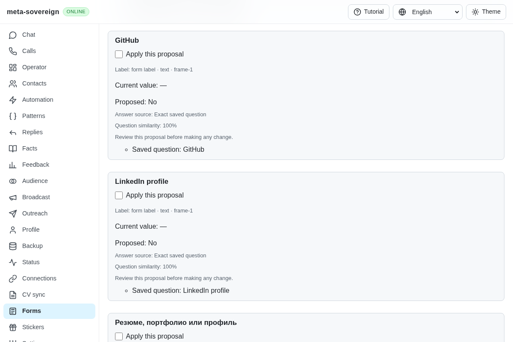
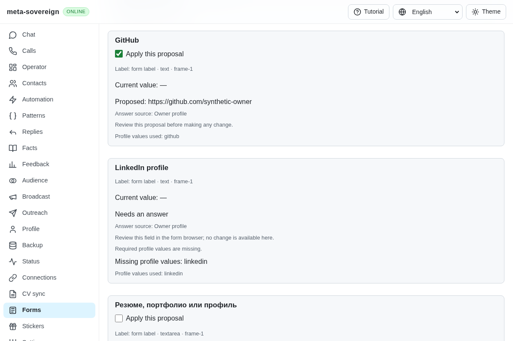
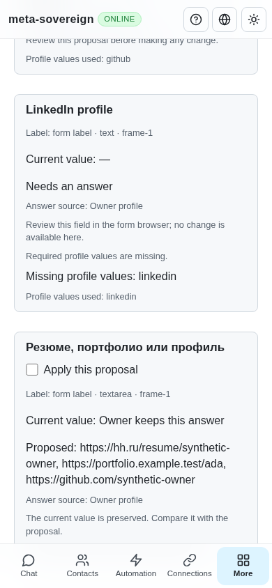

# Requested links in form answers

[PR 57](https://github.com/link-foundation/meta-sovereign/pull/57) implements reference requirement B5 in the shared form planner. A résumé request uses the configured résumé link, GitHub requests use GitHub links, and LinkedIn requests stay unresolved when that contact is missing. A combined résumé/portfolio/profile request offers every available configured link.

To reproduce the original defect, save an approved answer `No` for `GitHub`, read a form containing a text field with that label, select saved answers without an owner profile, and plan answers. Preceding commit `eea31cdbfa698bced1248a5df17b7045099d401d` offers the literal `No` as selectable field text. A selected profile with no links similarly lets a combined request fall back to `Yes`. Four of the initial seven focused tests fail, and the production Chromium scenario fails its no-boolean-proposal assertion after taking the before screenshot.

The root cause was profile-dependent contact classification followed by ordinary text acceptance. Combined labels also discarded every missing contact key and unintentionally restored saved-answer fallback. Link intent now exists independently of the current profile, and the common proposal validator requires HTTP(S) links matching the requested provider. It rejects credentials, misleading host suffixes, another provider, and boolean wording for link text. LinkedIn regional subdomains, multiple GitHub links, ordinary saved contact values, boolean controls and questions about experience retain their meaning. Explicit link labels work in English, Russian, Hindi and Chinese. Missing combined contacts retain missing-profile evidence rather than falling back to a boolean.

Saved answers and optional model results use this same validation. An invalid model link remains unresolved with the existing field-format reason. Plans continue to require review and preserve owner content; no form is submitted. No profile or saved-answer record is rewritten. This verifies configured links; automatic CV extraction, automatic filling and complete provider workflows remain separate required criteria.

Forty-five focused checks pass in Node and Deno, covering specific/combined/missing links, saved and model output, exact host boundaries, ordinary contacts and boolean questions, existing planning/CLI/both Lino encodings, frozen model context and reviewed field application:

```sh
NODE_OPTIONS=--max-old-space-size=384 node --test --test-concurrency=1 \
  js/tests/forms-link-answers.test.js js/tests/forms-answer-plan.test.js \
  js/tests/answer-model-drafts.test.js js/tests/forms-review-prefill.test.js
deno test --v8-flags=--max-old-space-size=384 --allow-all --no-check \
  js/tests/forms-link-answers.test.js js/tests/forms-answer-plan.test.js \
  js/tests/answer-model-drafts.test.js js/tests/forms-review-prefill.test.js
RUN_BROWSER_E2E=1 FORMS_LINKS_ONLY=1 FORMS_LINKS_SCREENSHOTS=1 \
  E2E_EXECUTABLE_PATH=/opt/google/chrome/chrome \
  NODE_OPTIONS=--max-old-space-size=384 node js/tests/e2e-forms-reader-browser.mjs
```

Production Chromium and independent Playwright MCP verify the actual résumé/GitHub field values, two applied readback receipts, missing LinkedIn left blank, all three links in the combined proposal, unchanged owner content, acknowledged browser closure and zero submissions. Both desktop and 390-pixel phone views fit their viewport. The new scenario is included in the normal hosted browser registry, not only the local focused selector. Strict changed-code lint, scoped formatting and the production web bundle pass. Complete runtime/engine matrices remain on hosted CI; the preceding document-identity commit's complete matrix was still pending when this evidence was collected.







The [verified archive](data/forms-link-answers.tar.gz) and [manifest](data/forms-link-answers.tar.sha256.json) preserve failing-before/passing-after logs, source, the independent MCP receipt and screenshot hashes. Every other unchecked issue criterion remains required. PR 57 stays draft and unmerged.
