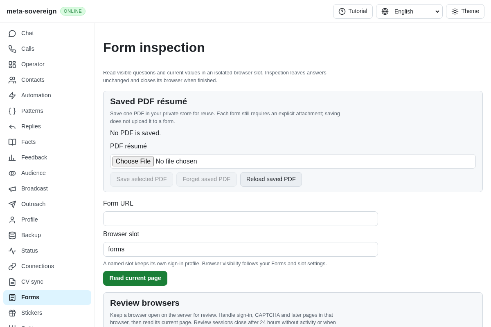
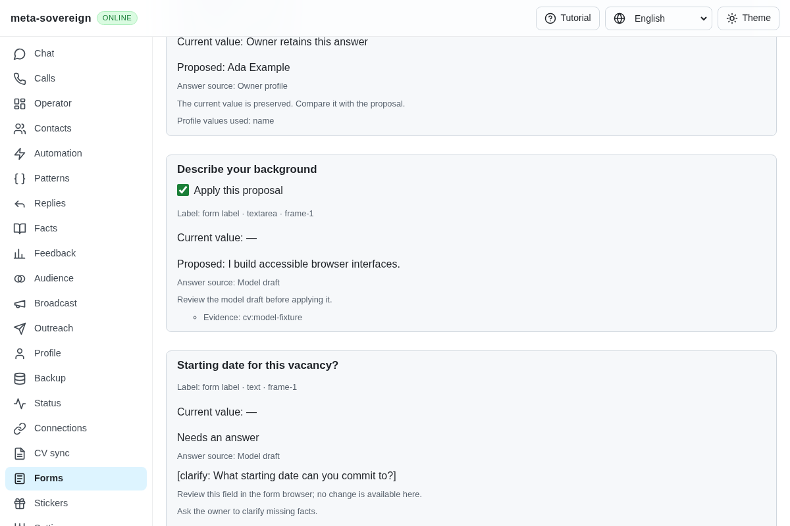
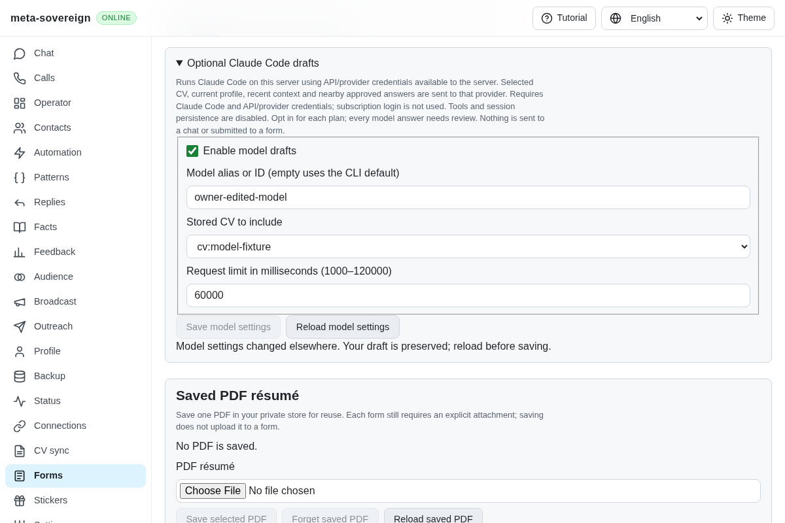
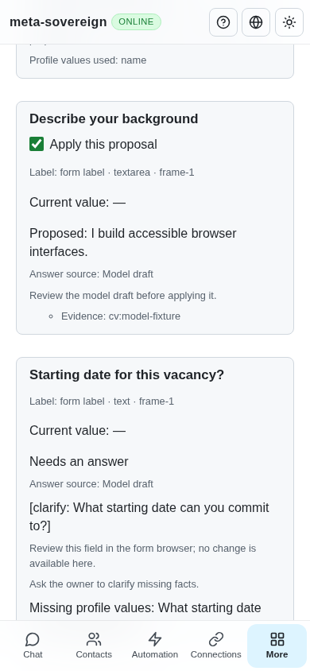
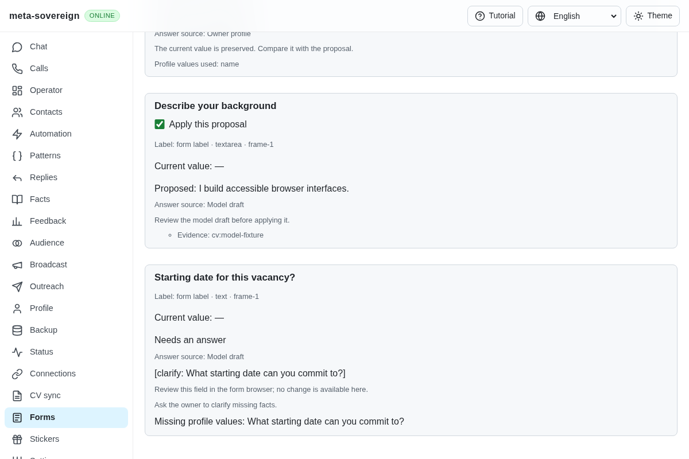
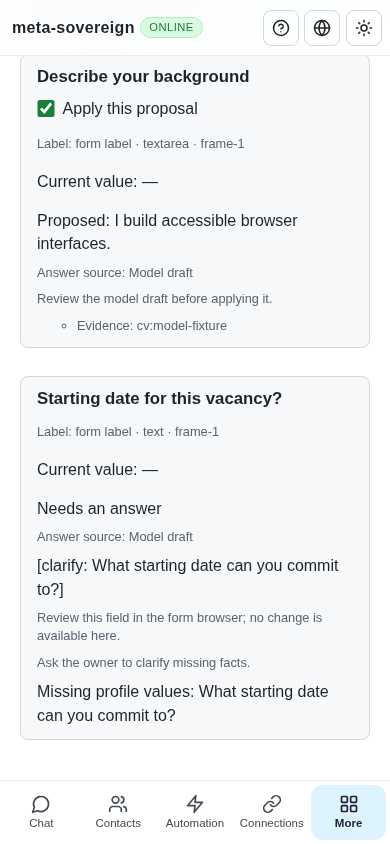

# Optional model drafts with reviewed form application

Issue: <https://github.com/link-foundation/meta-sovereign/issues/56>. Draft implementation: <https://github.com/link-foundation/meta-sovereign/pull/57>.

Unresolved question previews and form plans can now explicitly request Claude Code drafts. Stored exact/profile/approved answers remain first. An owner selects a stored CV and enables the adapter, then opts in for each plan. Proposed model text shows its source and evidence. Missing personal facts become visible clarification questions and cannot be selected for form writes. Applying a selected proposal revalidates the frozen context and reads back the actual control without making another model request or submitting the form.

This completes a shared drafting mechanism within B7, QA18 and R-AA6. The later [chat model unit](chat-model-drafts.md) supplies reviewed automatic chat drafting. Full Google/Yandex and authenticated provider workflows, automatic filling of every form, assignments and other unchecked criteria remain required. PR 57 stays draft and unmerged.

## Reproduction and root cause

At preceding commit `60eb49c5b60b7626b6c1c45c949ac260774ca86a`, a stored CV containing a background summary cannot supply an unresolved form answer: the planner has no model adapter and reports model use unavailable. `experiments/issue-56/forms-model-baseline.py` temporarily restores that commit's planner and production bundle, runs the bounded regression, captures the missing-settings view, and restores both files in `finally`. The planner regression fails because the expected one model call is zero; the browser regression fails because model configuration is absent.

The new implementation adds one shared configuration/context/draft contract, rather than separate form and question generators. A browser check also exposed a missing projection from the automation API to the page API; the production bridge now includes configuration reads and saves. The API name list is extracted to keep the DOM module within the repository size limit.

## Configuration and actual data flow

The adapter is disabled by default. Settings are one owner-store record with optimistic revisions: enabled, Claude Code model alias/ID, optional exact stored CV ID and a 1000–120000 ms limit. Explicit save acknowledgements must contain a fresh revision and the requested values. A refused or uncertain save preserves the owner's draft and requires Reload. The shared Questions and Forms controls have English, Russian, Chinese and Hindi text; no offline browser-store fallback pretends that server configuration succeeded.

Claude Code runs on the server. Selected CV content, the resolved profile, bounded recent/vacancy context and up to five nearby approved saved rules go to its provider. This is not an offline model. Bare mode skips discovered project/user customizations; an empty built-in tool list, denied MCP tools, disabled browser integration and disabled session persistence further constrain the request. Credentials never appear in the prompt, process arguments, public errors or evidence fixtures.

Bare mode does **not** use subscription login. The server needs API/provider credentials and an installed Claude Code supporting these flags. Model aliases are validated; an empty alias uses the CLI default. See the primary [CLI reference](https://code.claude.com/docs/en/cli-reference) and [bare-mode authentication documentation](https://code.claude.com/docs/en/headless#start-faster-with-bare-mode). No live provider/account request was made here. Tests exercise finite synthetic child processes and the complete application path with an injected synthetic provider.

Example CLI sequence (retain the returned revision for subsequent saves):

```sh
meta-sovereign answers model show --store=./store
meta-sovereign answers model save --enabled=true --cv=cv:owner --revision=null --store=./store
meta-sovereign answers plan --question="Describe your background" --model-draft --store=./store
meta-sovereign forms-plan --file=inspection.json --model-draft --store=./store
meta-sovereign forms-review https://example.com/form --model-draft --store=./store
```

`GET`/trusted `POST /api/automations/answers/model` expose the same revisioned settings. Question preview and form planning/review accept the strict boolean `modelDraft`. Server mutation paths retain trusted-origin checks. Model-generating POSTs do not automatically replay after transport uncertainty.

## Bounds, refusal and review

One adapter child runs at a time, without a shell. The private prompt travels over stdin; maximum prompt size is 128 KiB, accepted knowledge is 96 KiB, stdout is 128 KiB and discarded stderr is 64 KiB. Abort, timeout and server/CLI stop terminate and drain the actual owned process, escalating if it ignores termination. Opt-in diagnostic events contain exit code and byte counts, never context text. Local test children use a 64 MiB JavaScript heap and finite inputs.

Each form request includes at most 25 unresolved groups; the UI reports requests and omitted groups. Nearby references use a shared finite matching budget and at most three approved rendered answers per rule. Invalid schema/IDs, unknown evidence, rejected answers, ambiguous choices, unsupported formats or missing facts never become confirmed field writes. A syntactically valid model claim is still a draft: citations are checked against supplied identifiers, not independently fact-verified.

The issued model draft binds settings, selected CV content, profile/context, answer rules/policy and deterministic field proposals. Changed knowledge, changed browser documents/controls or changed owner values require a fresh review. Applying uses the frozen proposal and existing replacement/selection guards; it never calls the model again. Unknown facts remain explicit clarification markers. Automatic chat delivery and form submission are outside this unit.

## Verification

Seventy-one focused Node tests and the same 71 Deno tests pass. Coverage includes configuration/CAS and both Lino encodings, shared preview and CLI planning, strict structured results, approved-context selection, failed/oversized process output, Unicode stdin/output, real child termination, reader stop, changed CV/DOM refusal, bounded batches, actual selected field readback and no second model call. The production Chromium regression covers persisted settings, invalid/stale saves with retained input, explicit recovery, displayed evidence/clarification, phone width, actual receipt recovery and closed browsers with zero submissions. Independent Playwright MCP confirms the selected text was written, the owner's full name remained, the unknown date stayed empty, one model call occurred and the browser closed without submitting.

Focused commands (no full local suite or browser matrix):

```sh
NODE_OPTIONS=--max-old-space-size=384 node --test --test-concurrency=1 js/tests/answer-model-drafts.test.js js/tests/answer-model-process.test.js js/tests/answer-model-api.test.js js/tests/forms-model-review.test.js js/tests/forms-answer-plan.test.js js/tests/forms-review-prefill.test.js js/tests/i18n.test.js
deno test --v8-flags=--max-old-space-size=384 --allow-all --no-check js/tests/answer-model-drafts.test.js js/tests/answer-model-process.test.js js/tests/answer-model-api.test.js js/tests/forms-model-review.test.js js/tests/forms-answer-plan.test.js js/tests/forms-review-prefill.test.js js/tests/i18n.test.js
RUN_BROWSER_E2E=1 FORMS_MODEL_ONLY=1 E2E_EXECUTABLE_PATH=/opt/google/chrome/chrome NODE_OPTIONS=--max-old-space-size=384 node js/tests/e2e-forms-reader-browser.mjs
```

Strict lint, targeted formatting and the production web bundle pass. The shared browser scenario is included in hosted browser coverage. Full runtime/browser matrices remain on CI. On the preceding capacity commit, four auxiliary workflows pass and the main workflow is still running as evidence was collected. The older tutorial run `42901172076` completed cancelled: job log `tutorial-parent-webkit-130136636068.log` line 2247 records external operation cancellation; its required tutorial controls passed earlier. Full run log `tutorial-parent-42901172076.log` lines 105879 and 105921 show the cancelled browser result caused the final gate to fail. This is not evidence of a test assertion failure or a reason to increase timeouts. New-head hosted results remain required.

The verified [evidence archive](data/forms-model-drafts.tar.gz) and [per-file hashes](data/forms-model-drafts.tar.sha256.json) retain focused logs, finite baseline, synthetic fixtures, changed source, official contract notes, public MCP receipt and CI metadata. No owner credentials or private CVs are included.

## Visual evidence

Before: model settings and drafts are absent.



After: reviewed CV-derived text and an unknown fact that requires clarification.




Stale saves retain owner input and require an explicit reload.





Independent MCP desktop and phone views:




