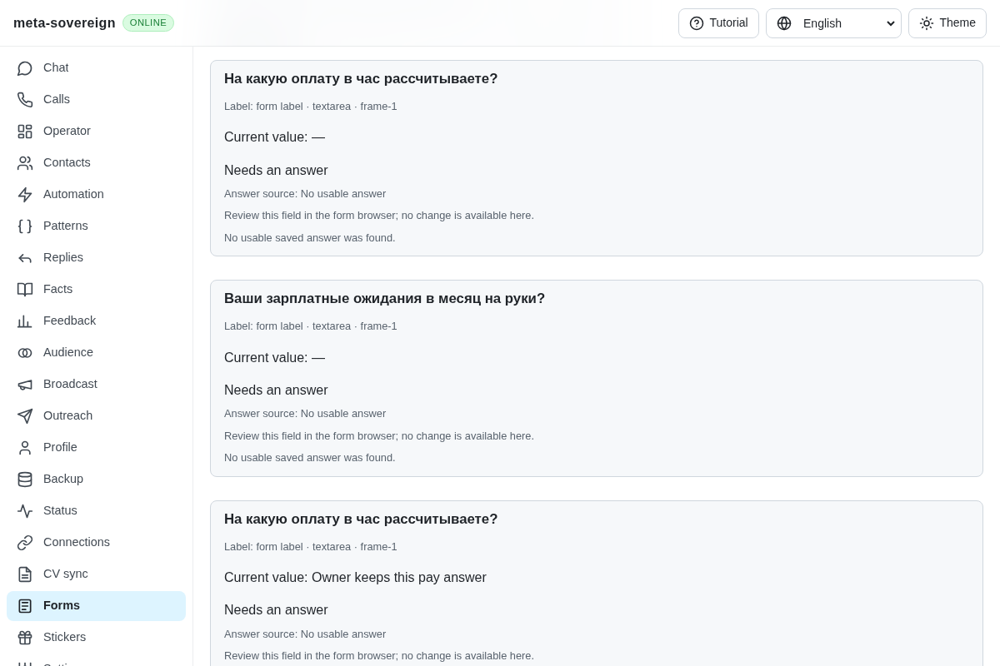
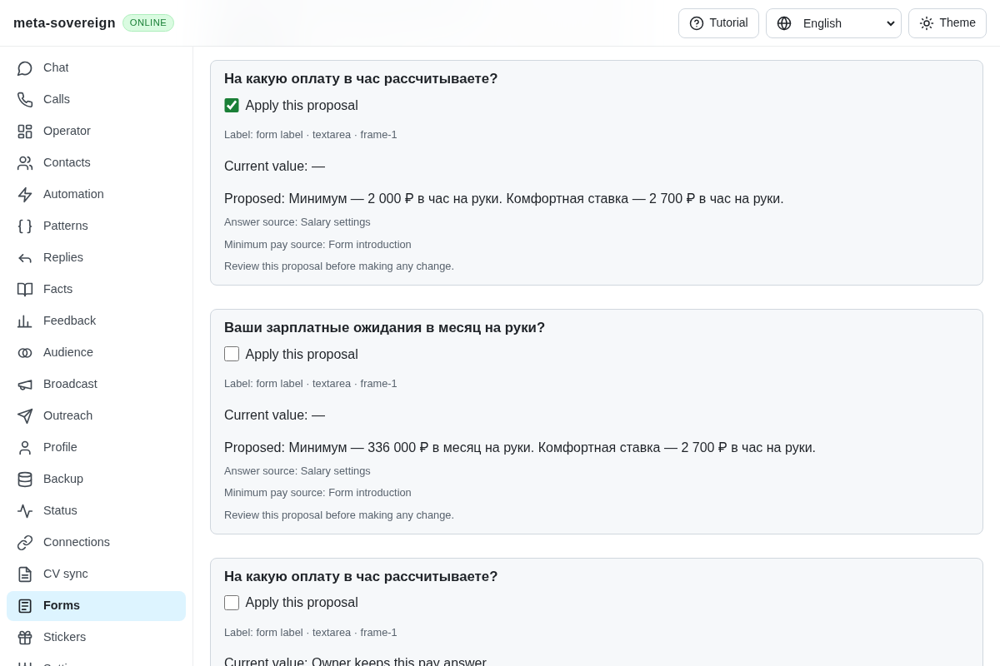
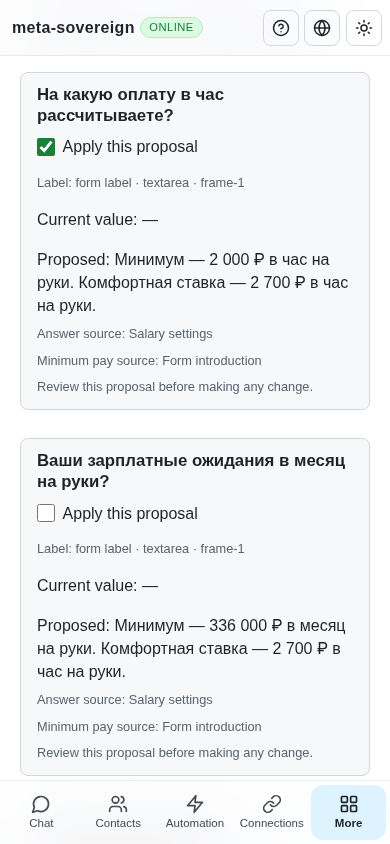

# Vacancy and form pay guidance

[PR 57](https://github.com/link-foundation/meta-sovereign/pull/57) adds reviewed minimum-pay proposals for reference B26/B27. Previously, a form profile with salary and comfortable-rate values produced no answer to “На какую оплату в час рассчитываете?”, and the form's stated lesson pay was absent from planning context. The shared salary engine also ignored a lower vacancy offer.

The behavior was studied in [the pinned reference requirements](https://github.com/konard/hh-job-application-automation/blob/fa0991b8c2d0896fb3b4be6c69947f0590094b15/docs/requirements/forms-and-chats.md) and its vacancy-context module. No reference code was copied or executed.

Opt-in `salary.vacancyGuidance` uses the top of one explicit vacancy range, or the stated “from” amount, when it is below the owner's target in the same currency and net/gross basis. Monthly/hourly conversion uses configured monthly hours, defaulting to 168 for this mode. Existing salary configurations retain their current hours. Explicit `hourlyNet`/`hourlyGross` values supply a separate comfortable rate; otherwise the owner's configured hourly calculation supplies it. Higher, missing, ambiguous or incompatible offers retain the owner target. Unknown/unconfigured currencies remain unresolved. These vacancy-specific proposals always require review, even when the original target was approved.

A visible pay statement before the first question takes priority over supplied vacancy pay. A lesson amount requires one explicit duration; `3000р. на руки` for `1,5 часа` produces:

> Минимум — 2 000 ₽ в час на руки. Комфортная ставка — 2 700 ₽ в час на руки.

The requested monthly equivalent is 336,000 ₽ with 168 configured hours. The answer contains two short sentences without a calculation dump. An ambiguous introduction cannot silently fall through to a cheaper vacancy offer. Missing tax-basis evidence is not treated as proof of net/gross equivalence.

Each frame retains its own bounded introduction, excluding hidden text, control values and text after the first question. Inspection limits remain visible; the reader scans at most 1,000 text nodes and 6,000 characters. Changing introduction text changes the reviewed document snapshot. Only the corresponding frame supplies a field's introduction. Pay answers are excluded from reusable learning; delivery/поставки experience remains learnable.

## Configure and reproduce

In a selected named form profile, set `salary` to an explicit monthly amount with currency and net/gross basis, for example `450 000 ₽ net per month`, and `rate` to `2 700 ₽ net per hour`. Optional `salary_monthly_hours` changes the 168-hour default. This bounded profile shorthand recognizes RUB, USD, EUR and GBP. Explicit salary configuration supports the existing configured currency catalog, including custom keywords; it takes priority over profile derivation.

The shared salary editor exposes vacancy guidance and comfortable net/gross hourly values in all four UI languages. CLI `forms-plan` and `forms-review` accept `--salary=<Lino>` and `--vacancy=<Lino>`. The read-only plan and owned-review Lino endpoints accept the same optional objects. `vacancy.pay` contains the explicit offer and optional `vacancy.evidence` identifies its source. The Forms UI automatically uses the selected profile and the inspected frame introduction, and displays the minimum-pay source. This unit does not automatically fetch provider vacancies.

Use `experiments/issue-56/forms-pay-fixture.mjs`: open the isolated teaching form, read it, select “Salary and comfortable rate”, and plan. Select only the hourly proposal and apply. On preceding commit `dacc7c17`, the initial seven regressions all fail and the production browser fails the minimum/comfortable-rate assertion. The retained before screenshot shows unresolved pay fields.

The final nine new regressions plus existing salary, salary-control and reviewed-prefill checks total **37 passing Node tests and the same 37 in Deno**:

```sh
NODE_OPTIONS=--max-old-space-size=384 node --test --test-concurrency=1 js/tests/forms-pay-guidance.test.js js/tests/question-salary.test.js js/tests/forms-review-prefill.test.js js/tests/question-salary-controls.test.js
deno test --v8-flags=--max-old-space-size=384 --allow-all --no-check js/tests/forms-pay-guidance.test.js js/tests/question-salary.test.js js/tests/forms-review-prefill.test.js js/tests/question-salary-controls.test.js
RUN_BROWSER_E2E=1 E2E_EXECUTABLE_PATH=/opt/google/chrome/chrome FORMS_PAY_ONLY=1 FORMS_PAY_SCREENSHOTS=1 CI_BROWSER_DEBUG=1 NODE_OPTIONS=--max-old-space-size=384 node js/tests/e2e-forms-reader-browser.mjs
```

Coverage includes vacancy range/from values, introduction priority, lesson/month/hour conversion, incompatible tax bases, missing/unknown currency, configurable/default hours, custom currency, normalization/editor round trips, invalid amounts, per-frame isolation, unchanged knowledge, pay-learning exclusion, delivery-answer compatibility and actual CLI/text-binary Lino planning without browser launch.

Production Chromium and independent Playwright MCP each confirm one actual hourly-field receipt, untouched unselected monthly/technical fields, preserved owner text, closed owned browsers and zero submissions. Both capture desktop and 390-pixel layouts without overflow. The MCP console records only the fixture's missing favicon. The pay scenario is also registered in the normal hosted form-browser sequence.







## CI and evidence

The preceding exact-head Checks run [42930182071](https://github.com/link-foundation/meta-sovereign/actions/runs/42930182071), created 2026-11-11 00:17:29 UTC for `dacc7c171bb200664f14972db47e776f0a7e9cc1`, failed job `130226919907` at the duplication gate. The full preserved job log has 12,082 lines: lint has no errors at lines 384–393, formatting passes at 407, duplication reports 35,862/551,475 lines (6.502923%) at 12058, and the step exits at 12063. Four other workflows for that SHA pass. The remaining macOS work was still queued when this unit was prepared.

Commit `db0721a8` extracts shared form opening/screenshots and a verified evidence-bundle helper. Five existing collectors successfully run into temporary archives while preserving metadata, hashes and prior source snapshots; historical archives stay untouched. The local duplication check passes with the existing 6.5% threshold. Strict changed-code lint, scoped formatting and the production web bundle pass. Full runtime/browser/native matrices remain on GitHub CI and require the new commit's SHA.

The [verified archive](data/forms-pay-guidance.tar.gz) and [manifest](data/forms-pay-guidance.tar.sha256.json) preserve complete focused logs, the parent failing job log, source snapshots, reference evidence, real browser receipts and screenshot hashes. Reproduce collection with [collect-forms-pay.py](../../../experiments/issue-56/collect-forms-pay.py).

## Remaining required work

This verifies a bounded shared B26/B27 planning and reviewed-application mechanism. Automatic provider vacancy discovery, complete pay-expression/form parity, automatic filling, live provider execution and every unchecked issue criterion remain required. No live employer form or model account was used. The earlier hosted model-name reload, valid-refusal edit and Contacts-navigation failures remain unexplained. PR 57 stays draft and unmerged; this unit does not complete issue 56.
