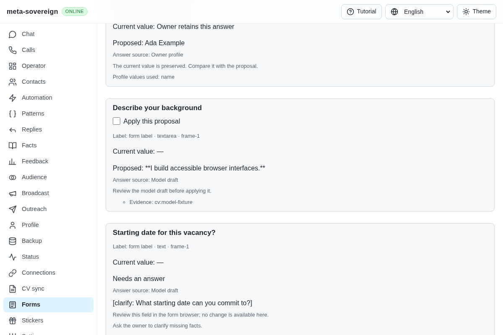
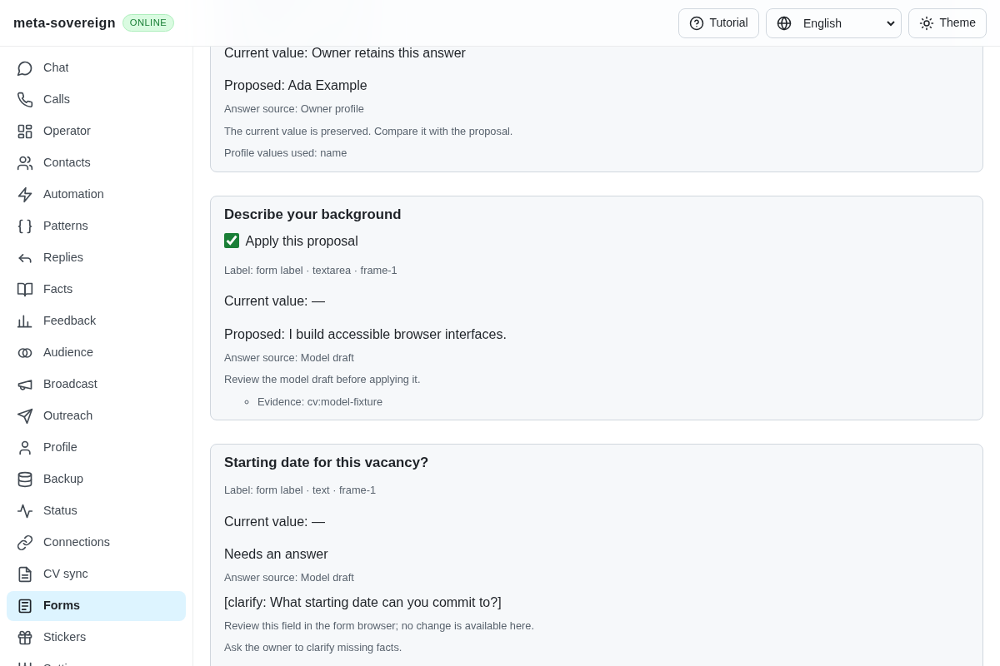
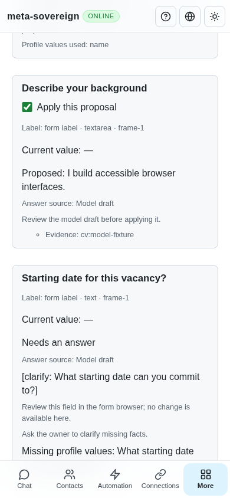

# Plain model drafts for form fields

[PR 57](https://github.com/link-foundation/meta-sovereign/pull/57) addresses reference requirement B15: model drafts are plain text before they become reviewable proposals or field writes.

The previous prompt already requested plain text, but accepted model output verbatim. A finite synthetic provider returning `**I build accessible browser interfaces.**` produces literal asterisks in the proposal on preceding commit `aa591e85`. The existing model-plan regression fails with those characters in its expected field value, and the production browser fails the same proposal assertion. The [before screenshot](../../screenshots/issue-56-forms-plain-before.png) shows the actual problem. No live provider request was necessary.

The shared model-result contract now removes headings, block quotes, unordered/ordered list prefixes, emphasis, strike-through and code fences or inline-code delimiters. Link labels retain their destinations in plain parentheses, including balanced parentheses in URLs. Code contents and intraword identifiers remain literal. Exact supplied choice labels bypass conversion so a real option containing formatting characters still matches its bound control. Existing approved owner wording and observed field values are unchanged. Missing-fact questions remain explicit clarification and cannot be selected for writing.

Validation checks the rejection policy both before and after conversion. An empty converted answer or a conversion exceeding its 6,000-character, 128,000-work-unit or sixteen-level nesting bound refuses the draft with the existing truthful model state. Frozen plans store the converted answer; application revalidates current context, checks actual control readback and makes no second model call. The same implementation serves CLI, trusted text/binary Lino question/form plans and the shared UI/offline planner. The production bundle is rebuilt.

Eighteen focused checks pass in Node and Deno. They cover Markdown examples, multilingual text, literal identifiers/code/URLs, finite malformed input, actual form proposals, exact and decorated choice output, converted empty/rejected answers, unknown facts, unchanged approved/owner wording, frozen-context application, cancellation and both negotiated wire encodings:

```sh
NODE_OPTIONS=--max-old-space-size=384 node --test --test-concurrency=1 \
  js/tests/answer-plain-text.test.js js/tests/answer-model-drafts.test.js \
  js/tests/forms-model-review.test.js js/tests/answer-model-api.test.js
deno test --v8-flags=--max-old-space-size=384 --allow-all --no-check \
  js/tests/answer-plain-text.test.js js/tests/answer-model-drafts.test.js \
  js/tests/forms-model-review.test.js js/tests/answer-model-api.test.js
RUN_BROWSER_E2E=1 FORMS_MODEL_ONLY=1 FORMS_PLAIN_SCREENSHOTS=1 \
  E2E_EXECUTABLE_PATH=/opt/google/chrome/chrome \
  NODE_OPTIONS=--max-old-space-size=384 node js/tests/e2e-forms-reader-browser.mjs
```

Production Chromium and independent Playwright MCP verify the plain proposal on desktop and a 390-pixel phone, actual field value, preserved owner name, unselected unknown starting date, one model request, acknowledged browser close and zero submissions. The existing model scenario now always uses decorated synthetic output, so the full hosted browser registry retains this regression. Strict changed-code lint and formatting pass; full runtime/engine matrices remain on hosted CI.







The [verified archive](data/forms-plain-drafts.tar.gz) and [manifest](data/forms-plain-drafts.tar.sha256.json) retain the regression logs, focused checks, MCP receipt, source and screenshot hashes. Live model/provider accounts, automatic multi-form prefilling, assignment workflows and all other unchecked issue criteria remain required. PR 57 stays draft and unmerged.

The capacity parent's separate WebKit failure remains open: [run 42904657245](https://github.com/link-foundation/meta-sovereign/actions/runs/42904657245), job `130147210202`, records a lost-response prefilling assertion at complete job-log line 2299 after one-millisecond document-identity differences at 2295–2298. This is distinct from both the plain-text gap and the corrected Chromium fixture counter. The full job log is retained for the next investigation. Parent `aa591e85` passes Pages and links; its remaining workflows still require completion.

The model parent's [run 42910909524](https://github.com/link-foundation/meta-sovereign/actions/runs/42910909524), job `130164660346`, identifies a formatting failure in all four updated requirement ledgers at complete job-log lines 406–411. The full job log is preserved. This unit formats those changed ledgers and verifies the exact files locally. The four existing ESLint warnings at 383–392 did not fail that job; the formatting step did. New-head hosted verification remains required.
