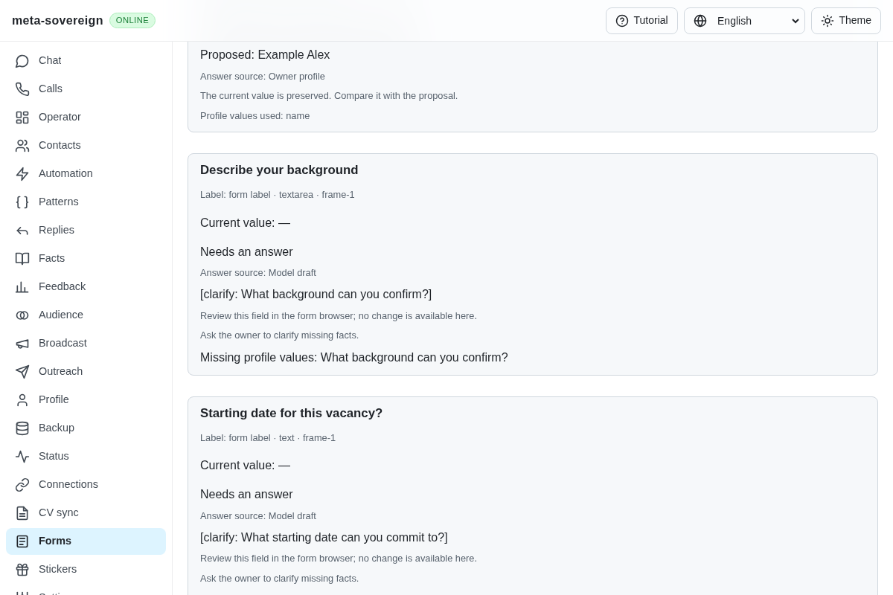
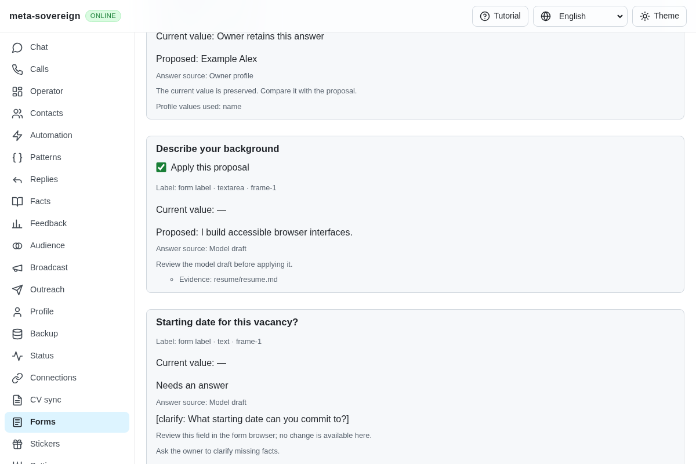
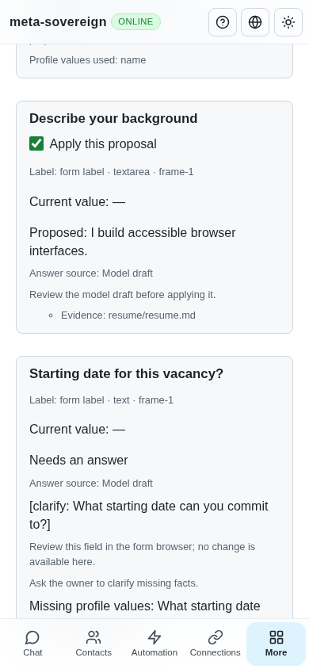

# Private résumé context for optional Forms model drafts

[PR #57](https://github.com/link-foundation/meta-sovereign/pull/57) supplies the
complete conventional `resume/resume.md` to an explicitly enabled Forms model
when no stored CV is selected. Pinned B7 requires résumé-grounded drafts and
clarification of unknown facts. The preceding private-profile correction parsed
contacts from this file, but its model context omitted the résumé itself.

Reproduce with a temporary selected store, a synthetic résumé in that relative
location, enabled model settings with an empty CV selection, and a form asking
about background. Explicitly opt into model drafting. Parent `fa58010f` supplies
no CV to the model. The correction passes the full Markdown with the relative
source identity; it creates no stored CV or selection. A selected stored CV
still takes precedence, and an invalid selection refuses. Generic chat model
preparation receives no implicit private-file context.

The same bounded, validated source read serves CLI, both Lino encodings and
reviewed/automatic Forms planning. Existing opt-in, model settings, 96 KiB
knowledge bound, unknown-fact clarification and approval rules remain in force.
Plans contain source fingerprints and proposed answers, rather than the full
résumé or absolute directory. A private-source edit or deletion invalidates a
reviewed proposal before typing. Applying a valid reviewed proposal reads back
the actual field and reuses its receipt without another model request.

## Verification

Seven of eight new checks fail against the actual parent; the positive control
retains generic-context isolation and its byte bound. All 30 focused Node checks
and the same 30 Deno checks pass after correction. The tests cover direct
planning/application, changed and deleted sources, stored-CV precedence, disabled
and absent opt-in, unknown facts, the actual `forms-plan` command and both Lino
HTTP transports. Request bodies cannot select host paths.

The isolated native Chromium scenario reproduces the parent omission and
verifies the complete private résumé in the fixture model input. A source edit
refuses before typing. Explicit replanning makes one new model request; applying
the reviewed draft makes none and verifies actual field contents. Owner text and
unknown facts stay unchanged. There are zero submissions and the browser closes.
The scenario is awaited by the mandatory Forms reader group.

The [source-bound archive](data/forms-private-model.tar.gz) retains exact parent
bytes, failing-before results, focused results, native receipts and inspected
screenshots. This uses a deterministic model fixture; it does not claim a live
model or authenticated provider execution. Exact-source hosted verification and
the complete QA22 contract remain required. Current issue acceptance remains
83 of 118, with 35 unfinished; PR57 remains draft and unmerged.
