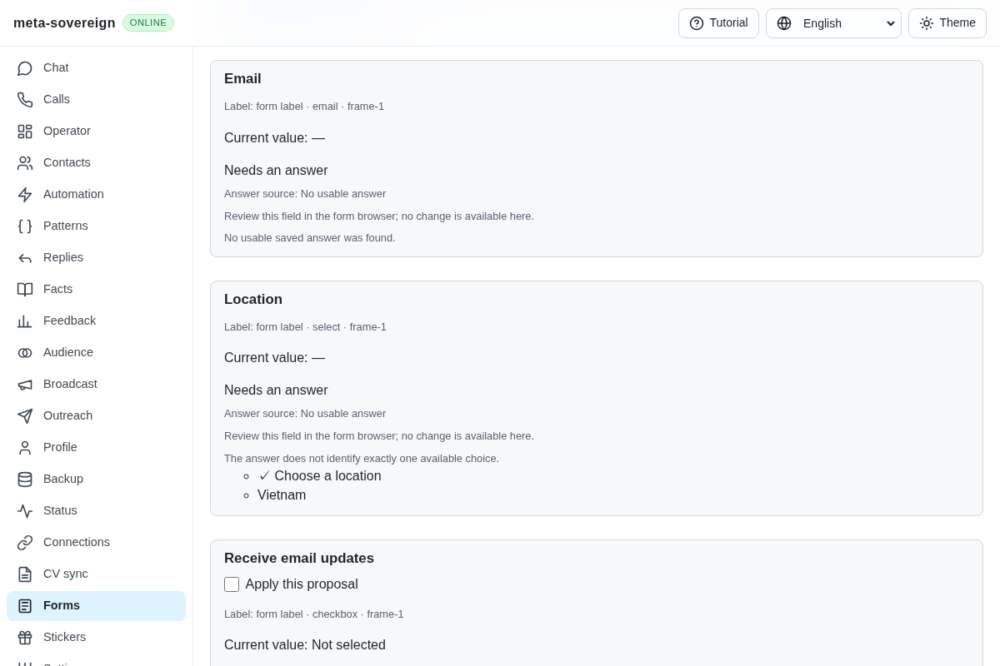
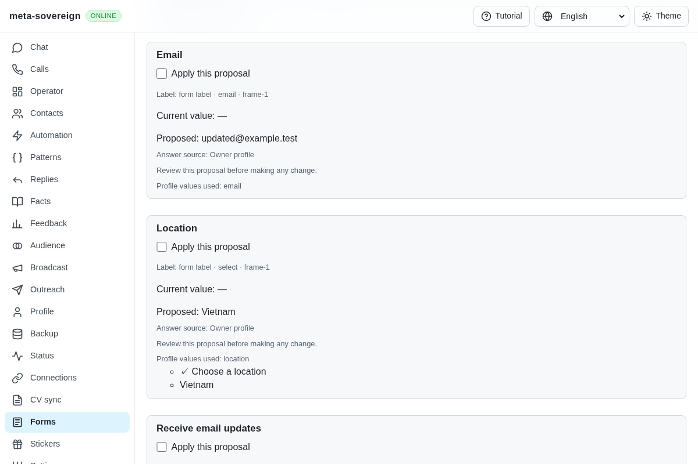
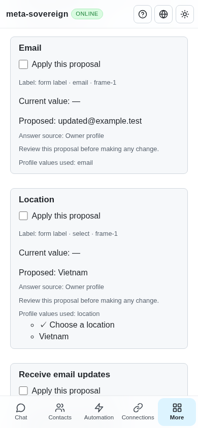

# Automatic private Forms profile defaults

[PR #57](https://github.com/link-foundation/meta-sovereign/pull/57) previously
required an inline or saved profile even when the selected private store already
contained the reference resume and contacts files. A normal Forms plan therefore
left known contact questions unresolved. Planning and the learning bridge now
share automatic, read-only defaults from the directory containing that store's
`data.lino` log. With `--store=data`, the conventional sources are:

1. `data/resume/resume.md`, using the existing bounded Markdown importer.
2. `data/contacts.lino`, overriding resume facts.
3. `data/profile.lino`, overriding those contacts; placeholders expand against
   the previously loaded contacts.

This order follows the pinned
[reference loader](https://github.com/konard/hh-job-application-automation/blob/fa0991b8c2d0896fb3b4be6c69947f0590094b15/src/form-prefill.mjs)
and its
[slot entry point](https://github.com/konard/hh-job-application-automation/blob/fa0991b8c2d0896fb3b4be6c69947f0590094b15/src/form-slots.mjs).
The original implementation reuses our profile import and answer planner.
Legacy `full_name`/name-part/city keys become the canonical name/name-part/location
keys. A selected saved profile and explicit inline values take precedence over
these defaults, including an explicitly empty inline value. There is no implicit
profile save, approval, file rewrite, Next click or submission.

Missing files are optional. Memory or remote stores without a local log do not
read host files. HTTP body properties cannot select another directory or file.
Each source must be a regular, valid UTF-8 file within 64,000 characters and
256,000 bytes. Reads allocate only the finite byte limit plus one byte; symbolic
file links and parent links outside the selected directory refuse. Source errors
name the conventional relative source and limits, without its contents or the
private directory. Conflicting aliases refuse; ambiguous or invalid higher-source
facts remove the corresponding lower default instead of resurrecting it.

Plans retain each present source's relative name, SHA-256, accepted keys, conflicts
and skipped count. Reviewed filling recomputes that evidence, refusing before a
native write if the files change. Replanning uses their current bytes. Learning
uses the same facts to skip known contact answers and contract new answers to
placeholders, then rechecks source evidence before persistence. Learned proposals
remain unapproved and preserve existing partial-write receipts on failure.

## Reproduction and focused verification

Create a private temporary store with `contacts.lino` containing an email; run
`forms-plan` on a captured email question without a profile argument, or open and
plan a live Forms review without choosing a named profile. Parent `77bd5f71`
produces no email proposal. The corrected planner proposes the file's email.
Changing the file after planning must refuse Apply; replan and explicitly select
the current proposal to fill it. Existing owner text stays intact.

All eleven new checks fail against the actual published parent; the restoration
probe keeps the new test and restores the previous production modules. All 47
focused profile/Forms planning/learning checks pass after the correction. They
also exercise automatic prefilling, named/inline precedence, known-contact
learning, unresolved overrides, unsafe paths, invalid UTF-8, finite limits, CLI
store closure, both HTTP encodings and a contact edit during learning.

The isolated Chromium scenario uses actual temporary files, the built shared
Forms UI and native controls. Its receipt confirms three loaded files, no named
profile, zero stale writes, one acknowledged current email fill, retained owner
name, zero submissions and a closed owned browser. It joins the existing reader
group for both engines in CI without changing shard registration. The screenshot
helper waits for resize rendering before positioning the same field on a phone.
The native parent probe also creates those same three files, confirms the missing
email proposal and zero submissions, and captures the actual problem screenshot.

The source-bound archive and manifest retain the actual-parent failures, focused
and native receipts, reviewed reference blobs, static checks and screenshots.
This unit covers automatic profile defaults, not automatic PDF acquisition,
provider authentication or the complete B4/QA22 workflow. QA22 and every other
unfinished inventory criterion remain required; PR57 stays draft and unmerged.
