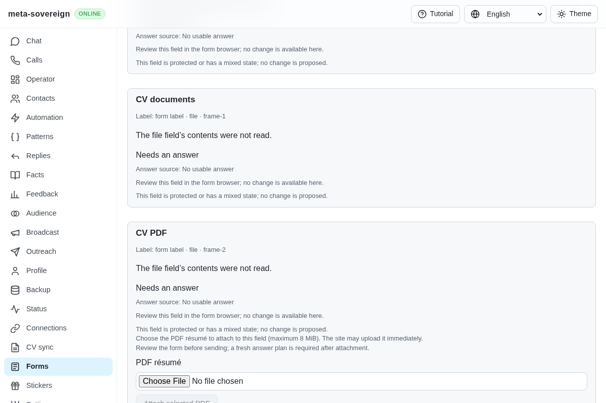
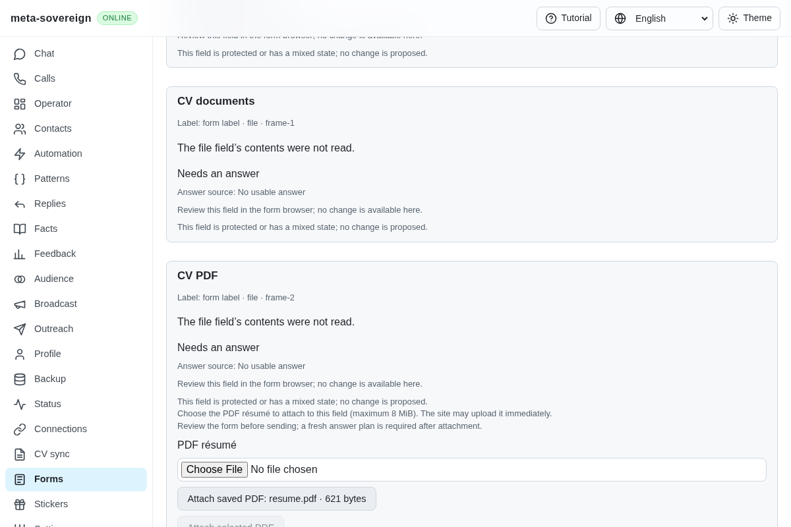
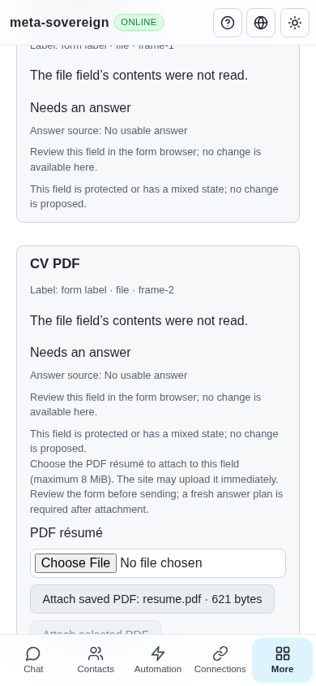

# Automatic conventional Forms PDF

[PR #57](https://github.com/link-foundation/meta-sovereign/pull/57) discovers
`resume/resume.pdf` beside the selected local store when planning a supported
résumé upload. With `--store=data`, this is `data/resume/resume.pdf`, as required
by pinned B8. Previously the file had to be supplied explicitly or saved into a
separate configured-PDF record. The conventional file alone left it unresolved.

The existing reviewed upload and automatic-prefill executor share this fallback.
A saved selection takes precedence. An explicit automatic-prefill file bypasses
the fallback, including a malformed default. Forms without an eligible résumé
upload do not inspect the private PDF. Memory/remote stores without a local log
never inspect host files. Discovery creates no saved selection and performs no
upload during planning; saved-selection management keeps its existing behavior.

Private text and PDF inputs share one finite source reader. Each must be a
regular file within its byte limit; final symbolic links and parent paths outside
the selected directory refuse. PDF reads allocate at most 8 MiB plus one byte and
use the existing PDF signature/end-marker validation. Plans retain only relative
source, name, size, SHA-256, modification time and content revision. Private
path/content details are absent from reports and source refusals.

Attachment rereads the PDF inside the shared knowledge-writer queue and compares
its content revision with the plan. A changed/deleted PDF or a newly saved
preferred selection refuses before upload. Existing native target/document
checks, separate replacement consent and actual byte-digest readback apply.
Cached recovery returns the original receipt after source deletion without
another upload. Automatic filling keeps existing files, never clicks Next or
Submit, and reports unresolved questions and required review.

## Reproduction and verification

Create a temporary store with a synthetic PDF at `resume/resume.pdf`. Open
`forms-review --url=<form> --store=<directory>`, then plan and attach its supported
résumé field without `--resume-pdf` or a saved selection. Published parent
`5283e26a` offers no PDF; the corrected plan offers the conventional file.

Seven of twelve new checks fail against the actual published parent; five
positive controls pass. The source-restoration probe retains the new assertions
and restores changed existing production modules in `finally`. All 38 focused
Node checks and 23 focused Deno checks pass after correction. They cover real
CLI plan/attach, both Lino encodings, automatic prefilling, unsafe/malformed/
oversized sources, selection precedence, unrelated forms, owner-file consent,
source edits/deletion, receipt recovery and serialized replacement.

The isolated native Chromium scenario creates the conventional file without
saving a selection. It reproduces the parent omission, rejects a changed-source
attachment before the cross-origin control receives a file, replans and verifies
the actual uploaded SHA-256. The main document's owner attachment remains intact;
there are zero submissions and the owned browser closes. This awaited scenario
joins the mandatory reader group without changing shard registration.

[The source-bound archive](data/forms-private-resume.tar.gz) retains parent assertions and bytes, focused results,
native receipts, reviewed screenshots and static checks. This supersedes the
discovery gap in the [configured-PDF report](forms-configured-resume.md). Broader
QA22 acceptance and every other unfinished criterion remain required. PR57 stays
draft and unmerged; the complete matrix runs in hosted CI.
