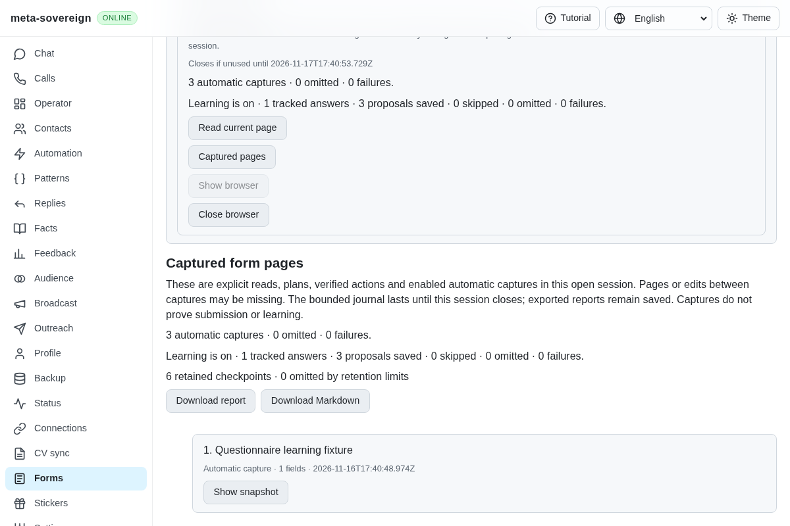
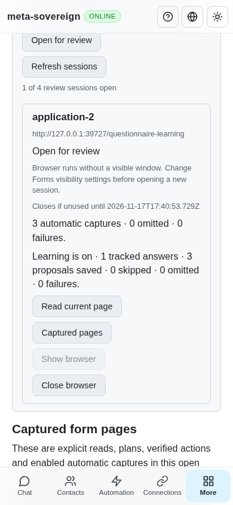

# Learning whole form questionnaires and their answers

This correction in [PR 57](https://github.com/link-foundation/meta-sovereign/pull/57)
addresses part of QA09 in [issue 56](https://github.com/link-foundation/meta-sovereign/issues/56).
The complete acceptance inventory remains unfinished and the PR stays draft.

## Reproduction and cause

Open the isolated questionnaire learning fixture through Forms. Read and plan
its numbered two-question textarea. Enter numbered answers in the owned browser
and explicitly submit the fixture. Published `76c56487` saves only the whole
reply. Neither individual answer is persisted. Both focused regressions and the
native browser scenario fail on that actual parent source.

Conversation learning already used the shared conservative alignment parser,
but the paired learner used by observed form answers saved only the whole pair.
Splitting also requires correcting the form journal's skipped counter: derived
proposals are not additional input pairs.

## Change and verification

The paired learner keeps the admitted whole reply and uses the existing bounded
alignment parser. Numbered answers align with numbered, bulleted or separate
questions. Conditional follow-ups and code stay with their parent. Ambiguous
alignment stays whole. All observations retain their original count and
evidence; new proposals remain unapproved. Privacy, rejected wording, canonical
corrections and notice handling still apply. Skipped counts count input pairs
that were not admitted. Replaying the same observation is idempotent.

Five new portable regressions fail three assertions on the published parent;
all five pass after the correction. Forty-two focused Node checks pass with one
worker, including existing form learning, questionnaire indexing, list alignment
and notice learning. The mandatory Forms browser scenario uses production read,
plan, observation, history and close routes. Its parent run records one proposal;
corrected Chromium records three unapproved proposals with count one, zero
skipped pairs, one explicit owner submission and one drained owned session.

```sh
RUN_BROWSER_E2E=1 E2E_EXECUTABLE_PATH=/usr/bin/google-chrome node --max-old-space-size=384 experiments/issue-56/forms-questionnaire-learning-browser.mjs
```

Independent Playwright MCP checks the same UI and journal, then closes the
review and reloads at phone width. The fixture is synthetic and isolated from
the user's server; this does not verify an authenticated provider run.
The [archive](data/forms-questionnaire-learning.tar.gz) and
[manifest](data/forms-questionnaire-learning.tar.sha256.json) retain actual
parent/current sources, failing and passing logs, browser receipts and screenshot
hashes. Exact-head hosted verification remains required before accepting QA09.

Before, one proposal:


After, whole reply and two individual answers:



Phone:


