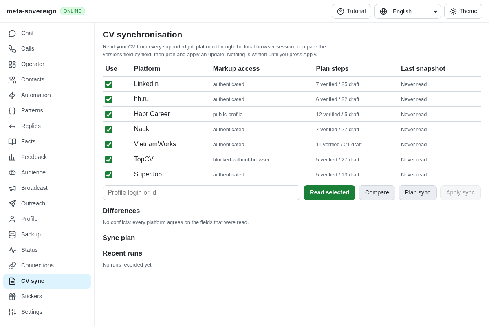
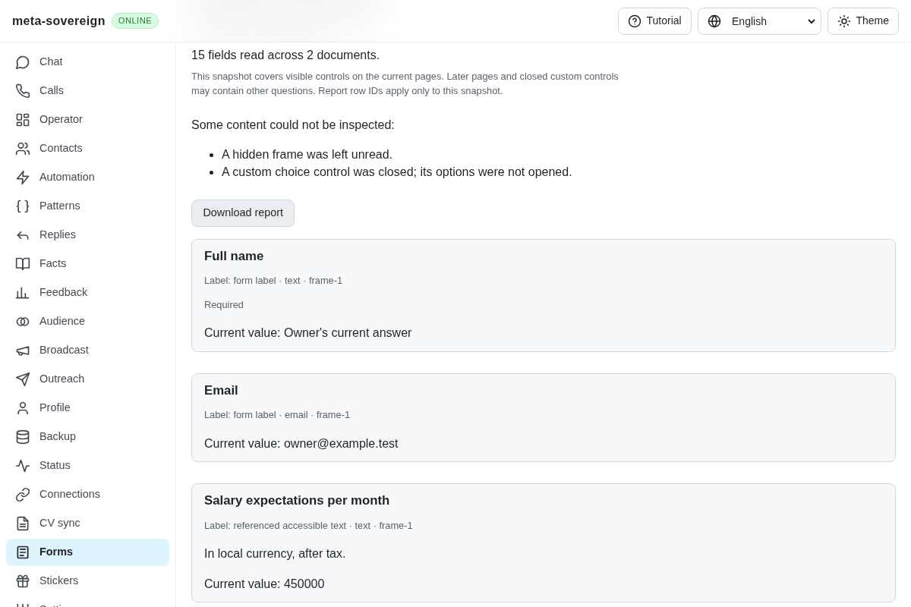
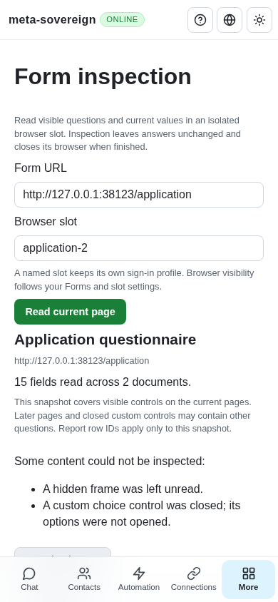

# Shared accessible form inspection

Implementation and review evidence for [PR 57](https://github.com/link-foundation/meta-sovereign/pull/57), addressing the reader foundation of QA21 and QA25. Answer planning, prefilling, persistent review slots, later-page traversal and submission/edit learning remain required. This reader alone does not complete those criteria.

## Reproduction and behavior

The preceding application (`4ed3f9c58`) has CV synchronization but no shared form inspection command, endpoint or screen. Run `experiments/issue-56/forms-reader-before.py` with the installed browser path in `E2E_EXECUTABLE_PATH`: it loads that bundle in an isolated fixture, waits for the application to render, captures the missing Forms entry and fails the navigation assertion. It restores the current bundle even when the probe fails.

The new Forms screen reads an absolute HTTP(S) URL into a named browser slot. It inherits the shared headed/headless settings, shows current questions, label evidence, groups, descriptions, options and existing states, and exports the actual snapshot. A failed reread retains the URL and previous report, explains the refusal and requires an explicit retry. Offline/unavailable servers expose recovery without claiming inspection support.

The same reader is available as `meta-sovereign forms-read --url=<url> --browser-slot=<name>`, the `meta-sovereign/forms` library entry, `GET /api/forms/capabilities` and `POST /api/forms/read`. API requests and responses use the existing negotiated text/binary Lino transport and trusted-origin mutation gate. The CLI accepts explicit `--headed`/`--headless` overrides and closes its store and browser on failure.

No inspection click, input, change or submit is issued. Password and file value getters are never accessed. The transient browser closes after a snapshot, including failures and shutdown during lazy launch. Report row IDs identify only that snapshot; they are not durable fill targets. Browser profile persistence does not imply a persistent open review session.

## Reading and coverage

The DOM evaluator follows accessible referenced labels, ARIA labels and native explicit/implicit labels, then reports weaker placeholder, title, legend and preceding-heading fallbacks. Native label text excludes embedded controls and their current answers. It preserves current text whitespace and native/ARIA selection, required, disabled and read-only states. See the primary [WAI labels guidance](https://www.w3.org/WAI/tutorials/forms/labels/) and [grouping guidance](https://www.w3.org/WAI/tutorials/forms/grouping/).

Browser-commander owns navigation and the main-document read. Its connected Playwright frames provide child-document access because the commander interface has no frame target. The finite fixture verifies a real cross-origin iframe. The relevant primary references are [Playwright frames](https://playwright.dev/docs/frames) and [page evaluation](https://playwright.dev/docs/evaluating), checked on 2026-11-10.

One snapshot is limited to 200 fields, nine attempted child frames, 100 options per field, bounded control/custom-element scans, 2,000-character descriptions and 10,000-character values. An internal deadline closes the owned browser. Hidden, unavailable or unvisited frames, unopened choices, custom elements, truncation and unlabelled fields produce explicit partial coverage. Navigation or detachment of a captured document refuses the snapshot. Later pages, shadow controls and sign-in/CAPTCHA interaction are not claimed as inspected.

## Verification

- 73 focused Node checks cover reader lifecycle, CLI, real text/binary Lino routes, locale/guide compatibility and mandatory browser registration. The reader/report subset also passes 13 Deno checks.
- The production Chromium flow inspects 15 native/ARIA fields across two visible documents, verifies inherited disabled state, sensitive getters, preserved answers, zero interaction events and zero submissions, downloads and compares the report, refuses a changed form, retries explicitly and checks 390px layout. Finite extraction probes verify field, option and value limits. Both Chromium and WebKit flows are mandatory in CI; the full matrix is left to CI.
- Independent Playwright MCP inspection verifies the same report, desktop/mobile layout and owned shutdown using `experiments/issue-56/forms-reader-ui.mjs`. The fixture has no real account, scheduler or running application data.
- MCP exposed an invalid HTML pattern under Chromium's Unicode-set regex rules and option text leaking into an implicit label. A focused browser regression fails before the fixes; escaped hyphen validation and control-excluding native label extraction now pass.

Before:

After:

Phone:

The [evidence archive](data/forms-reader.tar.gz) and [verified manifest](data/forms-reader.tar.sha256.json) preserve reproduction, focused checks, browser results, MCP observations and source hashes. Synthetic cross-origin coverage does not establish authenticated Google/Yandex or complete multipage parity. Those workflows and every other open issue criterion remain unfinished in the draft PR.
