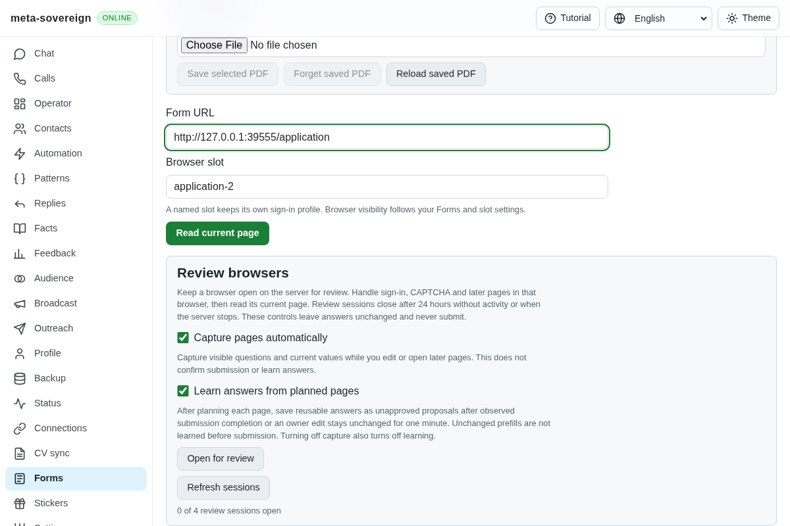
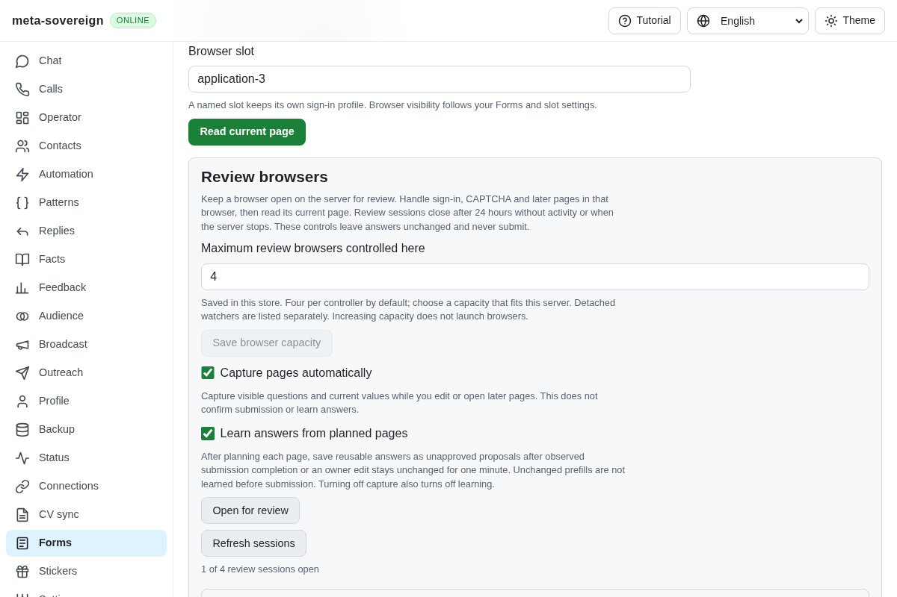
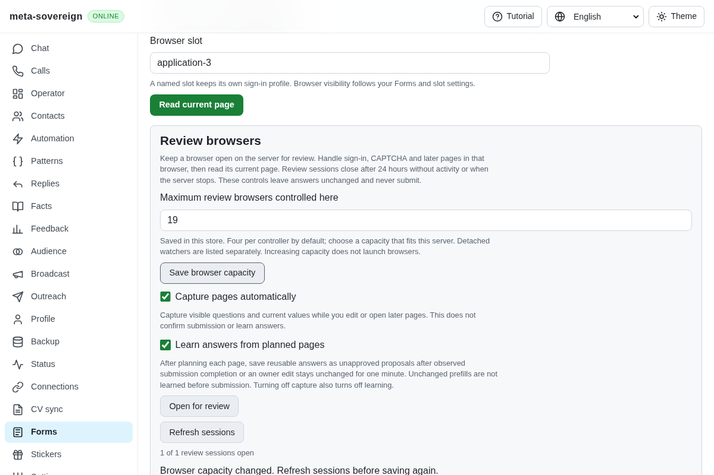
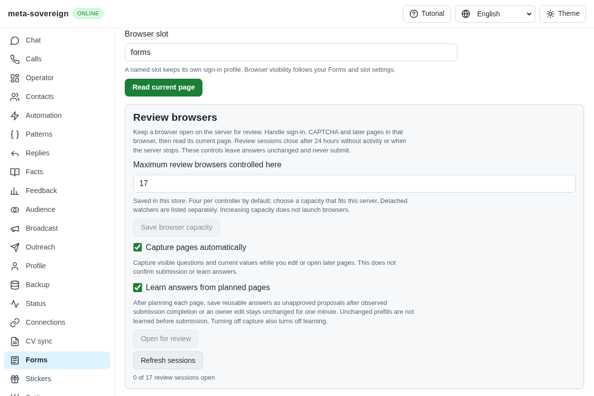
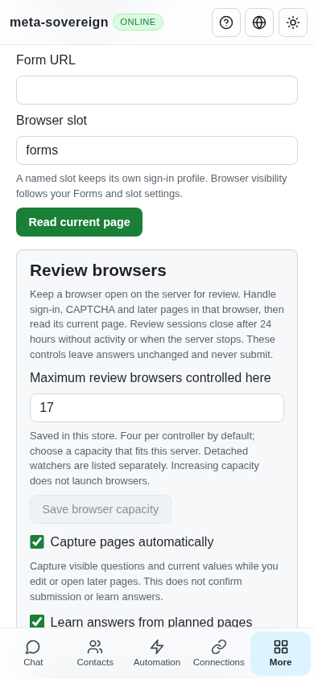

# Configurable capacity and larger form batches

[PR 57](https://github.com/link-foundation/meta-sovereign/pull/57) removes the arbitrary four-URL CLI ceiling and sixteen-browser constructor ceiling. HH requirement B1 asks for any number of forms in one command. This change supplies the capacity and batch-opening part; automatic prefilling of every supported form remains unfinished.

The default remains four review browsers per controller. An owner can save a positive safe integer in the private store through Forms or the trusted Lino API. Raising capacity opens no browser. Capacity counts browsers owned by the current controller, including reservations during startup. Detached watchers are listed separately; this is not a server-wide memory quota. Owners must choose a capacity appropriate for their server.

Settings and reservations use the existing store writer queue. A revision is required for each save, stale saves refuse without discarding typed input, and capacity cannot be reduced below currently owned reservations. Unknown or corrupt stored settings refuse admission instead of inventing a fallback. A pending or failed save cannot admit a browser under an unconfirmed larger limit. Shutdown prevents new reservations and drains issued settings writes alongside browser cleanup.

## Reproduction and use

Previously five URLs in `--urls` failed with “Review one to four form URLs at a time.” A constructor capacity of seventeen failed with “Use finite form review limits.” The bounded `experiments/issue-56/forms-capacity-baseline.py` restores the two original sources temporarily and reproduces both failures, then restores the draft even on failure.

The CLI now accepts one input source: positional URLs, `--url=<url>`, or `--urls=<Lino-list>`. For example:

```sh
meta-sovereign forms-review https://forms.example/one https://forms.example/two --max-sessions=8 --store=<directory>
```

`--max-sessions` saves the explicitly selected capacity. Without that flag, a batch larger than the saved capacity raises it to accommodate the batch. URL, slot and capacity validation completes before opening the store. Browsers start sequentially. A failed browser reports its actual slot/error, later forms are still attempted, and the final exit status is nonzero. Successful slots retain the existing review commands and detached learning lifetime. Opening a batch does not fill or submit its forms.

Forms exposes “Maximum review browsers controlled here” with explicit saved/default scope and an acknowledged Save action. `GET /api/forms/sessions` returns the confirmed capacity and revision. Trusted `POST /api/forms/sessions/capacity` accepts `{maxSessions, revision}` through both text and binary Lino. Offline or unknown server status disables mutation; a refused save keeps the current draft until explicit Refresh.

## Verification

The focused Node run passes 47 tests; Deno passes the same 47 tests, with no failures. The four selected files cover real dual-store reopen, seventeen mocked slots, duplicate/capacity refusal, reservation during deferred startup, pending/failed persistence, invalid and corrupt settings, optimistic saves, reducing active capacity, shutdown races, five-URL CLI batches, complete prevalidation, strictly sequential starts, partial batch failure, both Lino encodings, trusted mutation and locale consistency. All inputs are finite; no browser or memory stress test runs locally.

```sh
node --test --test-concurrency=1 js/tests/forms-review-capacity.test.js js/tests/forms-review-capacity-api.test.js js/tests/forms-review-sessions.test.js js/tests/i18n.test.js
deno test --v8-flags=--max-old-space-size=384 --allow-all --no-check js/tests/forms-review-capacity.test.js js/tests/forms-review-capacity-api.test.js js/tests/forms-review-sessions.test.js js/tests/i18n.test.js
RUN_BROWSER_E2E=1 E2E_EXECUTABLE_PATH=/opt/google/chrome/chrome FORMS_CAPACITY_ONLY=1 node js/tests/e2e-forms-reader-browser.mjs
```

The production Chromium regression saves seventeen, reloads, confirms that no browser was launched, then chooses one and refuses a second browser. It retains an owner-edited form answer, refuses a stale save while preserving the typed value nineteen, explicitly refreshes, restores four, checks the 390px layout and closes the owned browser with zero submissions. The same helper runs in the mandatory shared form-reader CI flow. Independent Playwright MCP confirms durable seventeen, zero open sessions and the fitting phone layout. All isolated fixtures and browsers are closed afterward. Strict changed-code lint, formatting and the production web build pass.











The [archive](data/forms-review-capacity.tar.gz) and [manifest](data/forms-review-capacity.tar.sha256.json) preserve the failing-before logs, focused results, public browser receipts, relevant sources, pinned B1 reference and screenshot hashes. Private stores and browser profiles are excluded.

Automatic one-command prefilling, optional models, assignments, complete authenticated provider workflows and every other unchecked issue criterion remain required. QA21/QA25 and R-AA6 remain partial; PR 57 stays draft and unmerged. Four auxiliary workflows pass on preceding commit `48278460`; its main checks and the new commit's exact-SHA CI remain required.
