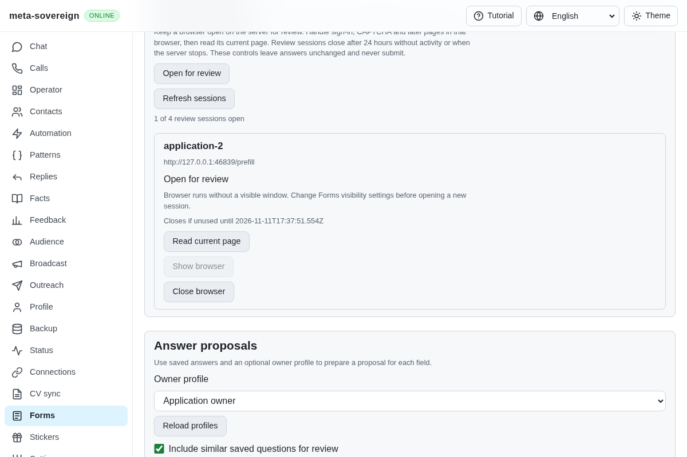
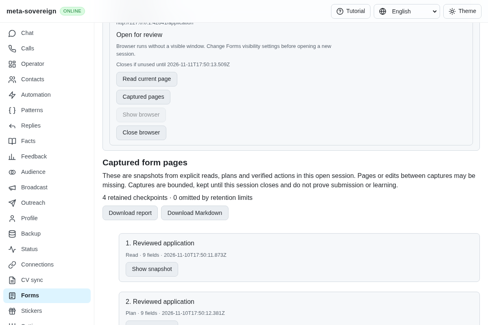
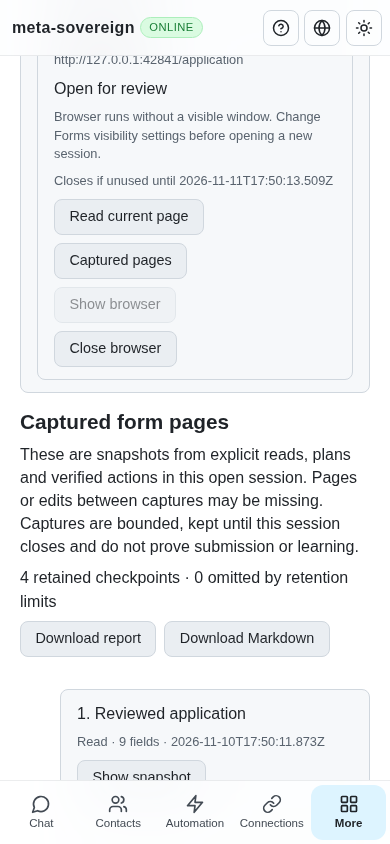
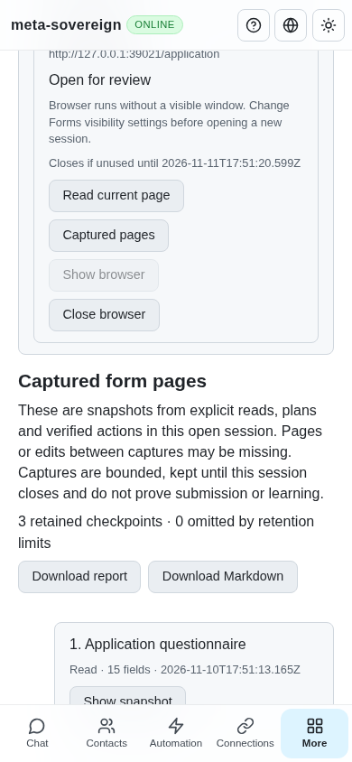

# Captured form checkpoints and Markdown provenance

[PR 57](https://github.com/link-foundation/meta-sovereign/pull/57) now keeps bounded public checkpoints from explicit reads, answer plans and verified action results. A later read previously replaced the only report in the UI, and the review service retained no exportable history. The regression against `1d0526a9` fails because `historyReview` is absent; the production browser also fails on the missing Captured pages control. The reusable reproduction is [forms-journal-before.py](../../../experiments/issue-56/forms-journal-before.py).

Each owned session retains at most 32 checkpoints and 4 MiB of serialized checkpoint data. Entries use their own sequence and capture time. Oversized entries and evicted entries increase a visible omission count; the report describes only captured checkpoints. Returned reports are cloned. Checkpoints omit session and plan authority, and opening history neither reads the browser nor disposes a live plan. Closing the session releases its journal. Historical views offer no planning, field selection, attachment or apply controls.

The existing current-page report still carries current values separately from proposals. After an action, matching fields retain the reviewed answer source, saved question, similarity and profile evidence alongside the actual returned snapshot and outcome. When readback is unavailable, the checkpoint explicitly labels its contents as the last reviewed snapshot. Recovered cached actions create neither another checkpoint nor another file and never repeat the browser interaction.

CLI `forms-read`, `forms-plan` and `forms-review` accept `--format=markdown`; JSON remains the default. The interactive review command adds `history <slot>`. The trusted POST history route uses the same text/binary Lino negotiation as other review controls. Both current reports and history have JSON and Markdown downloads in all four interface languages. Markdown escapes untrusted form HTML and formatting and includes question/group labels, current values and observed choices, proposal provenance, unresolved reasons, coverage and action outcomes.

The CLI and server save reports automatically as uniquely named `logs/forms/<time>-<id>.md` files, using an exclusive create, private directory/file modes and a flushed write before reporting success. Reports are limited to 8 MiB; no existing report is overwritten. Library callers can provide a writer or leave persistence disabled. Save failures remain separate from browser receipts: a confirmed attachment stays confirmed while its report save is visibly failed. Shutdown waits for an issued report write. Downloads remain available if disk persistence fails.

## Verification

Thirty-seven focused Node checks and ten Deno checks cover retained pages, cloning, count/byte limits, oversized omission, unavailable readback, unchanged live plan authority, actual attachment confirmation despite failed persistence, recovery deduplication, owned shutdown, trusted origins, closed sessions, both Lino encodings, private unique files, Markdown escaping, actual saved-question provenance, CLI format validation and all four UI languages. Existing reader, session and report checks remain included in the focused Node selection.

The production Chromium flow captures a read, a profile-based plan, a confirmed selected fill and a manually opened later page. It verifies the saved Markdown against the actual receipt, exports both formats with all four checkpoints, checks that history never interacts with the form and that historical fields cannot be applied, and closes the owned browser with zero submissions. Independent Playwright MCP confirms three captured checkpoints, zero historical fill/apply controls, the preserved original current value and a 390-pixel layout. Its isolated fixture records zero form events, zero submissions and acknowledged cleanup. An initial MCP probe selected a nonexistent fixture option; it was closed and retried using the observed `qa-profile:forms-fixture` value. The only console resource error is the fixture's missing favicon.

| Before: no retained history                                    | After: captured checkpoints                                  |
| -------------------------------------------------------------- | ------------------------------------------------------------ |
|  |  |

The [evidence archive](data/forms-review-journal.tar.gz) and [manifest](data/forms-review-journal.tar.sha256.json) preserve focused logs, source snapshots, regressions and browser evidence. The preceding exact-head hosted run has passing Pages, desktop and security checks. Its link log reports one Google Contacts HTTP 429 with CAPTCHA redirects at lines 405–426 of [run 42864298263](https://github.com/link-foundation/meta-sovereign/actions/runs/42864298263); this is retained separately from product test results. The preceding Checks matrix passed both browser jobs and every acquired test job; its macOS Deno job never acquired a hosted runner. The saved annotation reports runner capacity constraints, and the pipeline log fails with `test: abandoned`. The full workflow log request returns `log not found` for that unstarted job, so individual pipeline logs and annotations are preserved. The next exact-head full matrix remains required.

## Remaining required scope

The subsequent [automatic capture unit](forms-automatic-capture.md) adds default-on passive snapshots within owned sessions. The limits and remaining scope below describe this earlier commit.

This is the captured-history and Markdown-report foundation for reference requirements B11/B12 and inventory QA21/QA25. It does not capture every page automatically or establish submission. Default-on detached per-slot watchers, confirmed-submission learning across pages, stable owner-edit learning, configured résumé selection, optional models, assignments and complete provider parity remain required. These criteria and the wider issue remain unfinished; PR 57 remains draft and unmerged.
