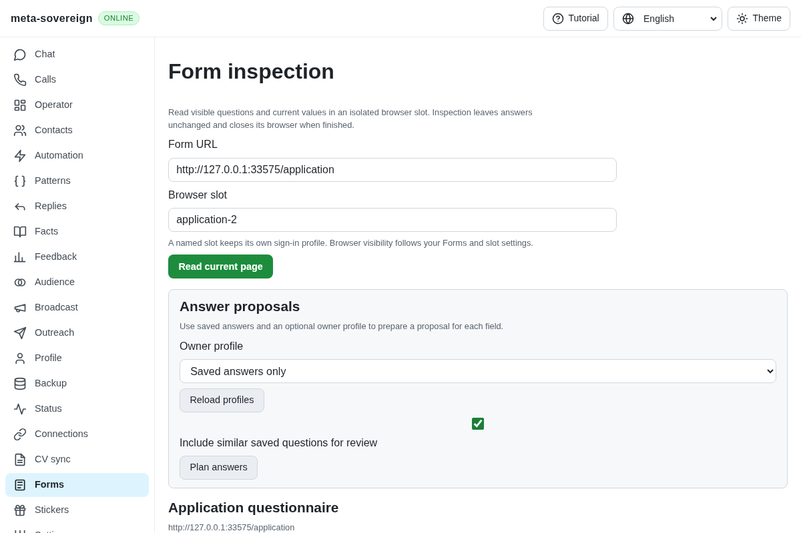
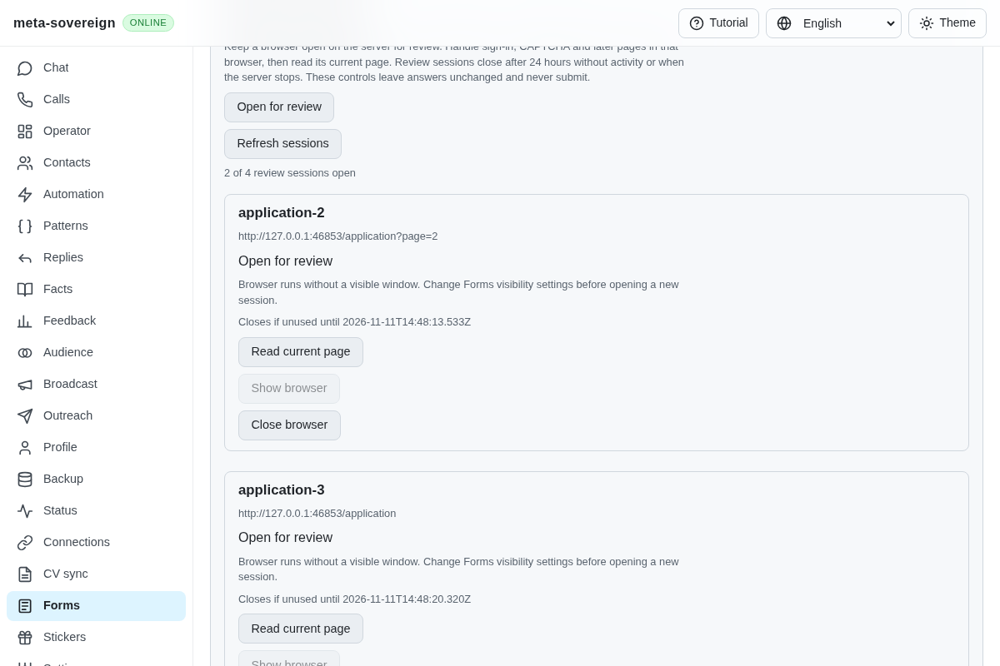
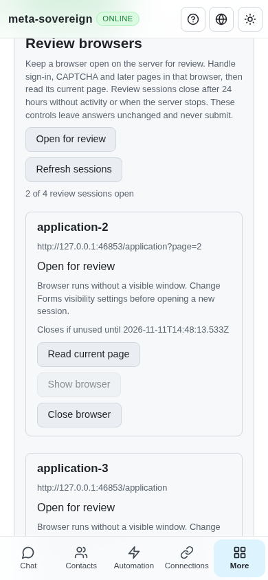

# Persistent read-only form review sessions

Implementation and verification for [PR 57](https://github.com/link-foundation/meta-sovereign/pull/57), extending QA21/QA25 and the pinned form requirements B2/B9/B10/B11. Reviewed prefilling, accumulated multipage answers, submission/edit learning and complete provider workflows remain required.

## Reproduction and resulting behavior

The preceding application (`0176fe7d`) always closes its inspection browser. A person cannot keep that browser open to sign in, solve a CAPTCHA, correct answers or open the next page. The finite `experiments/issue-56/forms-session-before.py` experiment serves that bundle in the isolated browser fixture, captures the missing controls and fails the review-control assertion. It restores the current bundle in `finally`; the service-level missing-method regression is preserved separately.

The Forms screen now offers separate review browsers. Opening one retains its browser and named persistent profile in the `forms-review` namespace, separate from transient inspection and application profiles. Browser visibility follows the shared Forms/slot settings, defaulting to visible. The UI reports actual visibility and disables focus for headless sessions.

The owner uses that browser for sign-in, CAPTCHA, edits and page changes. Reading a review session inspects its current document and visible child frames without returning to the original URL. No answer is filled, submitted or learned. An explicit close waits for cleanup acknowledgement; an unconfirmed close retains the record and offers retry. Closing one slot leaves other slots open, and the last successful report survives failed actions and closing its browser.

## Shared controls and lifecycle

`meta-sovereign forms-review --url=https://example.test/form` keeps its process and browser alive. `--urls=<Lino-list>` opens up to four independent slots in one invocation. Its terminal accepts `list`, `read <slot>`, `focus <slot>`, `close <slot>` and `quit`; EOF and signals drain owned work before closing the store. CLI/headless options share the existing browser policy. This finite initial capacity does not claim unlimited parallel browser parity.

The default text/binary Lino API provides `GET /api/forms/sessions` and trusted `POST /api/forms/sessions/{open,read,focus,close}` controls. Bodies are bounded to 8 KiB. Requests do not automatically replay through browser HTTP recovery. The same reader service backs CLI, API and four-language UI controls.

Slots reserve ownership before asynchronous launch. Duplicate slots and capacity exhaustion refuse new launches; at most four sessions are open by default, with a bounded library maximum of 16. Operations use finite deadlines. Closing or shutdown retains ownership of pending launches and issued reads, disposes late browsers and refuses new work. Cleanup failures stay visible for an explicit retry instead of being removed as successful closes.

Trusted pointer, key, input and change activity renews the default 24-hour idle deadline through a throttled binding installed in future documents and frames. The observer reads no keys, text or field values. Explicit service actions also renew activity; automatic frame navigation does not. Idle and deadline timers are unreferenced and cancelled during cleanup. The CLI/server process must remain running; shutdown closes all owned browsers. This implementation does not provide session restoration after process exit.

## Verification

All five hosted workflows passed for preceding head `0176fe7d9bc8227602b913302d4ff03e9d923be9` (created 2026-11-10 14:31:28 UTC), including both browser lanes. The new review-session head still requires its own hosted CI.

- Thirty-nine focused Node checks cover nine new lifecycle/CLI/Lino cases plus reader, planner, field-label and report compatibility. Twelve Deno checks cover review lifecycle and all four report/control locales. Strict changed-file lint and the production web build pass.
- Held launches, held reads and close acknowledgements exercise actual ownership ordering. Fake finite clocks verify idle renewal and opening deadlines without waiting 24 hours. Failed cleanup remains listed until retry succeeds. One CLI invocation opens three slots and exercises its terminal commands and store cleanup.
- The production Chromium flow opens real review pages, refuses duplicate slots, preserves a manually edited answer without additional form events, reads an owner-opened next page without navigation, retains browser/report state after a failed close, checks two independent slots and confirms final closure with zero submissions. Desktop and 390px screenshots are captured in the mandatory existing forms browser flow; hosted CI retains the second browser lane.
- Independent Playwright MCP verification reads 15 fields, checks actual headless focus refusal, equal viewport/document widths at 1200 and 390 pixels, and closes the session while preserving the report. The fixture records no form events, only GET requests, zero submissions and acknowledged browser closure. The only console error is the fixture's missing favicon. The onboarding overlay was dismissed before verification; it initially intercepted the Open click.

Before:

After:

Phone:

The [raw evidence archive](data/forms-review-sessions.tar.gz) and [verified manifest](data/forms-review-sessions.tar.sha256.json) preserve failed-before reproductions, checks, MCP observations, hosted-run snapshots and source hashes. Authenticated Google/Yandex flows, CAPTCHA completion, reviewed writes and learning remain unfinished; these synthetic read-only checks do not establish that wider parity.
