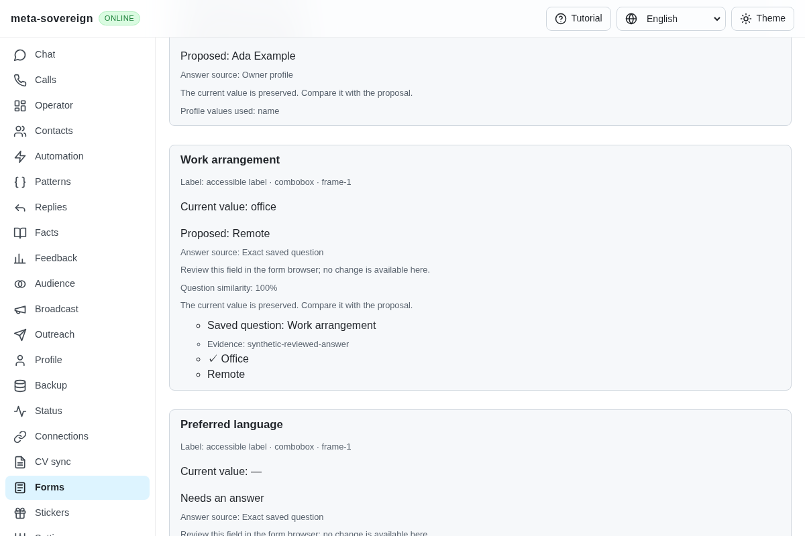
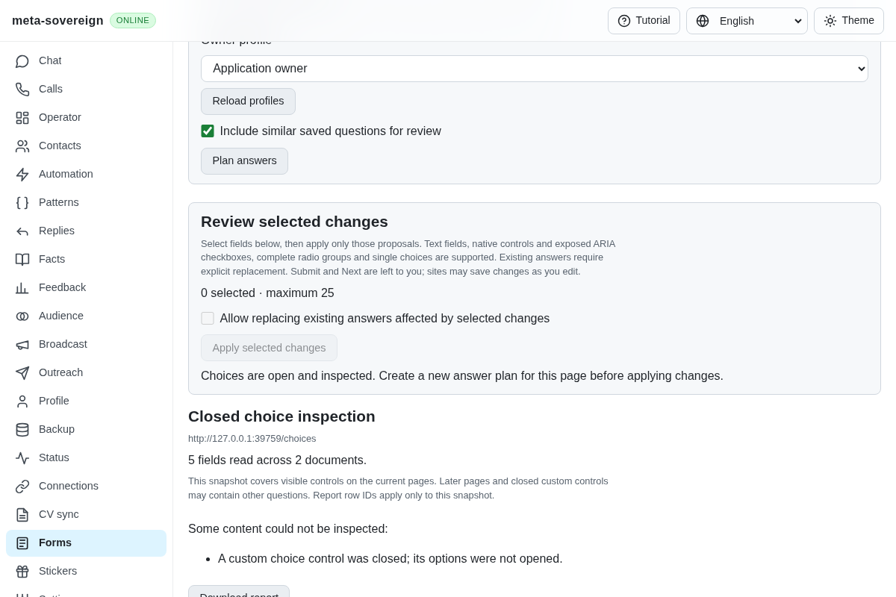
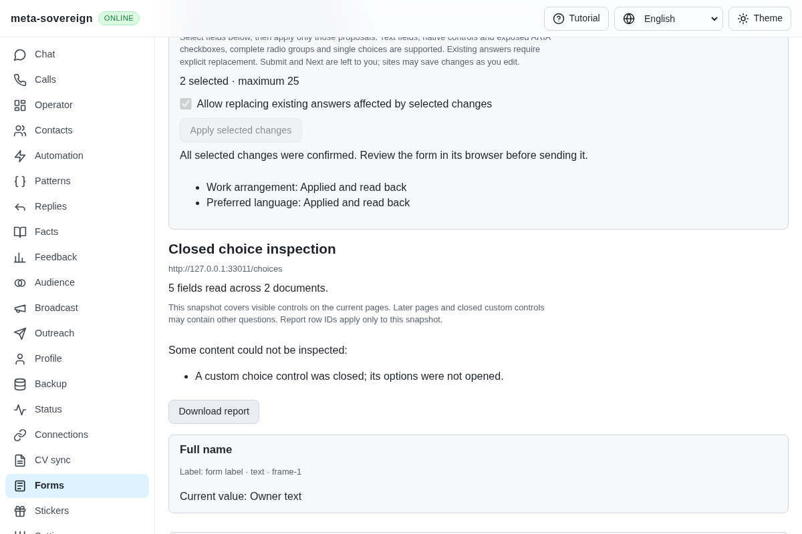
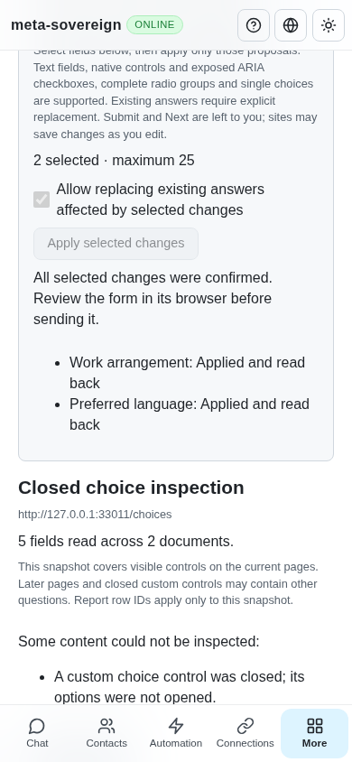

# Explicit choice inspection

This extends QA21/QA25 in [PR 57](https://github.com/link-foundation/meta-sovereign/pull/57). Owners can explicitly open a supported closed combobox and inspect its choices, including a lazily created listbox in a cross-origin frame. Inspection consumes the held plan; applying answers requires a fresh plan and explicit field selection. Unsupported menus, uploads, optional models, accumulated pages, learning, assignments and the remaining issue-wide requirements stay unfinished.

## Reproduction and behavior

The preceding `a7682ac7` reads a closed custom choice but offers no inspection action. Run `experiments/issue-56/forms-choices-before.py` with the installed Chrome path. Its finite production-browser probe captures the missing action, fails the corresponding assertion and restores the temporarily replaced source and bundle in `finally`.

The reader advertises disclosure only for a readable, enabled, closed combobox with listbox semantics. Native submit controls, default form buttons and links remain unavailable. An explicit CLI `disclose <slot> <plan-id> <field-id>`, trusted text/binary Lino POST or shared localized UI action uses the same owned service. Private document/control handles and the complete snapshot are checked before clicking the exact control once. The plan is consumed before issuing that click. Automatic HTTP retries are disabled.

An opened result requires expanded state, actual visible options and unchanged answers. A lazy list may reveal a selected option value while preserving the displayed answer. Other field changes, lost acknowledgements and unconfirmed expansion remain uncertain. Preflight refusals are distinguished from issued clicks. Cached same-plan response recovery never clicks again. A fresh plan binds the newly exposed options before selected-only application. Known popup closure is allowed only with actual selected-state readback. Submit and Next remain owner actions; sites may autosave edits.

## Focused verification

Thirty Node checks and ten Deno checks pass with 384 MiB heaps. These cover explicit one-click inspection, stale-plan refusal, cached recovery, changed/replaced controls, lost acknowledgements, changed answers, strict mutation origin checks, text/binary transport, CLI ownership and all four UI locales. Strict changed-source lint, formatting and the production bundle pass.

The production Chromium Forms flow opens two closed controls across two origins, including a lazily created listbox; recovers a response without another click; creates fresh plans; applies exactly two selected answers; preserves the unselected name; and refuses an identically replaced control before clicking. The predecessor reproduces the missing inspection action. The existing hosted browser registry runs this flow in both browser lanes; no local full matrix was run.

Independent Playwright MCP review starts with five fields, two inspection buttons and zero selected changes. It confirms inspection consumes the old plan, discovers the lazy choices and applies two explicitly selected proposals after a fresh plan. Desktop and phone each show two confirmed receipts without horizontal overflow. Fixture readback records Remote/English, four clicks, only GET requests, zero submissions and acknowledged browser closure.

Commands and raw results, CI investigation and hashed source snapshots are retained in the [archive](data/forms-reviewed-choices.tar.gz) with its [verified manifest](data/forms-reviewed-choices.tar.sha256.json).

Before:

Inspection requires another plan:

After:

Phone:

## Hosted CI investigation

Radio head `e975396a`'s [runtime run 42850196977](https://github.com/link-foundation/meta-sovereign/actions/runs/42850196977) failed after the macOS ARM64 Bun job was never acquired by a runner. GitHub's check annotation states that acquisition failed after multiple attempts and records three macOS ARM64 capacity notices. Job 129949991995 has no runner and no steps; its log is unavailable. Pipeline log lines 282–284 report an abandoned test dependency at 16:32:32 UTC. The workflow log download was incomplete because GitHub returned an invalid ZIP cache entry; the preserved 47,292-line partial file is explicitly not a complete workflow log. Its lines 41,529–41,539 include the Chromium Forms pass at 16:12:08 UTC. This is an allocation failure, not evidence that the full matrix passed.

For the following custom-control head `a7682ac7`, workflows were created at 16:33:09 UTC. At this capture Links, Security and Pages pass, Desktop and Checks remain active, and Bun/macOS is queued. Already completed native helpers, compilation, lint and other runtime jobs pass. New commits still require exact-head CI; previous passing jobs do not replace it.
