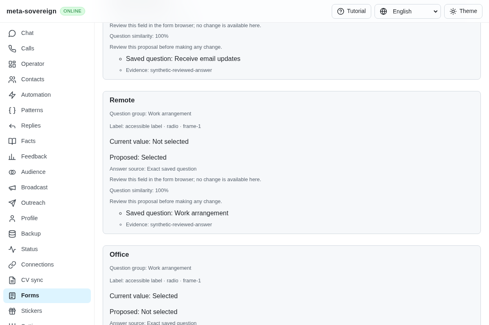
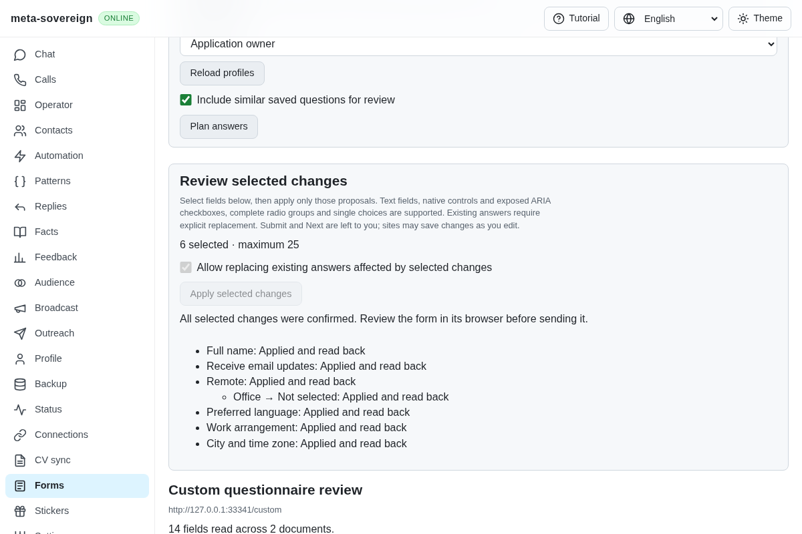
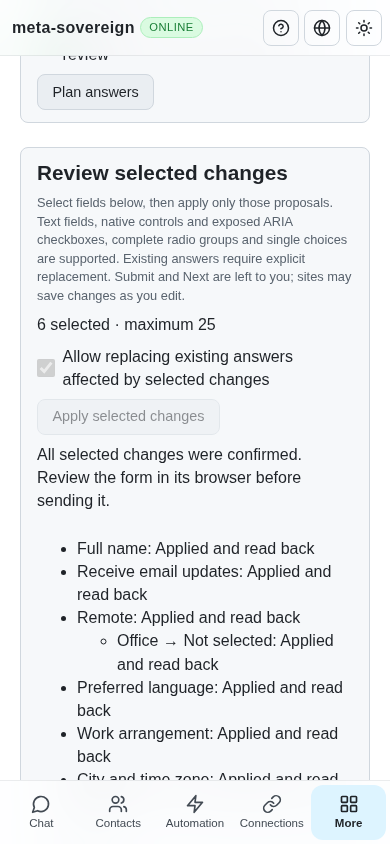

# Reviewed exposed ARIA controls

This extends QA21/QA25 in [PR 57](https://github.com/link-foundation/meta-sovereign/pull/57). Custom textboxes, checkboxes, complete radio groups and exposed single-choice listboxes/comboboxes use the existing selected-only review mechanism. Opening unknown menus, authenticated Google/Yandex forms, uploads, models, accumulated pages, learning, assignments and every other unchecked issue requirement remain unfinished.

## Reproduction and implementation

The preceding `e975396a` reads ARIA controls but does not apply their proposals. Run `experiments/issue-56/forms-custom-before.py` with the installed browser path to capture the missing custom-radio control and its failed assertion. The finite experiment restores every temporarily replaced service module and bundle in `finally`.

The reader counts all descendants of each actual ARIA radiogroup, including hidden peers, while preserving independent native form/name groups. A complete group has known checked states and consistent proposals for every peer. Unsupported external `aria-owns` membership, missing or disabled peers and unknown checked states prevent application. Native submit buttons and links cannot become click targets merely by adding a field role.

Custom listboxes and comboboxes retain bounded option indexes, visibility and ownership. A single enabled, visible option must match the proposed label and have a unique value. Missing controlled elements, truncated options, multiple selection and duplicate values remain unavailable. Controlled popup listboxes are represented by their combobox to avoid treating one selection as two independent answers. The current display text and selected value remain distinct, so owner edits still invalidate a held plan.

Private handles bind both the control and the selected option to the reviewed document. Replacing an option with identical markup or moving it outside its owner refuses the held plan before clicking. Commander fills editable textboxes; connected Playwright element handles click checked controls and exact options because the installed Commander API has no targeted checkbox/select operation. The existing document, knowledge and complete inspected-state guards remain active.

Readback requires the proposed checked state/value and exact option selection. A known popup may close after selection, but unknown changes or inconsistent selection remain uncertain and stop later fields. Radio peer clearing stays disclosed, permissioned and separately receipted. Cached same-plan recovery retains issued results without repeating an interaction. Submit and Next remain owner actions; editing may trigger site autosave.

## Verification

Sixty focused Node checks and twenty-four Deno checks pass, including native compatibility, custom target dispatch, complete-peer refusal, ambiguous/hidden options and inconsistent readback. Strict lint, formatting and the production bundle pass. The actual Chromium Forms flow applies six selected fields across two origins, verifies the cleared radio peer and refuses an identically replaced option before clicking. The predecessor fails the missing custom-radio review assertion. A finite popup probe first reproduced an excluded-field count changing from one to two when a controlled listbox closed; representing that popup only through its combobox keeps the count at one and allows the verified readback. A guarded password getter confirms that an ARIA role cannot expose a protected native value.

Independent Playwright MCP review starts with fourteen inspected fields, six available proposals, no selected changes and one disclosed clearing effect. Replacement refusal retains all six selections. Desktop and phone results contain six confirmed receipts plus the cleared peer, without horizontal overflow at 1,200 and 390 pixels. Fixture readback confirms the actual name, checkbox, radio group, language, combobox and cross-origin city values; unsupported controls remain unchanged. Six input/click events, only GET requests, zero submissions and acknowledged browser closure are recorded.

These focused results, failed-before probes and independent MCP desktop/phone evidence are retained in the [raw archive](data/forms-reviewed-custom.tar.gz) with its [verified manifest](data/forms-reviewed-custom.tar.sha256.json). The shared browser flow runs in both hosted browser lanes; wider matrices stay in CI.

Before:

After:

Phone:

## Hosted CI context

The preceding radio head `e975396a` has four passing auxiliary workflows; its runtime matrix is still running at this evidence capture, with the macOS Bun job reported cancelled. GitHub refuses that job's log while the workflow remains active; the response and job metadata are preserved for follow-up. Its link run [42850196906](https://github.com/link-foundation/meta-sovereign/actions/runs/42850196906) initially failed on a pinned TDLib source URL returning HTTP 503 (complete log lines 313–315 and 424–430). Its same-SHA rerun passes without suppressing or changing the source link.

Prefilling head `afaf8bed`'s [runtime run 42846576996](https://github.com/link-foundation/meta-sovereign/actions/runs/42846576996) did not pass: its complete WebKit job log confirms Forms passed at 16:00:18 UTC (line 2193), then cancellation during `lino-sync` at 16:03:05 (line 2318). Pipeline lines 249–252 report cancelled test/browser jobs and an abandoned native job. The available workflow log lacks an unavailable native job log and is identified as partial in archive metadata. The earlier `2bbf8998` macOS WebKit identity refusal remains unreproduced; see [native prefilling](forms-reviewed-prefill.md). Each subsequent head still requires exact-head CI checks.
