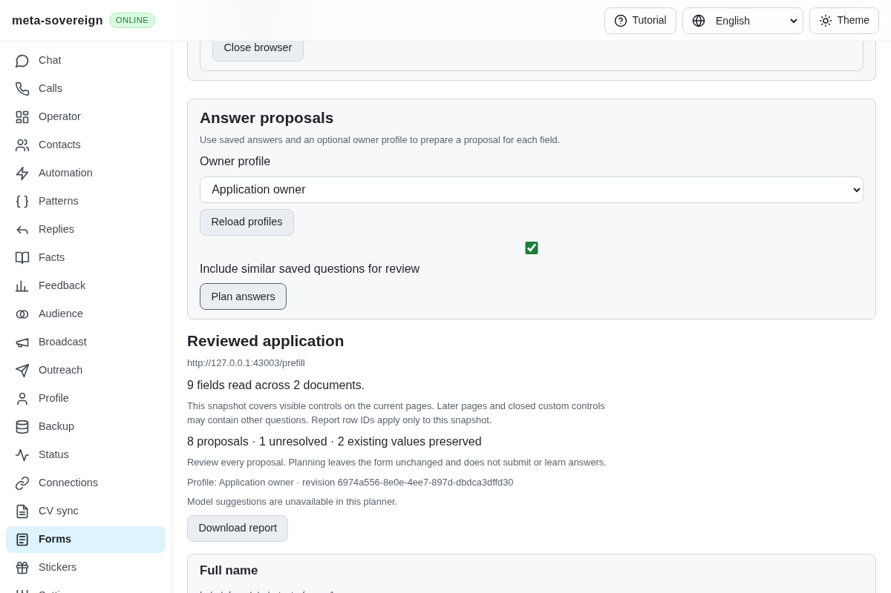
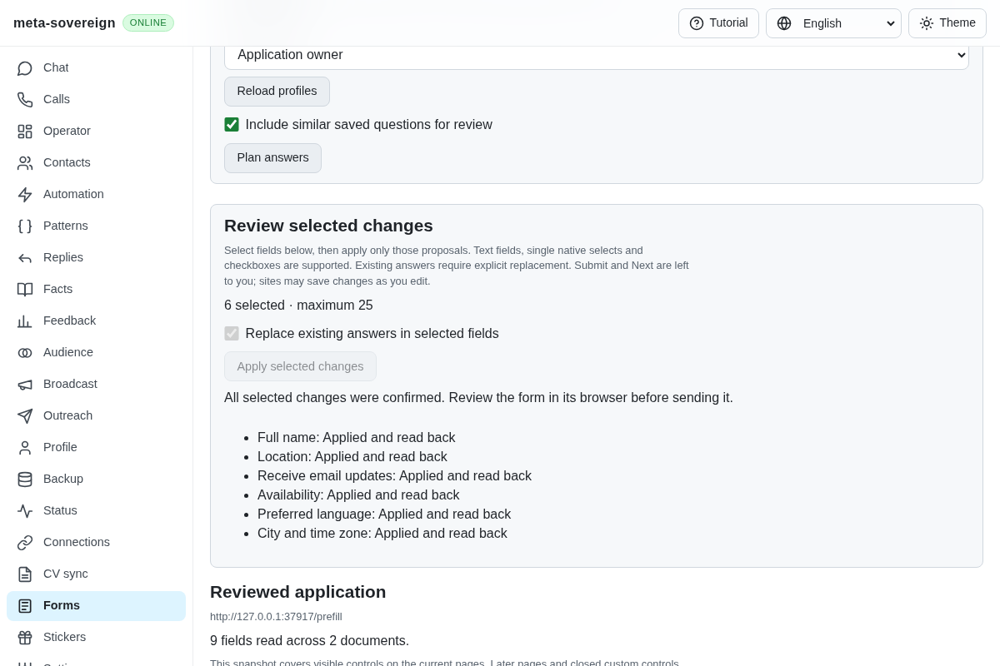
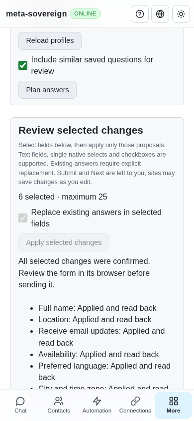

# Reviewed native form prefilling

Implementation and verification for [PR 57](https://github.com/link-foundation/meta-sovereign/pull/57), extending QA21/QA25 and the pinned external-form requirements. This step applies explicitly selected native text, single-select and checkbox proposals in an owned review browser. Radio/custom controls, models, accumulated pages, submission/edit learning and complete provider parity remain required.

## Reproduction and resulting behavior

Head `2bbf8998` can read and plan answers but cannot apply a reviewed proposal. `experiments/issue-56/forms-prefill-before.mjs` reproduces the missing service method. The finite `forms-prefill-before.py` experiment serves the preceding production bundle in the isolated browser fixture, captures the missing controls and fails its prefilling assertion; it restores the current bundle in `finally`.

After opening and reading a review browser, Plan answers now reads its actual current page and retains private element handles. The owner selects individual proposed fields, reviews their sources and separately permits replacement of selected existing answers. Nothing starts selected. One application accepts at most 25 fields and its plan expires after ten minutes. A reread or new plan invalidates the preceding held targets.

Plans bind the original documents, element identities, field positions and complete inspected state. Reloads, navigation, replacement controls and newer owner answers refuse stale plans. Each write rechecks the current saved-answer/profile policy and actual page, then reads the resulting value back. A storage guard can await another writer, so the page is checked after that wait; a held-storage regression caught and verifies this ordering. Only the intended field change is accepted. Additional page changes stop remaining fields.

Receipts distinguish applied/read-back, already matching, not attempted and uncertain fields. An interrupted batch retains earlier confirmed changes. An issued write with an unknown result consumes the plan and cannot replay. An explicit same-plan retry recovers its cached receipt, including when the first HTTP response was lost. Public returned objects are copies, so callers cannot edit a private proposal into a different write. Shutdown owns issued operations and prevents subsequent fields from starting.

The tool does not activate Submit or Next, learn answers or claim a submission. A site can save data in response to editing; the UI explains this before applying changes. This step deliberately leaves radio and custom controls unavailable rather than applying unreviewed group side effects.

## Shared implementation

The same service backs `POST /api/forms/sessions/plan` and `/apply`, negotiated text/binary Lino and the four-language UI. Existing origin checks and 8 KiB body limits apply; browser HTTP recovery does not repeat these operations. The interactive `forms-review` CLI adds `plan <slot>` and `apply <slot> <plan-id> <field-id,...> [replace]`, using `--profile-id` and the shared approximate-answer setting. IDs come from the live plan, not an imported report.

Text/contenteditable filling uses the connected browser commander's public element-targeted operation. Its installed API has no element/frame-targeted checkbox or select operation, so these use the connected Playwright element handle and the same document guards/readback. No host-side CSS selector is treated as a durable target.

The real browser fixture also exposed a planner error: contact words in boolean labels, such as “Receive email updates,” incorrectly selected the owner's literal email instead of its saved Yes/No answer. A failing-before regression now passes for email/GitHub choices. Boolean controls remain in the shared saved-answer planner. Forms checkbox sizing now follows the common control size, with adjacent wrapping labels on desktop and phones.

## Verification and limits

- Fifty-one focused Node checks pass for reader, planner, review sessions, prefilling, CLI/Lino and four-language rendering. Fifteen focused Deno checks pass. Strict changed-source lint, formatting and the production web build pass.
- The production Chromium flow checks explicit replacement refusal, retained selection, newer-owner-answer refusal, six selected native/cross-origin changes, unchanged unselected content and a deliberately lost application response. Explicit retry returns the same six receipts without additional page events. Same-URL reload refuses old targets; browser close is acknowledged with zero submissions. The same focused production flow also passes in local Linux WebKit. It is registered in both existing hosted browser lanes.
- Independent Playwright MCP reads nine fields, offers seven supported selections and starts with none selected. Missing replacement permission returns the expected refusal without losing selection. Four selected changes are read back. At 1200 and 390 pixels, document width equals viewport width with no UI alerts; close removes the browser card and retains all four receipts. The fixture independently records the chosen name/location/checkbox, unchanged email/date/language, GET-only requests, zero submissions and acknowledged cleanup. Console entries are the fixture favicon 404 and expected replacement-refusal HTTP diagnostic.
- The preceding head `2bbf8998` passed Pages, links, security and desktop checks, but [Checks 42839137051](https://github.com/link-foundation/meta-sovereign/actions/runs/42839137051) failed in macOS WebKit: full-log line 22087 reports the first form-report assertion, and its screenshot shows a document-change refusal before prefilling. Complete logs, timestamps, job metadata and the failure screenshot are preserved in the evidence archive. Three finite direct WebKit inspections and the single production Forms flow pass locally on Linux; the macOS refusal remains unreproduced. Optional identity tracing is off in production and enabled in the hosted synthetic fixture, without recording field answers. A focused regression verifies its output. New-head hosted CI still must pass. Synthetic fixtures establish the shared mechanism, not authenticated Google/Yandex, CAPTCHA completion or all external-site behavior.

Before:

After:

Phone:

The [raw evidence archive](data/forms-reviewed-prefill.tar.gz) and [verified manifest](data/forms-reviewed-prefill.tar.sha256.json) retain failed-before experiments, checks, MCP observations and source hashes. Wider native/custom choices, optional model proposals, multipage accumulation, stable-edit/submission learning, assignments and all other unchecked issue requirements remain unfinished.
