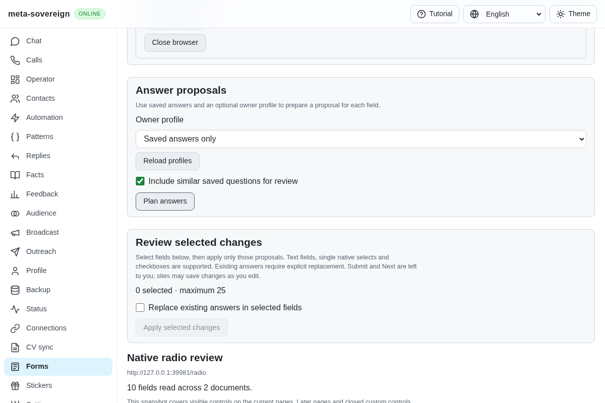
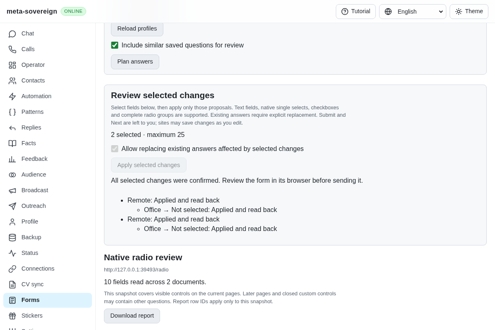
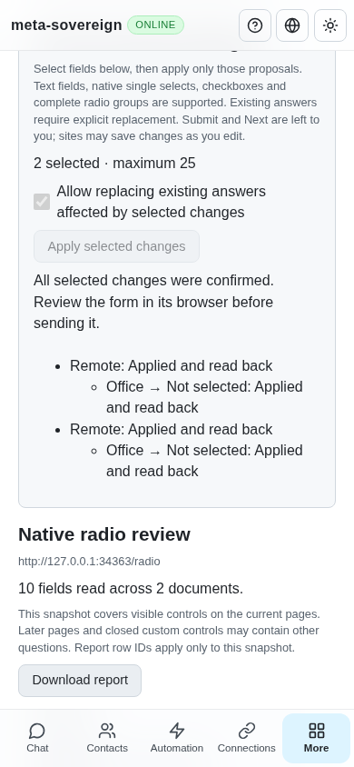

# Reviewed native radio groups

Implementation and verification for [PR 57](https://github.com/link-foundation/meta-sovereign/pull/57), extending QA21/QA25. This step supports explicit native radio choices and their disclosed group changes. Custom/ARIA choices, models, accumulated pages, edit/submission learning, assignments and the broader issue requirements remain unfinished.

## Reproduction and group behavior

Head `afaf8bed` offers native text/select/checkbox prefilling but leaves radio proposals unavailable. The finite `experiments/issue-56/forms-radio-before.py` experiment serves its service modules and production bundle in the isolated Forms fixture. It captures the before screen and fails “native radio option can be reviewed,” then restores every changed source in `finally`.

A native radio choice can clear a different control. Its actual group follows the exact name and form owner, including controls linked through the `form` attribute. Fieldsets provide question labels but do not define exclusivity. Separate forms and unnamed controls must remain independent. The reader now records bounded native group membership, counting hidden and disabled peers as well as visible ones. The shared planner uses this identity across fieldsets. The live reviewer accepts a positive radio proposal only when all group members were read, remain unprotected and have consistent proposals. Incomplete or conflicting groups remain unavailable.

Before applying an option, the UI and CLI plan disclose the currently selected option that will be cleared. Replacement permission covers these affected existing answers even when the chosen option was empty. Only positive proposals are selectable; the tool never attempts to uncheck a native radio by itself. Both selected controls and affected peers retain private element bindings. Existing document, pointer, current-answer and knowledge guards apply to the whole operation.

Readback verifies the selected option, the cleared peer and every other inspected field. Separate forms and frames retain their own groups. Receipts report the clearing effect as applied only after successful readback; an unknown or inconsistent result remains uncertain and stops later fields. Cached same-plan retry still recovers the original result without replaying the interaction. Already selected options cause no write. Submit and Next remain owner actions, and no answers are learned here.

## Shared controls and verification

The existing interactive CLI, trusted text/binary Lino session API and four-language Forms controls use the same mechanism. Plans expose the affected peer, and results retain its actual receipt. Unsupported fields now explain that review must continue in the form browser. Replacement wording includes affected answers, so it covers implicit radio changes accurately.

- Fifty-five focused Node checks and nineteen focused Deno checks pass. New regressions cover permission for peer clearing, bound peer targets, separate groups, missing/disabled/conflicting peers, changed state, unknown readback, cached retry and already selected options. Four-language rendering checks disclosed effects, status wording and escaped labels. Strict changed-source lint/formatting and the production web build pass.
- The production Chromium Forms flow checks form ownership across fieldsets and an external `form` attribute, separate forms with the same names, unnamed independent controls, cross-origin groups and hidden peers. It refuses replacement without permission, applies two selected choices, confirms both cleared-option receipts and preserves an unrelated selected option. Adding a hidden peer invalidates the held plan before any interaction. Cleanup is acknowledged with zero submissions. This flow remains in both hosted browser lanes; broad runtime/browser coverage is left to CI.
- Independent Playwright MCP starts with ten reported controls, five available positive selections, three disclosed clearing effects and nothing selected. A missing replacement permission preserves both selections. The two selected changes and their two clearing receipts are confirmed at 1200 and 390 pixels without horizontal overflow or UI alerts. The fixture independently records the actual native checked states, unchanged other-form/hidden/unnamed controls, six expected interaction events, GET-only requests, zero submissions and acknowledged closure. Console entries are the fixture favicon 404 and expected replacement-refusal HTTP diagnostic.

Before:

After:

Phone:

The [raw evidence archive](data/forms-reviewed-radios.tar.gz) and [verified manifest](data/forms-reviewed-radios.tar.sha256.json) preserve the failed-before browser check, focused checks, independent observations and source hashes. New-head hosted CI remains required. The preceding macOS WebKit document-identity refusal remains documented in [native prefilling](forms-reviewed-prefill.md); a passing local Chromium fixture does not establish its cause.
