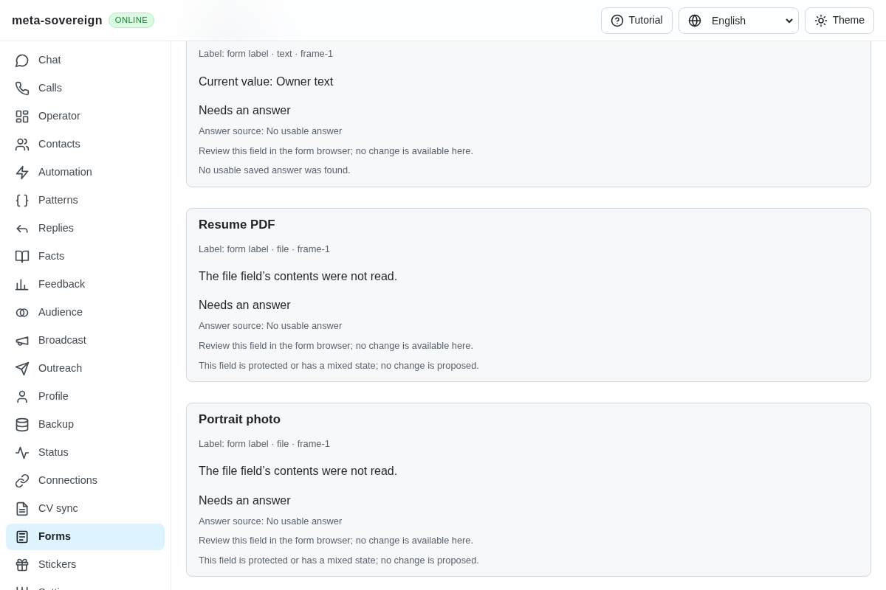
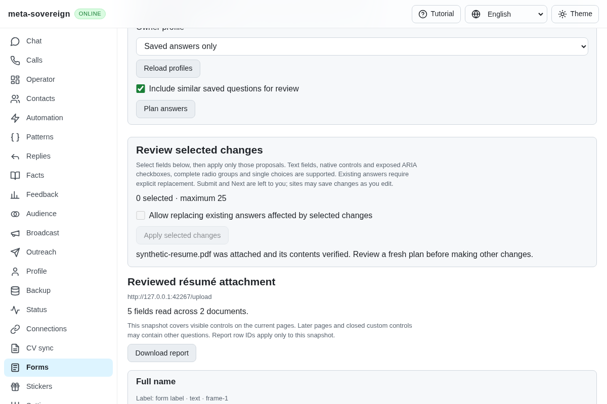
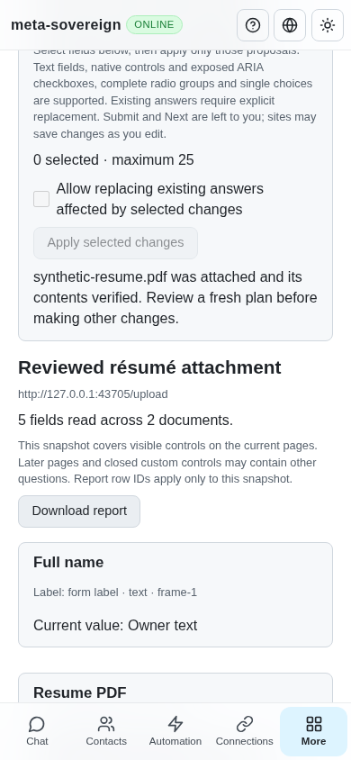

# Reviewed PDF résumé attachment

This extends QA21/QA25 and the B8 foundation in [PR 57](https://github.com/link-foundation/meta-sovereign/pull/57). Owners can choose a local PDF and explicitly attach it to one reviewed native résumé field, including a cross-origin frame. Configured/default résumé selection, optional model generation, accumulated pages, learning, assignments and every remaining issue-wide criterion stay unfinished.

## Reproduction and behavior

The preceding `32253199` inspects file fields but offers no attachment action. Run `experiments/issue-56/forms-upload-before.py` with the installed Chrome path. The finite production-browser probe captures the missing action, fails the corresponding assertion and restores the temporarily replaced source and bundle in `finally`.

The CLI accepts `forms-review --resume-pdf=<path>` followed by `attach <slot> <plan-id> <field-id> [replace]`. Trusted text/binary Lino POST and shared four-language Forms controls use the same owned service. The API receives chosen bytes, never an arbitrary server filesystem path. Native single-file résumé/CV fields accepting PDF are supported; directories, multiple files and unrelated image fields remain unavailable. Input is bounded to 8 MiB, a plain PDF basename, canonical base64 and PDF header/end signatures. This is signature validation, not a complete PDF parser.

The service checks the held plan, exact documents and element handles, current field metadata and other answers. Replacing an attached file requires separate permission. The plan is consumed before issuing attachment; HTTP mutation retries are disabled. An attached result requires actual file metadata and SHA-256 bytes to match, plus unchanged surrounding fields. Failed preflight is refused; lost acknowledgements, unreadable bytes or unexpected changes after issue remain uncertain. Cached same-plan recovery does not attach again. The receipt retains file metadata/digest without the PDF bytes. Another change requires a fresh plan. Submit and Next remain owner actions; sites may upload a file immediately after attachment.

## Focused verification

Eighteen Node checks and twelve Deno checks pass with 384 MiB heaps. They cover explicit attachment, separate replacement permission, invalid/oversized files, stale/replaced controls, actual byte mismatches, lost acknowledgements, cached recovery, trusted origins, text/binary transport, bounded CLI file loading, shutdown ownership and four UI locales. Strict changed-source lint, formatting and the production web bundle pass.

The production Chromium flow attaches a synthetic PDF in the main document and cross-origin frame, verifies actual digests, recovers a response without another upload, preserves unselected text/image fields and refuses an identically replaced control before issue. It records zero submissions and acknowledged cleanup. The existing hosted browser registry includes this flow; the full matrix belongs to CI.

Independent Playwright MCP starts with five fields, two enabled attachment controls and zero selected changes. It chooses the PDF through the visible file chooser, explicitly attaches each field using separate fresh plans and confirms the old actions disappear. Desktop and phone receipts show the verified attachment without horizontal overflow. Final fixture readback contains two 599-byte files with SHA-256 `89b6b1abd9be94d8896c57a64af2d45ff6c383170931885fb0be391702cf1ff9`, unchanged owner text, empty portrait/multiple controls, four input/change events, only GET requests, zero submissions and a closed review browser.

Commands, raw results, CI evidence and source hashes are retained in the [archive](data/forms-reviewed-upload.tar.gz) and [verified manifest](data/forms-reviewed-upload.tar.sha256.json).

Before:

After:

Independent phone review:

## Hosted CI investigation

The preceding custom-control head `a7682ac7` finished its [runtime run 42855655761](https://github.com/link-foundation/meta-sovereign/actions/runs/42855655761) with a WebKit Forms refusal. Job log line 2199 reports `form-changed` before any selected write; all six receipts are not attempted. Other runtime/native checks, including macOS Bun, passed. A focused local WebKit custom-control flow passes. The hosted refusal cause remains unproven. Optional tracing, off by default, now distinguishes document, control and option guards and application errors without removing those guards.

On choice head `32253199`, [link run 42859450035](https://github.com/link-foundation/meta-sovereign/actions/runs/42859450035) first failed with a pinned Signal source returning HTTP 503 (lines 427–437). A same-SHA rerun passed that URL but failed with HTTP 503 on a pinned Matrix source (attempt 2, lines 431–435). Both URLs returned HTTP 200 during direct local verification. Attempt 3 reported 42 errors, again HTTP 503s across changing GitHub sources (summary line 459). The raw logs and rerun state are retained. These are observations of transient remote errors, not reasons to suppress link validation. New-head CI and every remaining acceptance criterion are still required.
