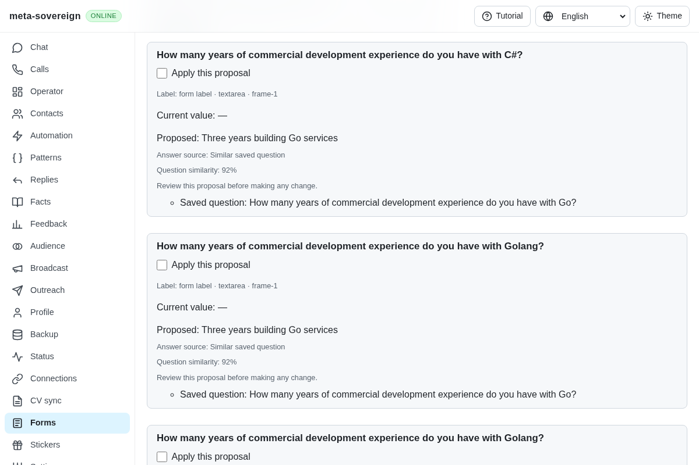
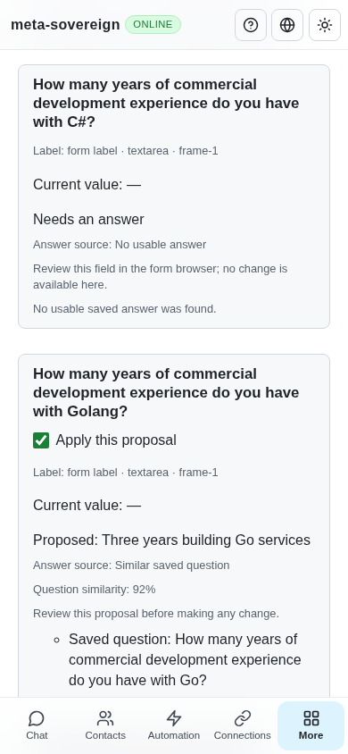
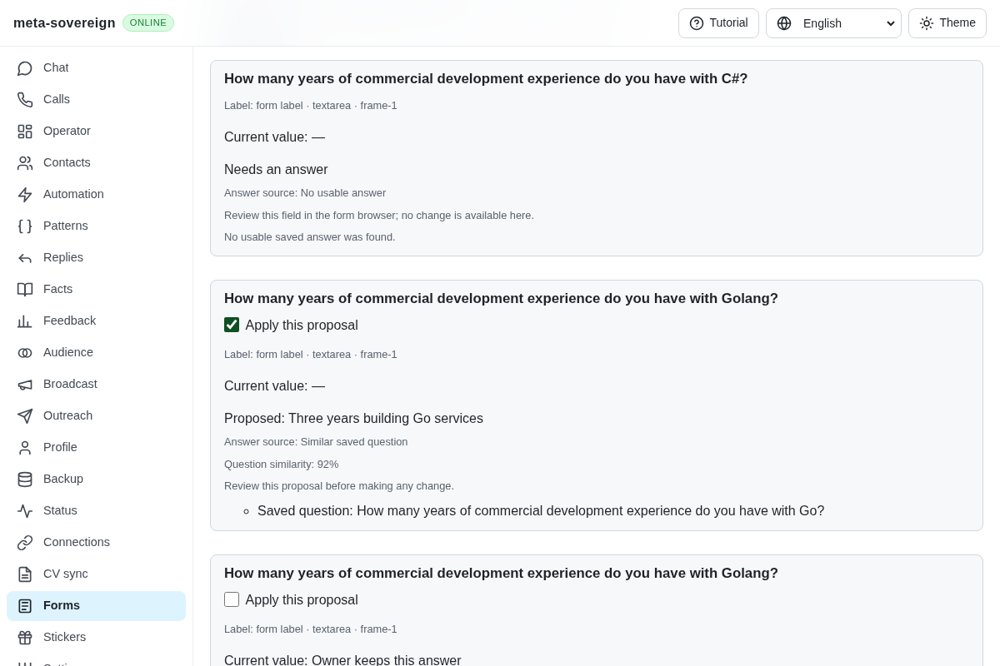

# Preserve the subject of a saved question

[PR 57](https://github.com/link-foundation/meta-sovereign/pull/57) fixes a shared chat/form matching defect: a saved Go answer was offered for a C# question because the ordered token score was 92%. Currency and employment questions with the same surrounding words had the same problem. A template gap could also absorb a new technology.

Reference [A4/B6](https://github.com/konard/hh-job-application-automation/blob/fa0991b8c2d0896fb3b4be6c69947f0590094b15/docs/requirements/forms-and-chats.md) requires matching to preserve subjects such as C#/Go, dollars/rubles, ИП/ТК РФ and GitHub/LinkedIn. The pinned reference tests and related merged PRs were read for behavior; implementation was written independently.

The shared matcher now compares literal subject sets before approximate reuse or template expansion. Its bounded catalog includes common technologies, roles, contact providers, explicit currencies and Russian employment arrangements. Known aliases such as Golang/Go, Cyrillic С#/Latin C#, JS/JavaScript and Докер/Docker share an identity. Previously unseen mixed-case identifiers are retained case-insensitively across the comparison. Adding or removing an identified subject leaves the question unresolved. Handles, remote and fulltime are qualifiers; English “go” requires technical context. The ambiguous ¥ sign is not inferred to mean either JPY or CNY.

Exact normalized saved questions and explicit owner-authored alternative questions retain their authority. Approximate aliases retain their actual token score and require review. Existing scoped rules, missing-value review, salary calculation, choice matching, knowledge limits and delivery guards continue through the same engine. This change neither lowers the existing similarity threshold nor changes the unique offered-option policy.

## Reproduce and verify

Save “How many years of commercial development experience do you have with Go?” with answer “Three years building Go services”. Plan a form with the same question ending in C#, another ending in Golang, and an already answered Golang field. The preceding commit `5d0f67b0` offers the Go answer for C#. After the fix, C# has no selectable proposal, Golang offers a reviewable approximate answer, and the existing owner value stays protected.

The initial six-case regression draft fails five cases before the fix. The production Chromium baseline fails the C#/Go assertion and captures the incorrect proposal. The final seven regression cases plus existing form-planning and question-automation checks total **33 passing tests in Node and the same 33 in Deno**:

```sh
NODE_OPTIONS=--max-old-space-size=384 node --test --test-concurrency=1 --test-timeout=15000 js/tests/question-subjects.test.js js/tests/forms-answer-plan.test.js js/tests/question-automation.test.js
deno test --v8-flags=--max-old-space-size=384 --allow-all --no-check js/tests/question-subjects.test.js js/tests/forms-answer-plan.test.js js/tests/question-automation.test.js
RUN_BROWSER_E2E=1 E2E_EXECUTABLE_PATH=/opt/google/chrome/chrome FORMS_SUBJECTS_ONLY=1 FORMS_SUBJECTS_SCREENSHOTS=1 CI_BROWSER_DEBUG=1 NODE_OPTIONS=--max-old-space-size=384 node js/tests/e2e-forms-reader-browser.mjs
```

The regression covers wrong technologies/roles, added subjects, mixed-case names, currency and employment mismatches including a negative ИП clause, correct aliases, template gaps, explicit owner alternatives, exact-only mode, shared chat/form previews, scoped rules, unchanged knowledge, actual CLI and both text/binary Lino transports without launching a browser. Strict changed-code lint, scoped formatting and the production web bundle pass.

Production Chromium and independent Playwright MCP both apply only the reviewed Golang proposal, confirm one actual field receipt, preserve the unresolved C# field and owner content, close the owned browser, and record zero submissions. Both verify 390-pixel layouts. MCP's only console error is the fixture's missing favicon; no JavaScript exception is recorded. The scenario is registered in the normal hosted form-browser sequence.








The [verified archive](data/forms-subjects.tar.gz) and [manifest](data/forms-subjects.tar.sha256.json) retain complete focused logs, source snapshots, reference tests, actual browser receipts and screenshot hashes. The reusable collector is [collect-forms-subjects.py](../../../experiments/issue-56/collect-forms-subjects.py).

## Remaining required work

This verifies a shared subject-preservation mechanism for A4/B6 and QA02/QA04/QA22. The literal catalog cannot identify every technical term or semantic distinction; unknown wording may still need explicit owner alternatives. Broader rewording similarity, configurable thresholds/case sensitivity and complete sorted-match inspection from reference PR 123, complete HH/external form option parity, automatic filling, live provider execution and all other unchecked issue criteria remain required. The earlier hosted model-name reload, valid-refusal and Contacts navigation failures remain unexplained. Current-head full CI is required; this focused result does not resolve those failures. PR 57 remains draft and unmerged.
