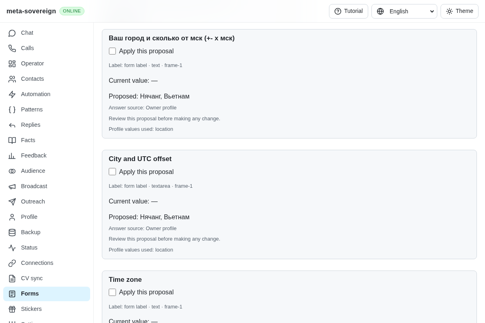
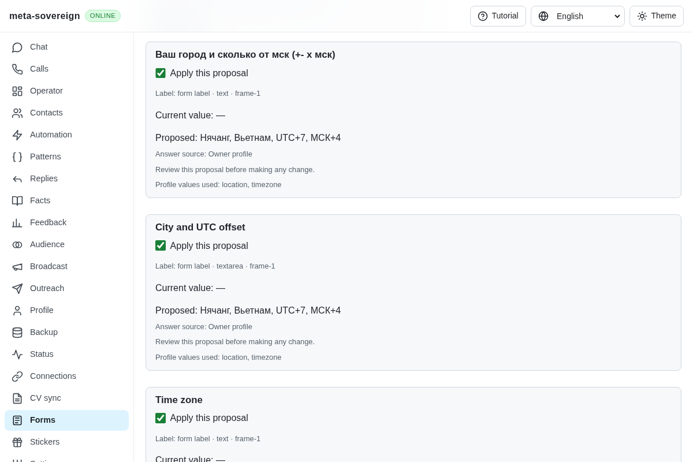
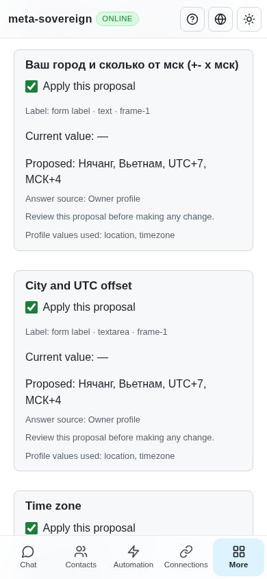

# Reviewed city and time-zone answers

[PR 57](https://github.com/link-foundation/meta-sovereign/pull/57) now includes both configured profile values when a form asks for the city and a time zone or Moscow/UTC/GMT offset. Separate city and zone controls still receive only their requested value. Missing requested values stay unresolved, and existing owner input remains protected by the reviewed application flow.

## Requirement and cause

Reference requirement [B25](https://github.com/konard/hh-job-application-automation/blob/fa0991b8c2d0896fb3b4be6c69947f0590094b15/docs/requirements/forms-and-chats.md) asks for the configured city plus time zone, including labels such as “Ваш город и сколько от мск (+- х мск)”. The current reference head and recent related PR search were checked; the source behavior was studied without copying implementation.

The form contact matcher recognized `город` and `city`, but recognized time zones only through full names such as `time zone`. A saved profile containing `location: Нячанг, Вьетнам` and `timezone: UTC+7, МСК+4` therefore proposed only the city for this question. It also accepted the incomplete city answer when the requested zone was missing. Explicit text profile extraction did not recognize a time-zone field at all.

The shared form matcher now recognizes explicit offset phrases and abbreviated standards alongside a city, or as a standalone short label. An ordinary technical mention of UTC/MSK is not sufficient. The existing employer/decision exclusions remain in effect. Text/Markdown contact extraction accepts explicit zone labels in all four UI languages, with source lines and current-value conflict protection. The answer uses owner-configured text; it does not infer a zone from a country or calculate an offset.

Before: the proposal omits the requested zone.



After: the shared review shows both configured values and their profile keys.





## Reproduction and verification

Save the two profile fields above, open the isolated `/timezone` form, read it, select the saved profile and plan answers. The old code omits the zone in the first two fields. Five of the six new focused tests fail before the change; the production Chromium assertion also fails after saving the before screenshot.

After the change, all 37 focused tests pass in Node and Deno. These cover combined and separate labels, missing values, all four UI languages, source evidence/current-value conflicts, named profiles and overrides, CLI plus text/binary Lino, and existing contact/proposal behavior. Lint, scoped formatting and the production bundle pass.

```sh
NODE_OPTIONS=--max-old-space-size=384 node --test --test-concurrency=1 \
  js/tests/forms-timezone.test.js js/tests/forms-answer-plan.test.js \
  js/tests/question-profile-source.test.js js/tests/question-profile-resume.test.js
deno test --v8-flags=--max-old-space-size=384 --allow-all --no-check \
  js/tests/forms-timezone.test.js js/tests/forms-answer-plan.test.js \
  js/tests/question-profile-source.test.js js/tests/question-profile-resume.test.js
RUN_BROWSER_E2E=1 E2E_EXECUTABLE_PATH=/opt/google/chrome/chrome \
  FORMS_TIMEZONE_ONLY=1 FORMS_TIMEZONE_SCREENSHOTS=1 \
  CI_BROWSER_DEBUG=1 NODE_OPTIONS=--max-old-space-size=384 \
  node js/tests/e2e-forms-reader-browser.mjs
```

Production Chromium verifies four selected fields with four actual readback receipts, the exact combined/separate values, preserved owner content, an unresolved technical UTC question, phone width, acknowledged browser closure and zero submissions. The same scenario is included in the normal hosted Forms registry. The independent Playwright MCP check confirms four visible receipts, the desktop and 390-pixel layouts and review closure; the isolated server's final receipt independently records the exact actual input values and zero submissions. Its console contains only the fixture favicon 404. All fixture/browser processes were closed.

To reuse the MCP check, start `experiments/issue-56/forms-reader-ui.mjs` with `FORMS_TIMEZONE_MCP=1`, navigate to the printed app URL with `?fixture=<encoded printed form URL>` before the hash, and run `experiments/issue-56/forms-timezone-mcp.mjs` as the browser tool's function expression. Strip its final semicolon if passing it as inline code.

The [verified evidence archive](data/forms-timezone.tar.gz) and [manifest](data/forms-timezone.tar.sha256.json) retain reference metadata, full focused logs, source/test/probe files, MCP and actual-value receipts, and hashes of all five screenshots. Recreate it with `python3 -B experiments/issue-56/collect-forms-timezone.py` after regenerating the named evidence.

B25's configured-value mechanism is verified across CLI/Lino/shared review. Automatic filling/source discovery and complete provider parity remain required under QA22 and the other unchecked criteria. Previous hosted model-name, valid-refusal and Contacts navigation failures remain separate open investigations. At the latest precommit check, parent `75da379b` passes Pages and links; its full Checks matrix is still queued. This unit needs its own hosted matrix. PR 57 remains draft and unmerged.
