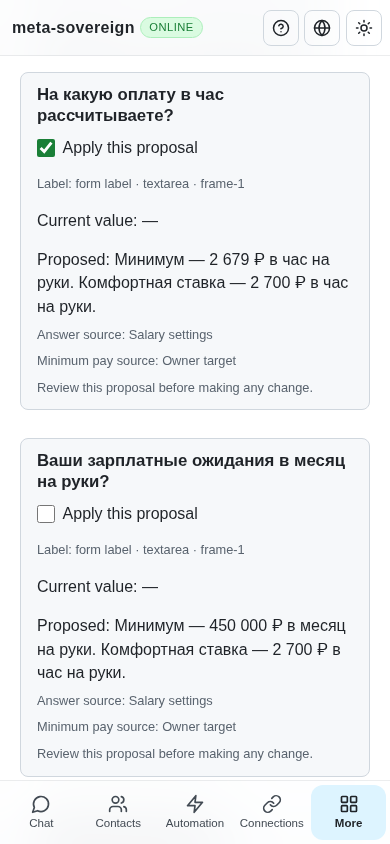
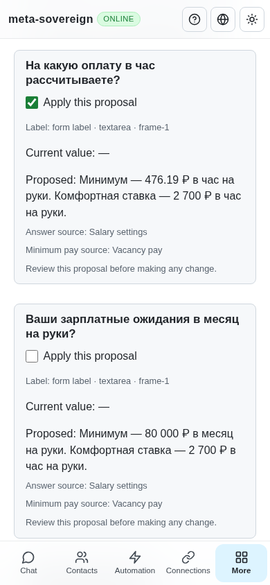

# Use the HeadHunter vacancy’s advertised pay in Forms

Open a saved HeadHunter conversation whose vacancy header identifies the employer’s posting and whose message contains an application form link. Open that link in Forms and plan with an owner profile that specifies 450,000 ₽ net per month and a comfortable rate of 2,700 ₽ net per hour. On the published parent `e90c2d02`, the form redirects successfully. The hourly proposal uses the owner minimum of 2,679 ₽ even though the linked vacancy advertises 60,000–80,000 ₽ net per month. [Pinned B26 and B27](https://github.com/konard/hh-job-application-automation/blob/fa0991b8c2d0896fb3b4be6c69947f0590094b15/docs/requirements/forms-and-chats.md#L208) · [PR #57](https://github.com/link-foundation/meta-sovereign/pull/57).

The shared planner uses the current exact chat link and verified form redirect to select the vacancy. It reads the public posting through the existing browser policy and reuses the observed vacancy snapshot. With the owner’s default 168 hours per month, the review proposes a minimum of 476.19 ₽ an hour and the separate 2,700 ₽ comfortable rate. The same vacancy proposes 80,000 ₽ for a monthly question. A frame’s visible pay statement takes precedence, including an ambiguous statement that needs review. An explicit vacancy supplied through CLI or Lino takes precedence over chat discovery. Conflicting sources or an unreadable posting leave the pay field unresolved. A readable vacancy with no advertised pay retains the owner target. Only pay fields use the discovered vacancy. Vacancy-specific responses remain excluded from reusable learning.

Applying selected fields rechecks the form’s chat association and the observed snapshot from local storage. A changed association requires a fresh plan. The apply step opens no vacancy browser.

## Reproduction and verification

```sh
python3 -B experiments/issue-56/forms-vacancy-pay-parent.py
python3 -B experiments/issue-56/forms-vacancy-pay-parent.py --browser
RUN_BROWSER_E2E=1 FORMS_VACANCY_PAY_ONLY=1 FORMS_VACANCY_PAY_SCREENSHOTS=1 node js/tests/e2e-forms-reader-browser.mjs
```

Set `E2E_EXECUTABLE_PATH` to an installed Chromium binary if Playwright’s default browser is unavailable. The parent replays use the exact published production source. Four regressions fail on that source. The corrected planner passes 53 focused checks in Node and the same 53 in Deno. Coverage includes the selected owner profile, explicit override, form introduction, conflicting and unreadable evidence, the CLI and both Lino encodings. [Regression tests](../../../js/tests/forms-pay-guidance.test.js).

Chromium captures a native HeadHunter conversation, follows the original form link through its redirect, and reads the exact advertised range from the vacancy DOM. Removing the original chat evidence makes Apply refuse before a form write. Restoring the evidence and planning again uses the existing snapshot. Applying only the selected hourly answer produces one receipt. The monthly and technical fields stay empty, owner text is preserved, and the employer form receives no submission. This scenario runs in the hosted Forms answers group. [Browser scenario](../../../js/tests/helpers/e2e-form-pay.mjs).

Independent Playwright MCP repeats the 390-pixel review from a common-chat import with the same vacancy DOM and redirect. All five Forms operations return HTTP 200, the selected field has one native readback, and the fixture logs one vacancy GET and zero employer submissions. The console contains a fixture favicon 404. Both browser sessions close.





The [archive](data/forms-vacancy-pay.tar.gz) and [SHA-256 manifest](data/forms-vacancy-pay.tar.sha256.json) contain the targeted output, source changes and browser evidence. The vacancy and form were routed fixtures. Authenticated provider verification, full pay-expression parity and wider automatic form coverage remain open in QA13 and QA24.
