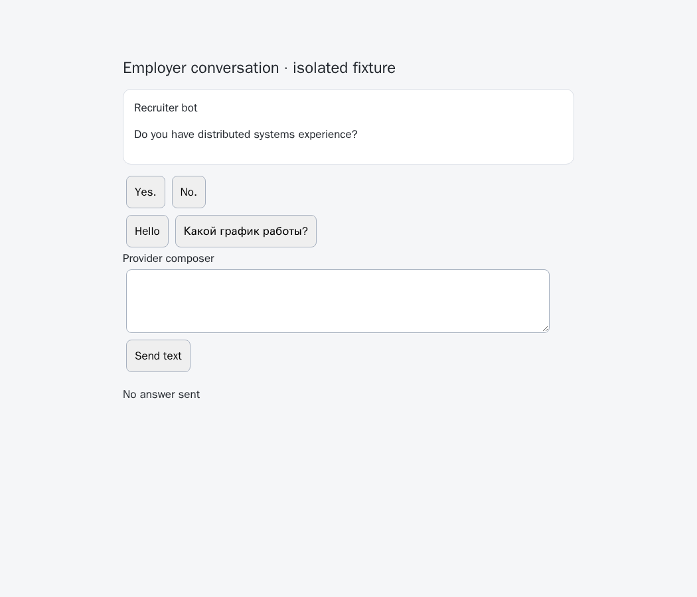
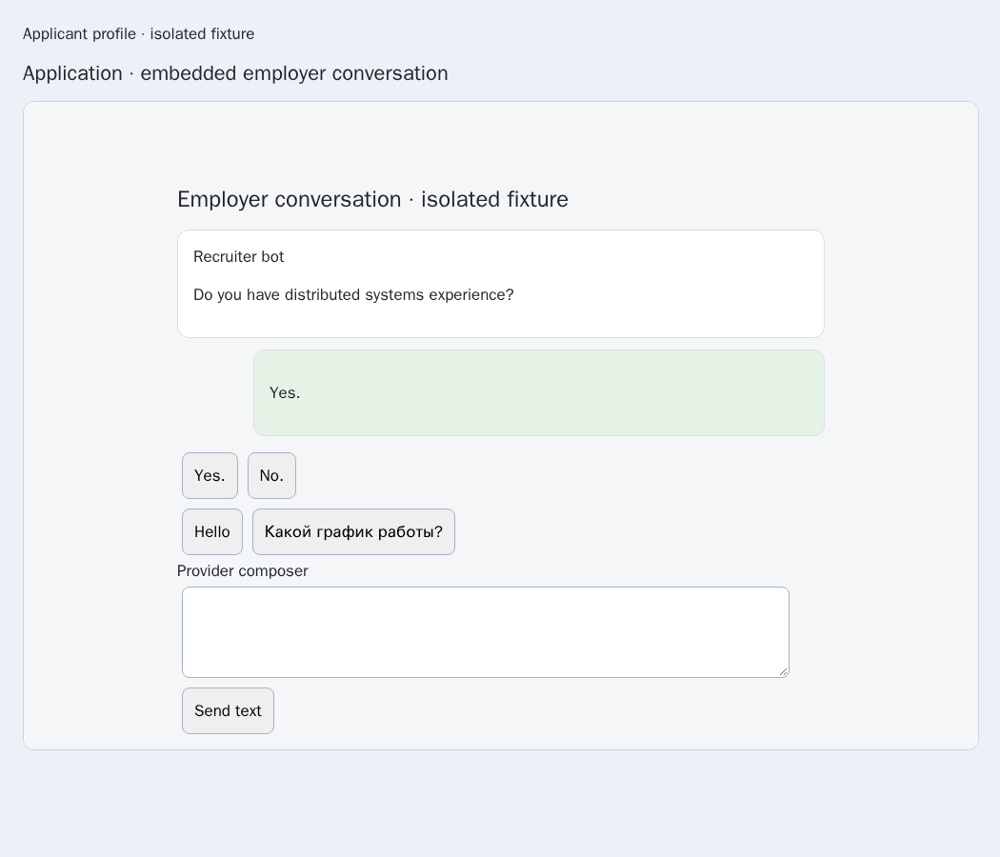
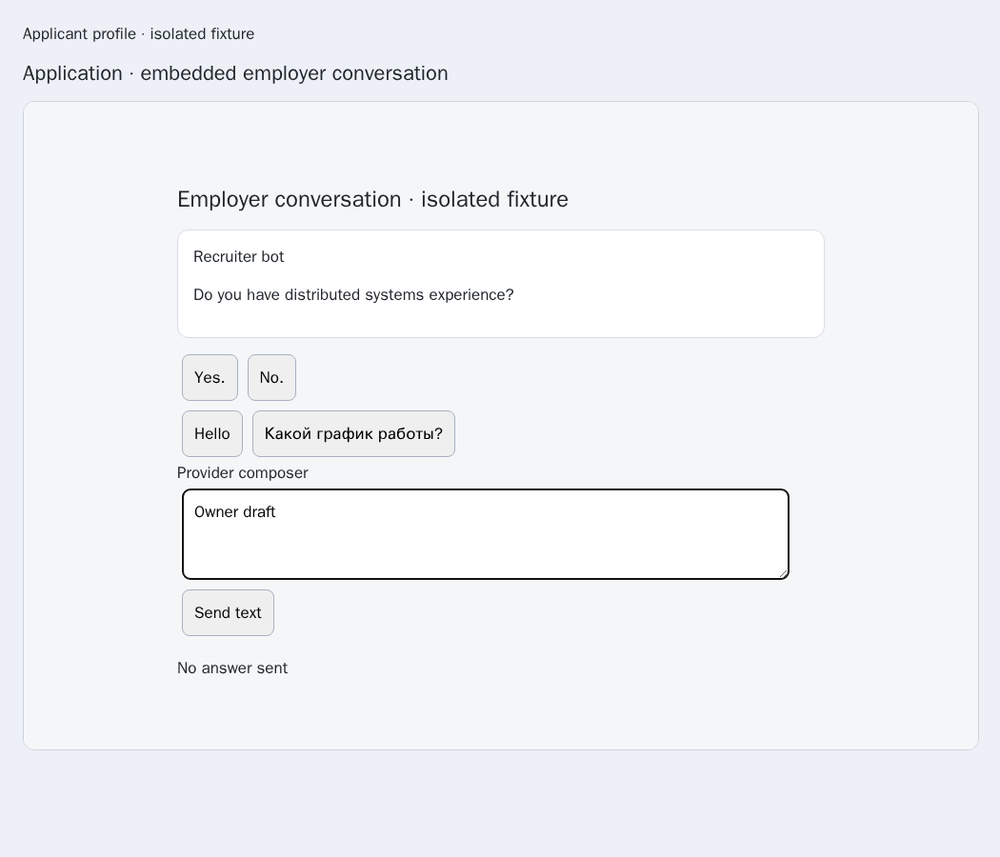

# Built-in HH web-chat answer choices

Issue [56](https://github.com/link-foundation/meta-sovereign/issues/56), [PR57](https://github.com/link-foundation/meta-sovereign/pull/57), parent `2a0fb639a6b0156a0249590b040664ef8fa86fb6`.

The previous browser-choice primitives required a configured adapter and read only its main document. The default sender had no HH web entry. Reproduce with an HH-shaped chat at an explicitly selected numeric web reference and call `readRecent({source:'hh',chat:'7'})`: the parent refuses with `unsupported-source` before inspecting the offered controls. `experiments/issue-56/hh-choices-before.py` restores only the parent registration for the regression, verifies the failure and restores the working file in `finally`.

The built-in adapter accepts a numeric web-chat ID or a validated official `/chat/<id>` URL. HH common-chat API UUIDs and negotiation IDs carry no proven web association and are refused. An explicit `browserUrl` can select an official HH application page; the selected child must still prove the requested numeric chat. A top-level chat route for another conversation is refused. Ordinary HH browser text sending and typing remain unavailable until their separate guarded receipt path is implemented.

At most 32 documents, including the main document, are considered. There must be exactly one visible document with message rows and the requested chat route. Every frame ancestor must remain visible and have an allowed origin. A private document identity distinguishes same-URL replacement; frame URL, owner URL, owner document and unique selection are rechecked around reads and before native clicks. History and current choice metadata come from the same validated snapshot. Descendant HH delivery markers retain actual outgoing direction. Message-attached nonbinary buttons and visible disabled options retain strict state. Greeting suggestions in generic wrappers are excluded; an unambiguous Yes/No pair in a mixed wrapper still qualifies.

Browser-commander still drives main-page reads and native selections. Its API has no frame target, so the adapter narrowly uses the connected Playwright frame for cross-origin evaluation and native locator clicks, as the existing form inspector does. No provider text becomes code.

Navigation or ambiguity after arming removes temporary attributes and event guards. The attempt reservation remains because cleanup cannot establish whether dispatch occurred. The same surviving document refuses another attempt. This does not yet provide durable recovery across document reloads or process restarts; that criterion remains open. Missing receipts remain unknown without ordinary text or API fallback. Owner edits and existing drafts remain protected.

The pinned [reference requirements](https://github.com/konard/hh-job-application-automation/blob/fa0991b8c2d0896fb3b4be6c69947f0590094b15/docs/requirements/forms-and-chats.md) supplied the behavior comparison. No reference implementation was copied.

## Verification

- Five new contract checks, plus existing sender/choice checks: 39 Node and 39 Deno checks.
- Seventeen isolated Chromium cases: main and cross-origin receipts, nested trusted frames, hidden/duplicate/wrong-chat frames, untrusted owner/ancestors, frame bound, owner drafts, attached/disabled controls, manual navigation, lost authority after arming, pointer-dispatch question changes, uncertain retry refusal and held-document replacement.
- Existing configured-adapter browser cases remain covered separately.
- Independent Playwright MCP desktop/mobile checks use the production document resolver and page controller, preserve an edited owner draft, verify one native click and receipt `102`, and reject held authority after owner navigation.
- Both browser families run the registered helper in the existing hosted Questions workflow. The full local browser/runtime matrices are left to CI.

All browser pages are isolated routed fixtures, with no cookies, live HH account, API send or ordinary browser text send. Initial draft failures exposed a missing signed-in fixture marker and controls mounted before the sender's first navigation; the fixtures now establish the page before mounting controls. The additional cleanup contract exposed a synchronous cleanup error masking the original failure; cleanup now retains the actual outcome. Those logs are retained with the passing evidence.

The parent view exposes native choices but has no built-in adapter:

A verified native answer produces the provider's outgoing receipt inside the application frame:

An owner draft blocks selection and remains intact:

QA14 remains unfinished. Shared CLI/Lino/React execution, completed-summary recovery, durable uncertainty across reloads, provider watchers, live authenticated parity and every other unchecked issue criterion remain required. PR57 stays draft and unmerged. Exact-head hosted checks remain required after each push.

The verified source, parent registration, raw focused results, initial draft failures, CI metadata and twelve screenshot hashes are preserved in [the evidence archive](data/hh-browser-choices.tar.gz) and its [SHA-256 manifest](data/hh-browser-choices.tar.sha256.json). Focused strict lint, formatting, secret scanning and the existing duplication gate pass (6.47%, below 6.5%).
