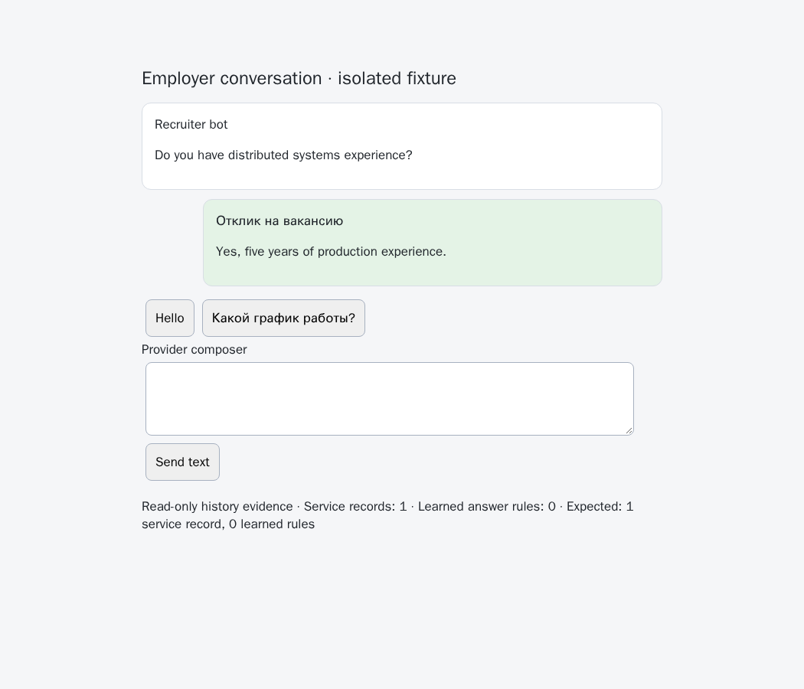

# HH browser application barriers and read-only history

Issue [56](https://github.com/link-foundation/meta-sovereign/issues/56), PR [57](https://github.com/link-foundation/meta-sovereign/pull/57). This fixes the browser-history prerequisite for C6 and the unread-chat work. All-unread orchestration, acknowledgement/rejection policies and live provider verification remain unfinished.

## Reproduction and cause

The API importer already marks application records as service messages. Browser extraction retained only message IDs, bodies, timestamps and direction. A native `chat-bubble-title` or `chat-bubble-author-name` identifying an application disappeared. An incoming question followed by an outgoing application letter therefore produced a learned answer. Empty application bubbles also disappeared in normalization, joining unrelated turns. A same-text application could falsely confirm a native choice.

History additionally called the answer-inspection operation. When native choices appeared, that operation cleared an unchanged automatic draft. Importing history unexpectedly changed the provider composer.

The pinned reference's message-title contract was inspected at `konard/hh-job-application-automation` revision `fa0991b8c2d0896fb3b4be6c69947f0590094b15`, `src/chat-answers.mjs` and `src/hh-words.mjs`. Only exact application titles are classified; body mentions and recruiter-bot names remain ordinary messages. Provider behavior was studied without copying implementation code.

## Correction and limits

The shared serialized reader now retains application service metadata. A dedicated history operation shares verified location, visible rows, bounded identities and native choice metadata, while leaving the composer unchanged. It can read an empty chat or a final service bubble without inventing a question. Normalization preserves empty service records so the existing learner cannot bridge across them. Native prefilling/selection refuses current application records and receipt matching excludes them.

Answer inspection still reconciles its own unchanged automatic draft when real native options appear. Existing owner edits, trusted main/child document checks, one-use selection protection and positive ordinary-message receipts remain covered. `MS_BROWSER_HISTORY_DEBUG=1` enables source/row/service counts; default behavior logs no history diagnostics. No message bodies, titles or draft contents are logged.

Classification covers the observed Russian, English and German application titles. Other provider notices need separately verified contracts. Browser history remains the currently rendered window, not a complete provider archive. No live account, cookie or application was used.

## Verification

`experiments/issue-56/hh-browser-history-before.py` temporarily loads the five actual parent production files from `50021c333fb066a21a19de03c523529ad662a958`, always restores the draft and records one focused normalization failure plus five browser failures. The browser failures cover learning a cover letter, dropping an empty barrier, clearing an owned draft, accepting stale application metadata and falsely confirming an application receipt. The last case includes a later real question, exercising the receipt filter itself.

The final draft passes 62 focused Node and 62 Deno checks. Run the six files `hh-browser-history`, `browser-sender`, `browser-choices`, `hh-web-ui`, `question-archive` and `question-turns` under `js/tests`, sequentially for Node. The existing `experiments/issue-56/hh-choices-browser.mjs` passes 25 production Chromium scenarios, including all five new cases. Set `HH_HISTORY_ONLY=1` for the five-case check. No application build is needed. All five are registered in the existing hosted browser check.

Independent Playwright MCP uses `hh-choices-mcp-server.mjs` and `hh-browser-history-mcp.mjs` against a routed cross-origin official child frame. It verifies retained metadata, strict choices, both owned/owner draft preservation, refused review/arming and zero clicks/text sends. Pass the formatted function as code after removing its final expression semicolon. The browser and fixture server are closed after verification.

Before and after screenshots show the same isolated native conversation with observed service and learned-rule counts. Their status line is fixture evidence, not product UI.

Raw logs, actual parent/current sources, test scripts and screenshot hashes are preserved in [the evidence bundle](data/hh-browser-history.tar.gz) and [SHA-256 manifest](data/hh-browser-history.tar.sha256.json).

## Hosted failure still under investigation

Earlier head `1fb190ca176519da8fb2a365bf52cc2e33c7994b` Checks run `43009884857` failed WebKit job `130487773262`. Full downloaded logs show Questions start at line 2356, `spawnSync ... ETIMEDOUT` at 2473 and termination after 180173 ms at 2480. Four current-chat-watch scenarios had passed immediately before termination. The aggregate job `130499576408` reports only `e2e-browser: failure`. This is not a proven assertion failure or a passing browser matrix. Investigate bounded group duration and retain the current deadlines. New exact-head hosted verification remains required before issue completion.
