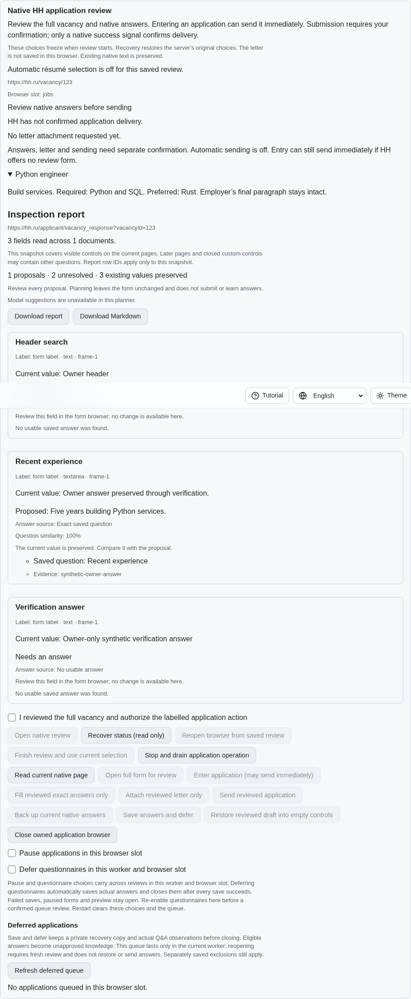
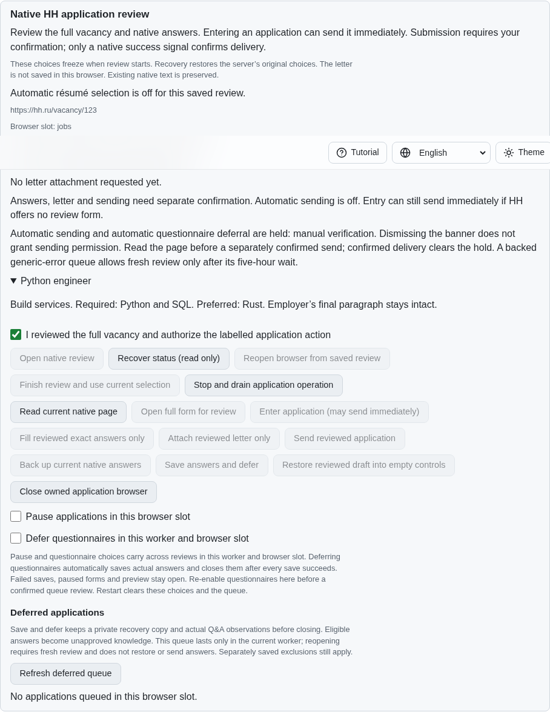
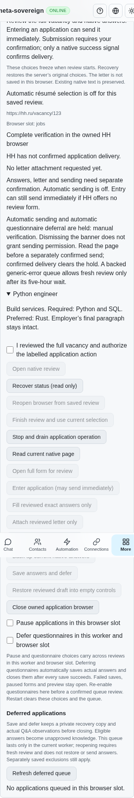

# HH verification boundaries and answer privacy

Visible HH text CAPTCHA inputs now stop both generic form inspection and native
application inspection before either reads form values, instructions or HTML.
The two native markers are `input[data-qa="account-captcha-input"]` and
`input[name="captchaText"]`. An unrelated completed widget token cannot waive
this boundary. Hidden inputs do not create a verification hold.

The generic reader returns its existing metadata-only verification report. The
native reader returns an empty form scope with no dispatch descriptors or letter,
including for already recognized verification widgets. This preserves the
complete receipt shape while preventing a challenge answer from becoming an
ordinary employer question, draft, model input or inspection report. Detection
uses visible boundary metadata only; it never reads or solves the challenge.

Daily-limit state retains priority when both boundaries are present. Every
synchronous action guard still refuses dispatch. Only the owner completes the
verification in the owned browser; a subsequent read can resume review with the
owner's existing application answers intact. Existing manual holds, uncertain
delivery reservations and ordinary form behavior remain in force.

## Reproduction and verification

On published parent `b4257480b578ae831db564d2a1965ef93b625ab4`, enter the synthetic
native application form, type an employer answer, then reveal either HH text
CAPTCHA input alongside a completed unrelated widget token. Inspection treats
the verification answer as an ordinary question. The native reader also reads
form payloads before detecting an already recognized verification widget.

`experiments/issue-56/hh-captcha-before.py` runs the new eleven-case regression
against that exact parent: ten cases fail with `Challenge payload access: answer`.
Its `--native` variant builds the parent's SPA, captures the leaked synthetic
answer and fails with `HH text CAPTCHA boundary is missing.` Both restore the
working sources and drain fixtures. Poison getters verify that answer,
instruction, title and HTML reads are absent, rather than merely omitted from
the resulting report.

The final focused group passes 56 Node checks and 51 Deno checks. It covers both
HH markers, completed unrelated tokens, existing widget detection, daily-limit
priority, synchronous entry/send/letter/refresh refusals, generic reader
compatibility, retained manual holds and mandatory browser registration. The
finite production Chromium scenario and independent Playwright MCP flow each
verify hidden markers, both visible markers, metadata-only reports, four locales,
phone layout, manual recovery and preserved owner answers. They report zero
challenge reads, dismissals, renewals, submits and application sends. The native
flow has one separately confirmed application entry. All owned fixtures close.

The reference markers and daily-limit priority were checked against the pinned
HH reference at `fa0991b8c2d0896fb3b4be6c69947f0590094b15`; its source responses are
preserved as evidence. Behavior was studied without copying its implementation.
These screenshots use an isolated synthetic fixture, not an authenticated HH
account.

Initial development failures are retained: the first payload split exceeded the
existing complexity rule, so boundary metadata and ordinary form capture now
have separate functions. A malformed MCP composition failed before execution;
the corrected independent run passed. Formatting, scoped lint, secret checks and
the unchanged duplication gate pass. No deadlines, scenarios or engines were
removed or weakened; the new scenario joins the existing bounded limits group.

## Hosted checks and remaining requirements

All five workflows pass for earlier diagnostic head `e2bc1bd9`, including Checks
run `43596139531`. WebKit shard 4 job `132451955406` passes all six résumé cases
at log lines 997–1009. Its bounded trace records trusted input and rendered
validation at lines 1013–1014. The original macOS résumé timeout cause remains
unproven.

Restoration parent `b4257480` started Checks run `43598794698` at
2026-11-14 13:14:55 UTC. WebKit shard 4 job `132459876361` was cancelled during
checkout before any dependency installation, build or tests. Its complete
148-line log and check annotations are retained; the sole annotation says
`The operation was canceled.` The reason for cancellation is unproven. This is
not test-pass evidence. Other jobs were still running when this unit was
prepared. Every exact-head hosted check remains required.

`data/hh-captcha-boundaries.tar.gz` and its SHA-256 manifest preserve source and
parent snapshots, reference responses, development failures, final focused and
native/MCP results, screenshots and the separate hosted evidence.

This is partial HH06/HH08 work. Daily-limit-specific answer backup and safe
dialog dismissal, authenticated account scope, optional verification assistance,
paced batches and every other original unchecked requirement remain unfinished.
All 81 original unchecked inventory rows remain required. Work continues in
[PR #57](https://github.com/link-foundation/meta-sovereign/pull/57), which stays
draft and unmerged.
