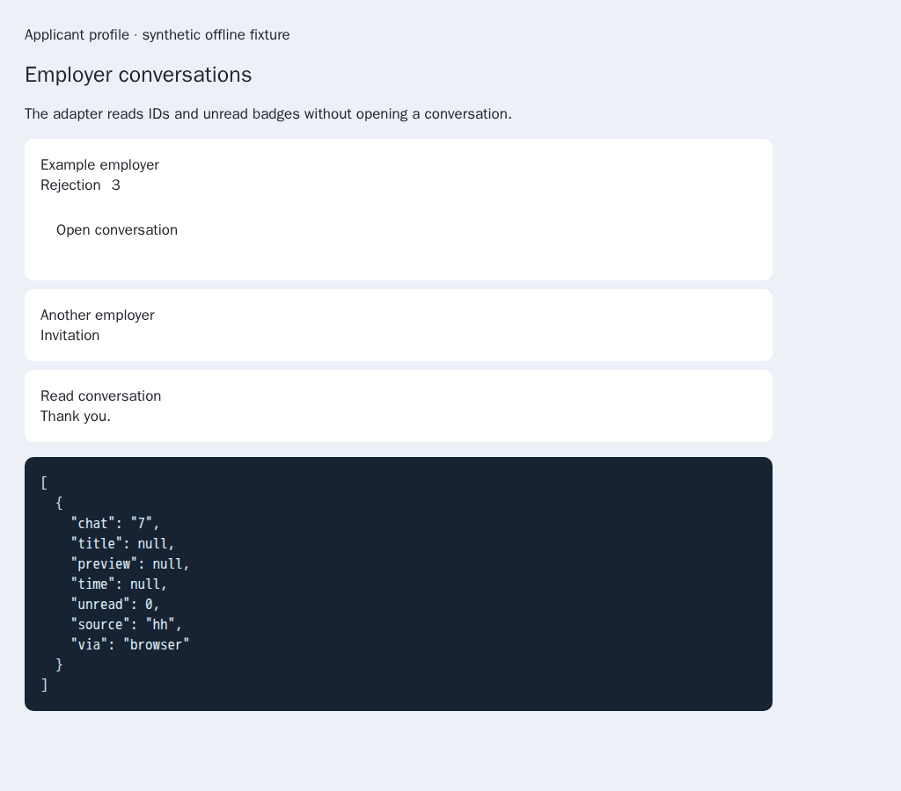
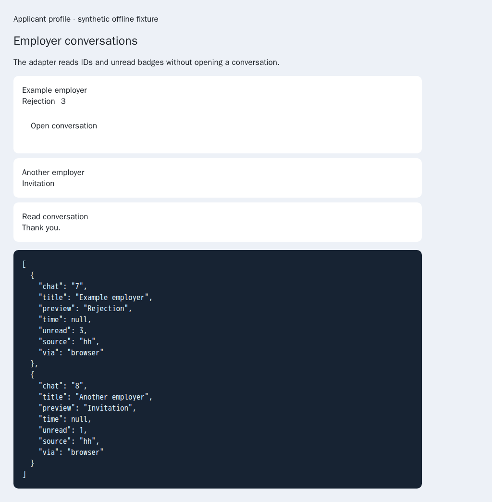

# Read native HH chat-list identities

[PR57](https://github.com/link-foundation/meta-sovereign/pull/57) remains draft;
all unmet issue requirements remain required.

The HH browser adapter selected only `/chat/` anchors. The pinned HH reference
(`konard/hh-job-application-automation`, `fa0991b8`) describes virtual chat cells
identified by `data-qa="chatik-open-chat-N"`, with a cell title, last-message
preview and unread badge. Such a cell need not contain an anchor. An anchor
inside a cell also omits its enclosing title and unread count. This prevented
the existing reader from supplying the native identities needed by unread-chat
processing. This was found by comparing the reference's `src/chat-answers.mjs`
contract with `HH_WEB_UI.chats`; no provider account was accessed.

The adapter now recognizes native cells and the older anchor layout, captures
only bounded numeric web IDs, rejects conflicting identities and deduplicates
nested anchors. Invalid or duplicate rows do not consume the requested limit.
The shared reader retains other providers' existing ID/title behavior. It stops
after the requested number of valid rows and never opens a conversation.

Run `python3 experiments/issue-56/hh-chat-list-before.py` to restore the actual
parent adapter (`4ab67839`), reproduce two failing unit checks and capture the
old browser result, then restore current source in `finally`. The parent
browser returns just the nested anchor, with no title/preview and zero unread.
After correction, the real sender and browser-commander return chats 7 and 8
with their actual fixture titles, previews and unread counts 3 and 1. A repeat
read returns all three unique fixture chats using one list navigation and no
conversation navigation. Both browsers are closed after verification.

Verification uses synthetic offline markup routed at the official HH origin:

- 33 focused Node checks: native identity/badge regressions and existing message
  actions, including browser fallback and non-HH list behavior.
- The same 33 checks pass in Deno with type checking.
- Production Chromium verifies the actual sender/commander and repeat reads.
  The helper is included in the existing hosted Questions browser flow.
- Independent Playwright MCP reads the current production function against the
  same native DOM and confirms the two identities/counts without clicking.

The [hashed evidence manifest](data/hh-chat-list.tar.sha256.json) preserves
before/after sources, scripts, logs and screenshot hashes. This corrects only
the current-document reader. Complete virtual-list traversal, trusted list-frame
selection, all-unread orchestration, live provider verification and every other
unchecked issue criterion remain unfinished.
