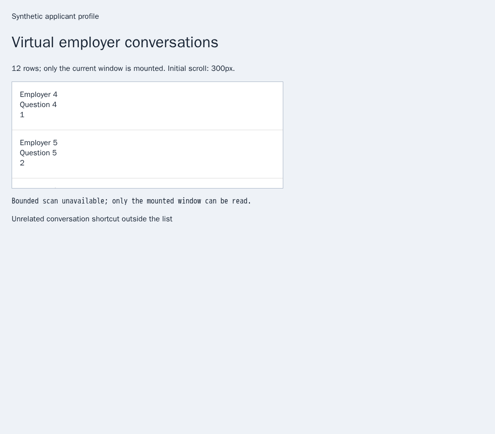
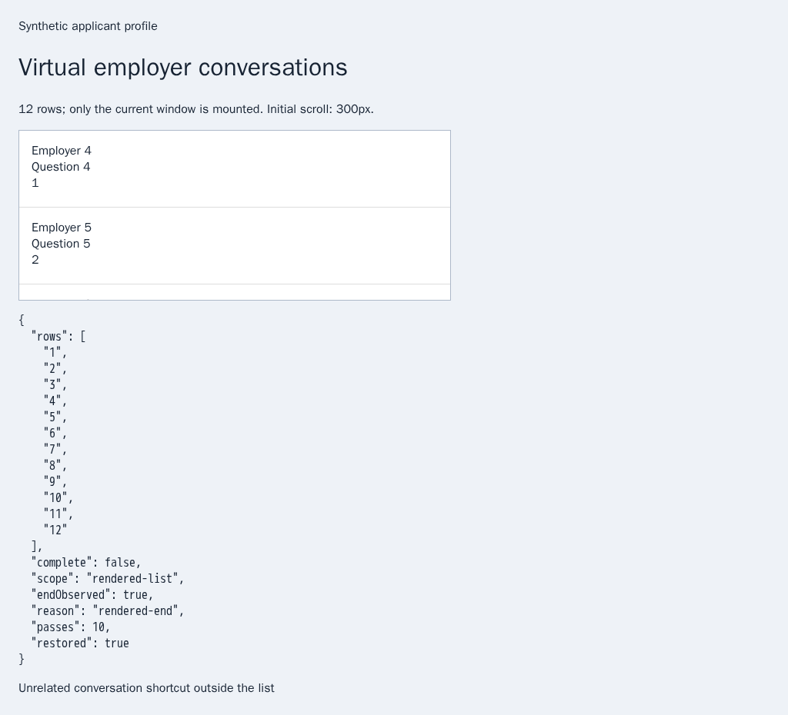

# Bound an owned HH virtual-list scan

[PR57](https://github.com/link-foundation/meta-sovereign/pull/57) remains draft;
every unmet issue requirement remains required.

The native HH reader returned only currently mounted virtual cells. Repeating
that read could not reach unmounted conversations, and an explicit zero unread
badge was incorrectly converted to one. The pinned HH reference
(`konard/hh-job-application-automation`, `fa0991b8`) describes overlapping
virtual-list traversal. This change supplies a bounded browser primitive for
that workflow; it does not implement the all-unread automation policy.

`scanChats({source: 'hh'})` now runs in the existing owned provider queue. It
selects exactly one visible, trusted main or child list document, binds its
document identity and scroll container, reads overlapping windows from the top
and deduplicates numeric web identities. Hidden stale rows and unrelated
shortcuts outside the owned scrolling container are excluded. An
explicit zero badge remains zero. Existing `readChats` array callers retain
their behavior.

The default limits are 500 unique rows, 100 passes and 30 seconds. Callers may
choose bounded limits and settling intervals. A stable rendered bottom without
an observed loading indicator reports `endObserved: true`; provider coverage
always remains `complete: false`. A DOM end cannot prove that the provider has
returned every conversation. Time limits are cooperative between browser
operations, whose existing browser-command deadlines still apply.

Trusted owner input, document navigation, list replacement, cancellation and
row/pass/time limits stop further traversal. The scanner restores its original
scroll position only while the original document/container is still owned and
the owner has not interacted. Queued cancellation refuses before opening or
navigating a browser. Shutdown closes admission, cancels active/queued work and
awaits cleanup before closing the provider browser. Optional
`MS_BROWSER_CHAT_SCAN_DEBUG=1` logs only the final reason and numeric counters.

Run `python3 experiments/issue-56/hh-chat-scan-before.py` to temporarily restore
the four actual parent files at `1fb190ca`, run the public scanner and zero-badge
regressions (five failures), capture the old browser state, and restore current files in
`finally`. The parent has no public bounded scan and treats zero as unread.
All 76 focused Node checks and the same 76 Deno checks with type checking pass.
They cover virtual overlap, changed metadata, finite bounds,
owner interruption, navigation, cancellation, capability validation and drained
shutdown. All twelve production browser scenarios pass. The fixture exercises visible
cross-origin children, hidden decoys, ambiguous/untrusted/wrong-route frames,
owner wheel input, root replacement and no reopening after navigation. Adding
a visible out-of-container shortcut first reproduced a thirteenth identity in
the draft scan; binding extraction to the private container excludes that row.

All browser evidence uses synthetic offline markup at the official HH origins;
no provider account was accessed. The production sender uses browser-commander.
The same helper is included in the existing hosted Questions browser flow.
Independent Playwright MCP runs the production scan algorithm against the same
virtual DOM with separate timing/page adapters and verifies twelve identities,
an observed rendered end, incomplete provider coverage and restored scroll.

The [hashed evidence manifest](data/hh-chat-scan.tar.sha256.json) preserves the
parent/current sources, scripts, logs and screenshot hashes. Full all-unread
orchestration, acknowledgement/rejection policies, CLI/Lino/shared controls for
that workflow, live provider verification and every other unchecked issue
criterion remain unfinished.
